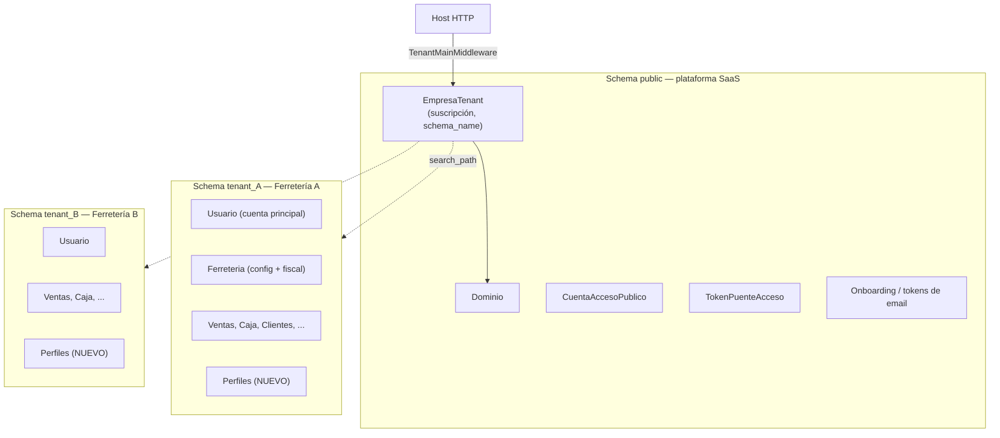
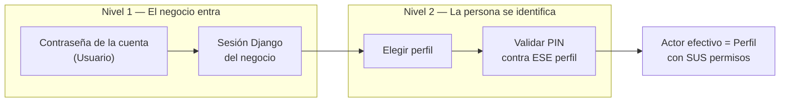
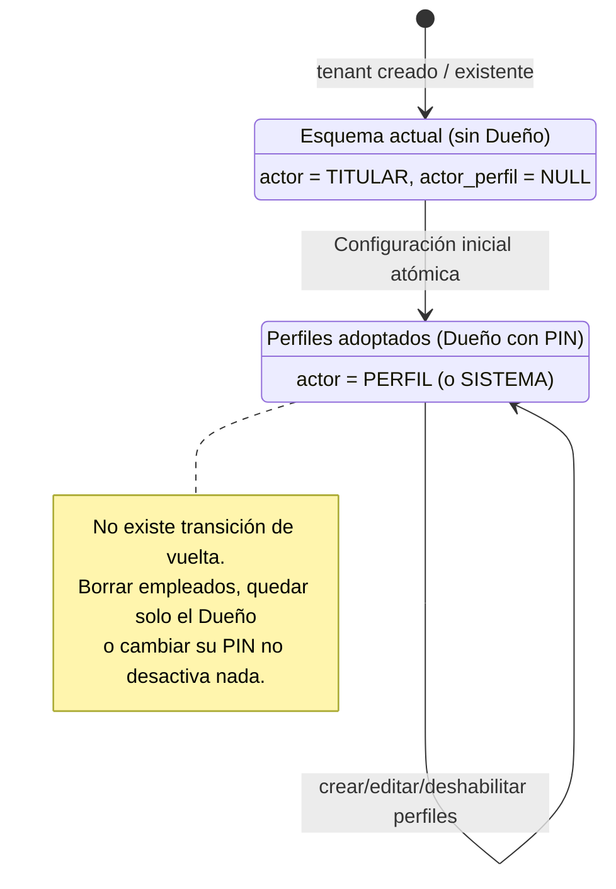
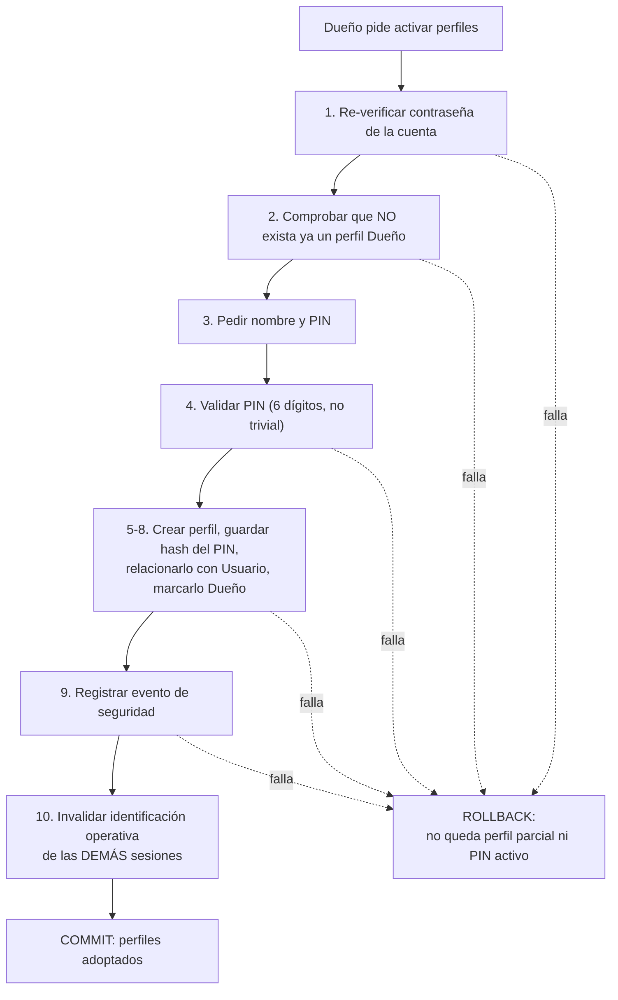
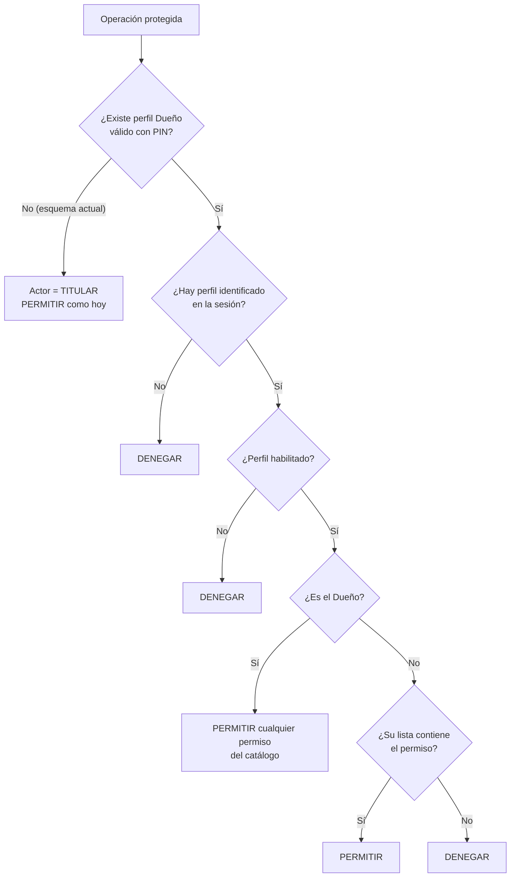
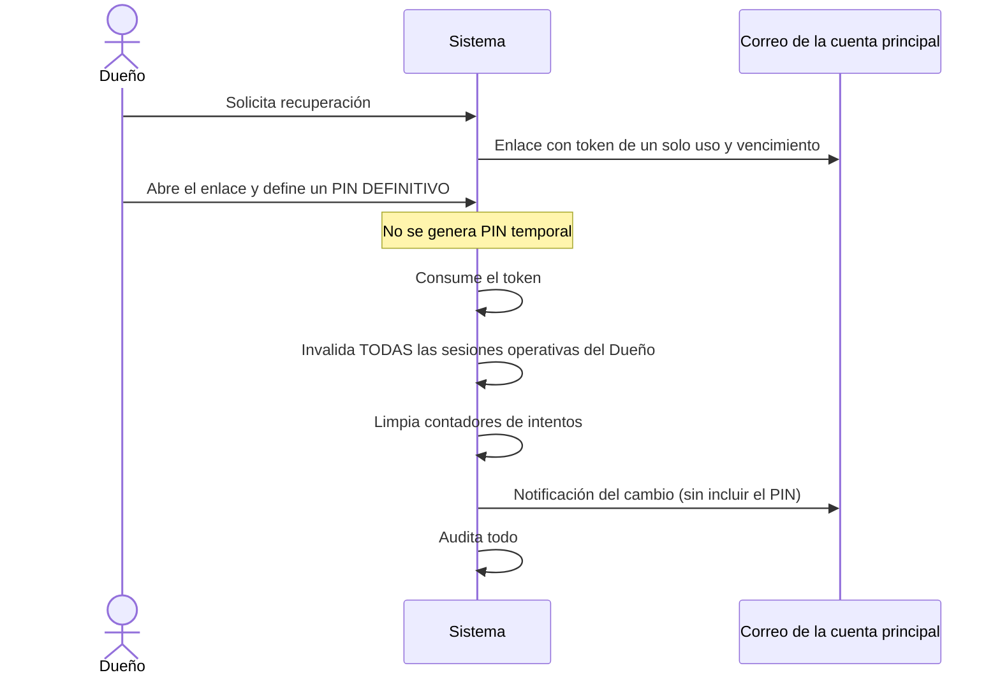
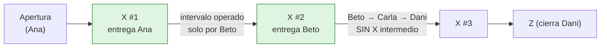

# Módulo de Usuarios, Identidad y Permisos — Documento maestro

> **Qué es este documento.** Una explicación continua y autosuficiente del módulo, de la ferretería al schema de PostgreSQL. Está construido a partir de siete documentos de análisis y contrastado con el código del repositorio.
>
> **Jerarquía de verdad.** Este Documento maestro consolida la regla funcional vigente. Las especificaciones backend y frontend deben implementarlo literalmente. `Usuarios - Contrato y reglas.md` y `Usuarios - Decisiones de diseño paso 0.md` son antecedentes: si difieren de este documento, prevalece el maestro. Los demás documentos aportan diagnóstico histórico (ver [§16](#16-qué-quedó-superado-y-por-qué)).
>
> **Estado del código.** Este módulo está **diseñado y contratado, pero no implementado**. Todo lo que se describe como "regla" es el destino. Lo que se describe como "hoy" fue verificado en el código y se marca como tal en los recuadros **Estado actual**.
>
> **Snapshot verificado.** La fotografía técnica de este documento corresponde al commit `43d5096` de la rama `arreglos-1210`, revisado el 14 de octubre de 2026. Los conteos son inventario de ese snapshot, no invariantes del sistema.

---

## Índice

1. [El problema, contado desde el mostrador](#1-el-problema-contado-desde-el-mostrador)
2. [El terreno: multi-tenancy por schemas](#2-el-terreno-multi-tenancy-por-schemas)
3. [Estado actual verificado en el código](#3-estado-actual-verificado-en-el-código)
4. [Vocabulario oficial](#4-vocabulario-oficial)
5. [La idea central: cuenta del negocio vs. personas](#5-la-idea-central-cuenta-del-negocio-vs-personas)
6. [Ciclo de vida: de "como siempre" a "con perfiles"](#6-ciclo-de-vida-de-como-siempre-a-con-perfiles)
7. [El perfil Dueño y los perfiles ordinarios](#7-el-perfil-dueño-y-los-perfiles-ordinarios)
8. [Permisos: catálogo, plantillas y dependencias](#8-permisos-catálogo-plantillas-y-dependencias)
9. [Las tres capas de control y el evaluador central](#9-las-tres-capas-de-control-y-el-evaluador-central)
10. [El PIN: identificación, no autenticación](#10-el-pin-identificación-no-autenticación)
11. [Gestión delegada de perfiles](#11-gestión-delegada-de-perfiles)
12. [Actor y atribución: quién hizo qué](#12-actor-y-atribución-quién-hizo-qué)
13. [Caja: una por negocio, X y Z](#13-caja-una-por-negocio-x-y-z)
14. [Sesiones, auditoría y respuestas de acceso](#14-sesiones-auditoría-y-respuestas-de-acceso)
15. [Qué hay que construir y en qué orden](#15-qué-hay-que-construir-y-en-qué-orden)
16. [Qué quedó superado y por qué](#16-qué-quedó-superado-y-por-qué)
17. [Invariantes innegociables](#17-invariantes-innegociables)
18. [Cierres restantes antes del contrato HTTP](#18-cierres-restantes-antes-del-contrato-http)

---

## 1. El problema, contado desde el mostrador

FerreDesk es un ERP/POS para negocios. Hoy un negocio entra con **una cuenta** (usuario y contraseña) y quien la use puede hacer **todo**: cobrar, anular, cambiar precios, tocar la configuración fiscal de ARCA, borrar un recibo.

En un negocio chico eso funciona mientras opera el dueño solo. Deja de funcionar cuando aparecen empleados, porque:

- **No se sabe quién hizo qué.** Si falta plata en la caja, no hay a quién preguntarle. Si una venta está mal, tampoco.
- **No se puede limitar a nadie.** El vendedor nuevo no debería poder facturar con CAE, bajar precios ni anular recibos. Hoy puede.
- **Compartir la contraseña es la única opción.** Y compartirla significa que todos son "el dueño".

La solución elegida es deliberadamente liviana para la realidad de un comercio chico:

- El negocio **sigue entrando con su cuenta** (nadie memoriza otra contraseña).
- Dentro de esa sesión, **cada persona se identifica con un PIN de 6 dígitos** y opera con **sus propios permisos**.
- Todo lo que hace queda **atribuido a esa persona**.

Lo que **no** se pretende: que los empleados tengan cuentas en la plataforma, correo, contraseña propia, jerarquías de roles, ni un sistema de permisos "por cada fila de la base de datos". Es un módulo chico y estricto, no un IAM empresarial.

La adopción es **opcional y permanente**: un negocio que nunca crea perfiles sigue funcionando exactamente como hoy. Pero el día que crea el perfil del Dueño con su PIN, no hay vuelta atrás ([§6](#6-ciclo-de-vida-de-como-siempre-a-con-perfiles)).

---

## 2. El terreno: multi-tenancy por schemas

Para entender por qué las decisiones son las correctas hay que entender el aislamiento.

FerreDesk usa **`django-tenants`**: cada empresa tiene su propio **schema de PostgreSQL**. Un request entra por un subdominio (`minegocio.ferredesk.com`), el `TenantMainMiddleware` resuelve qué empresa es y fija el `search_path` de la conexión a ese schema. A partir de ahí, todas las tablas "tenant" que el ORM consulta son las de esa empresa y solo esas.

Verificado en [`settings/base.py`](ferredesk_v0/backend/ferredesk_backend/settings/base.py): `TENANT_MODEL = 'tenants.EmpresaTenant'`, `DATABASE_ROUTERS = TenantSyncRouter`, y `django.contrib.auth`, `sessions`, `admin` y todas las `ferreapps.*` están en `TENANT_APPS`. Es decir: **el modelo `Usuario`, las sesiones y todos los datos de negocio viven dentro de cada schema.**

El despliegue también tiene `PUBLIC_SCHEMA_URLCONF = 'ferredesk_backend.urls_public'` y `SHOW_PUBLIC_IF_NO_TENANT_FOUND = True`. Por lo tanto, un host que no resuelve un tenant puede caer en el URLConf público en lugar de ser rechazado. La separación entre rutas públicas y tenant forma parte de la frontera de seguridad y debe probarse explícitamente.

### Qué consecuencias tiene esto para el módulo

| Hecho de arquitectura | Consecuencia de diseño |
|---|---|
| Un schema = exactamente un negocio | Un perfil **no necesita** una FK al negocio: el schema ya lo aísla. Por eso `Usuario.ferreteria` y las FK equivalentes de reservas son redundantes. |
| Los datos del tenant son inaccesibles desde otro schema | Los perfiles son **identidades locales**: no pueden existir ni autenticarse en otro negocio. No hay "empleado compartido entre tenants". |
| `public` contiene solo infraestructura de plataforma | Los empleados **nunca** generan registros en `public`. `CuentaAccesoPublico` es, a lo sumo, del titular. |
| Suspender/eliminar la `EmpresaTenant` afecta todo su schema | Suspender un tenant suspende a todos sus perfiles de forma natural. |

**Resultado:** la identidad del empleado es 100 % local al tenant. Meterla en `public` agregaría duplicación de credenciales y vectores de falla sin ningún beneficio, porque nadie trabaja en dos ferreterías con la misma cuenta.

### El puente de login (landing → tenant)

Existe un camino alternativo de entrada: el dueño entra desde la web pública con email y contraseña (`CuentaAccesoPublico`, en `public`), el sistema genera un `TokenPuenteAcceso` efímero (5 min) y redirige al subdominio, donde `login_bridge_view` abre la sesión de Django. Este camino **solo existe para el titular** y es un flujo de la cuenta principal; los perfiles no participan.

---

## 3. Estado actual verificado en el código

> **Estado actual** — Fotografía del código tal como está hoy.

### 3.1. Identidad

| Elemento | Hoy | Referencia |
|---|---|---|
| Usuario | `usuarios.Usuario(AbstractUser)` con `tipo_usuario` (5 opciones) y FK `ferreteria` | [usuarios/models.py](ferredesk_v0/backend/ferreapps/usuarios/models.py) |
| Usuario inicial | Creado en onboarding con `tipo_usuario="admin"`, `username = email` | [servicio_inicializacion_tenant.py](ferredesk_v0/backend/tenants/services/servicio_inicializacion_tenant.py) |
| `CliUsuario` | Tabla 1-a-1 con `cuenta_activa`; duplica `is_active`; consultada en el login | [login/views.py#L39-L47](ferredesk_v0/backend/ferreapps/login/views.py#L39-L47) |
| `Auditoria` (usuarios) | Modelo definido; **ningún código la escribe** | [usuarios/models.py#L45](ferredesk_v0/backend/ferreapps/usuarios/models.py#L45) |
| Perfiles, PIN, plantillas, catálogo | **No existen** | — |

### 3.2. Autorización

- `DEFAULT_PERMISSION_CLASSES = [IsAuthenticated]` y `DEFAULT_AUTHENTICATION_CLASSES = [SessionAuthentication, BasicAuthentication]` ([base.py#L123-L130](ferredesk_v0/backend/ferredesk_backend/settings/base.py#L123-L130)). Cualquier endpoint DRF que no declare otra cosa permite todo a cualquier autenticado.
- La **única** permission custom es `EsAdminTenant` ([permissions.py](ferredesk_v0/backend/ferredesk_backend/permissions.py)), que mira `tipo_usuario == "admin"`. En el snapshot verificado se usa para `PUT`/`PATCH` de `FerreteriaAPIView`; no para `destroy` de actualizaciones de listas de precios.
- `login_view` y `user_view` exponen `tipo_usuario` y `es_admin_tenant`. El frontend sí los usa para ocultar y redirigir la pestaña ARCA de Configuración; eso es UX, no una barrera de seguridad, y el backend vuelve a comprobar `EsAdminTenant` al modificar `Ferreteria`.
- Dentro del árbol de URLs tenant hay tres declaraciones `AllowAny`: `servir_logo_arca`, `servir_logo_empresa` y `PasswordResetConfirmAPIView`. La exportación PDF de órdenes de compra usa `@login_required` de Django. Los endpoints de autenticación implementados como vistas Django puras quedan fuera del sistema de permissions de DRF y deben inventariarse por separado.
- `/admin/` de Django está montado dentro del tenant ([urls.py#L36](ferredesk_v0/backend/ferredesk_backend/urls.py#L36)).

### 3.3. Agujeros y deudas que condicionan el módulo

| Hallazgo | Detalle | Gravedad |
|---|---|---|
| `POST /api/usuarios/register/` | FBV de Django pura, sin autenticación ni decorador. Crea `Usuario` y `CliUsuario(cuenta_activa=True)` para cualquiera que conozca el subdominio. Verificado en [usuarios/views.py](ferredesk_v0/backend/ferreapps/usuarios/views.py). | **Crítica** (seguridad, independiente del módulo) |
| `BasicAuthentication` activa y `/admin/` accesible | Ambos permiten entrar **sin pasar por la identificación por PIN** cuando esta exista. Hay que retirarlos o restringirlos. | Alta |
| `login_bridge_view` | `@csrf_exempt`; hace `login()` sin verificar `is_active`; el token se marca usado **después** del `login`, por lo que dos requests concurrentes podrían consumirlo ambos. | Media |
| `Ferreteria` no es singleton garantizado | No hay constraint. El código usa `Ferreteria.objects.first()` (**30** ocurrencias fuera de pruebas y migraciones en mi conteo; los documentos citan 37 con otro alcance). | Media |
| `Venta` no guarda un actor personal directo | No hay FK directa a usuario o perfil en el modelo ([ventas/models.py](ferredesk_v0/backend/ferreapps/ventas/models.py)). Algunas ventas permiten llegar indirectamente a `SesionCaja.usuario`, pero `sesion_caja` es nullable, puede faltar en el histórico y señala la cuenta autenticada, no a la persona que operó. `Compra` tampoco guarda autor. | **Alta** (la atribución indirecta es parcial y no resuelve quién operó) |
| Error latente en Caja | [caja/utils.py#L556](ferredesk_v0/backend/ferreapps/caja/utils.py#L556) y `L583` usan `getattr(venta, 'ven_idusu', None)`: el campo no existe, siempre devuelve `None`. | Media |
| Caja atada al usuario | `SesionCaja.usuario` + `UniqueConstraint(fields=['usuario'], condition=estado=ABIERTA, name='caja_una_sesion_abierta_por_usuario')` ([caja/models.py#L171-L177](ferredesk_v0/backend/ferreapps/caja/models.py#L171-L177)). El serializer abre la caja con `request.user`. | Estructural: contradice el Contrato |
| Estados de `Venta` no formalizados | `ven_estado` es un `CharField` nullable sin `choices`; el código usa `AB`, `CO`, `CE` y `AN`. `VentaFilter` lo declara como `NumberFilter` aunque el campo es texto. | Media: las reglas de modificación dependen del estado, pero hoy no existe una máquina de estados central |
| Postventa con atribución parcial | `PostventaOperacion.usuario` guarda la cuenta y enlaza venta original, nota de crédito y, en cambios, nueva venta. Los servicios también crean documentos, imputaciones y movimientos de caja. | Alta: el nuevo actor debe propagarse de forma consistente por todo el flujo |
| FK a `AUTH_USER_MODEL` dispersas | Hay 18 referencias directas en los `models.py`: alertas (2), caja (3), cuenta corriente (3), notas, productos (3), proveedores, reservas (2), ventas (`PostventaOperacion`) y usuarios (2). Cada una deberá decidir: ¿cuenta, perfil o ambos? | Alcance del cambio |
| `Vendedor` legacy | `Venta.ven_idvdo` obligatoria, `Cliente.vendedor`, comisiones; y `VentaCalculada` es una **vista SQL** (`managed=False`) que declara esas columnas. | Estorba el modelo de actor |

### 3.4. Módulos presentes pero deprecados por decisión

Notas y Alertas/Notificaciones siguen montados directamente en el [URLConf tenant](ferredesk_v0/backend/ferredesk_backend/urls.py). Libro IVA está montado indirectamente mediante `ferreapps.ventas.urls`. Reservas/Locks sigue en `TENANT_APPS` y conserva modelos, vistas y un `urls.py` propio, pero no se encontró una inclusión desde el URLConf tenant activo. El Contrato declara los cuatro módulos deprecados: **no entran al catálogo y sus rutas existentes deben retirarse o denegar todo**. Están deprecados por decisión; eso no significa que todos estén técnicamente expuestos del mismo modo.

---

## 4. Vocabulario oficial

Los términos tienen significado preciso y **no son sinónimos**. Gran parte de la confusión histórica vino de mezclarlos.

| Término | Significado | Lo que **no** es |
|---|---|---|
| **Tenant / negocio** | El espacio aislado de una empresa (su schema) y los datos del negocio. | No es una persona ni una cuenta. |
| **Usuario** | La **cuenta principal** con la que el cliente autentica al negocio (contraseña). | No es la empresa. Tras el primer PIN, **deja de ser un actor operativo**. |
| **Perfil** | Una persona concreta que trabaja en el negocio: ID inmutable, nombre, PIN, permisos propios. | No es un rol compartido; no tiene contraseña de plataforma ni email obligatorio. |
| **Perfil Dueño** | El primer perfil; único; ligado directa y exclusivamente a `Usuario`; acceso total. UI: **"Dueño (Nombre)"**. | No es una plantilla ni se asigna por permisos. |
| **Perfil ordinario** | Cualquier otro perfil. | No puede ser Dueño, aunque tenga todos los permisos. |
| **Plantilla** | Punto de partida de permisos mantenido por FerreDesk: **Vendedor, Cajero, Encargado**. Se **copia**. | No queda vinculada al perfil; "Dueño" no es una plantilla seleccionable. |
| **Operador / actor efectivo** | Quién ejecuta la acción *ahora*. Concepto de ejecución: `TITULAR`, `PERFIL` o `SISTEMA`. | No es una entidad persistida adicional. |
| **Permiso general** | ¿Puede esta *clase* de acción? (ver clientes, facturar) | — |
| **Regla particular** | Con el permiso general, ¿puede sobre *este dato*? (cliente restringido y su cuenta corriente, venta elegible para Postventa) | — |
| **Regla de negocio** | Autorizado, ¿es *válida en el estado actual*? (venta con CAE, caja ya cerrada) | No es un problema de permisos: no responde 403. |

> **Atención con "Vendedor".** Hoy existe el *Vendedor legacy* (tabla vieja de comisiones) y existe la *plantilla Vendedor* del Contrato. Se llaman igual y son cosas distintas. La plantilla es un conjunto de permisos; el legacy es un dato comercial que está previsto retirar ([§15](#15-qué-hay-que-construir-y-en-qué-orden)).

---

## 5. La idea central: cuenta del negocio vs. personas

Esta es la clave de todo. Hay dos niveles que nunca deben mezclarse:

1. **La contraseña abre el negocio.** Autentica a `Usuario` y crea una sesión de Django. Es el acceso al tenant.
2. **El PIN identifica a la persona dentro de esa sesión.** Nunca concede acceso por sí solo, no reemplaza la contraseña y no otorga permisos: solo dice "quien está operando ahora es María".
3. **Los permisos viven en el perfil**, no en la cuenta ni en la sesión.

Por eso, una vez que existen perfiles, **nadie opera "como Usuario"**: ni siquiera el dueño. El dueño opera como su propio perfil (Dueño) mediante su propio PIN. `Usuario` pasa a ser solo el *origen de sesión* (se conserva registrado en cada operación junto al perfil).

> **Por qué es la decisión correcta.** Si el dueño siguiera operando "como Usuario" tras el primer PIN, habría dos formas de ser dueño (cuenta y perfil), una de las cuales no deja rastro de persona. Con el dueño-como-perfil, **toda** acción humana posterior tiene un `actor_perfil`, la regla "sin perfil identificado, todo denegado" es uniforme y las auditorías no tienen excepciones.

---

## 6. Ciclo de vida: de "como siempre" a "con perfiles"

### 6.1. No existe "modo multiusuario"

Los borradores iniciales proponían un interruptor `modo_multiusuario_habilitado` en la ficha del negocio. **Está descartado (Decisión D7).** El problema de un interruptor es que crea un estado separado de la realidad: se puede estar "habilitado" sin Dueño, o con Dueño pero "deshabilitado", y hay que mantenerlos sincronizados.

En su lugar:

> **La fuente de verdad es la existencia válida del perfil Dueño con PIN configurado.**

No hay nada más que consultar, y por tanto nada que pueda desincronizarse.

### 6.2. Dos estados, una transición irreversible

**Antes del primer PIN** el tenant está completo y opera como hoy: no hay perfil ficticio, no se pide PIN ni selección de perfil, las operaciones se atribuyen como `TITULAR` con `actor_perfil` nulo y la cuenta autenticada registrada. No se guarda un texto falso tipo "Sin perfiles configurados". No se pueden crear ni usar perfiles hasta que exista el Dueño.

**Compatibilidad:** un tenant existente sin Dueño sigue funcionando sin cambios. La migración **no crea perfiles ficticios, no inventa PIN, no bloquea la cuenta, no obliga a configurar nada**, y el historial permanece como `TITULAR`.

### 6.3. La configuración inicial es una sola transacción

El paso de un estado al otro es la frontera de seguridad más importante del módulo, por eso es **atómico** (todo o nada):

La sesión desde la que se configura puede quedar identificada como Dueño; **todas las demás** deben pedir perfil y PIN antes de permitir otra operación. Esto evita que alguien que dejó una pestaña abierta siga operando "como siempre" tras la activación.

### 6.4. Permanencia

- El PIN del Dueño **puede cambiarse o recuperarse, pero no eliminarse ni quedar vacío/nulo**. Cambiar o recuperar reemplaza el hash en una sola operación, sin estado intermedio "sin PIN".
- La recuperación no elimina el perfil ni permite volver al esquema anterior.

> **Por qué irreversible.** Si se pudiera volver atrás, un empleado con acceso a la sesión podría "apagar" el sistema de perfiles y operar sin identificación, borrando el rastro. La irreversibilidad convierte la existencia del Dueño en una garantía, no en una preferencia.

---

## 7. El perfil Dueño y los perfiles ordinarios

### 7.1. Un solo Dueño

- **Máximo uno** por tenant, ligado directa y exclusivamente a `Usuario`.
- La condición de Dueño **no se asigna** por permisos ni plantillas. Un perfil ordinario con todos los permisos **sigue subordinado** al Dueño.
- Cómo debe garantizarlo la base (no solo el código): una restricción única que impida un segundo Dueño y que impida que un perfil ordinario ocupe la relación con `Usuario`.

### 7.2. Qué es especial en el Dueño

| Regla | Detalle |
|---|---|
| Acceso total | A todas las funciones **comerciales** del tenant, **no** por una lista editable sino por su cualidad especial. Sus permisos no se muestran como editables. |
| Permisos futuros | Recibe automáticamente cualquier permiso nuevo del catálogo. |
| Intocable | No puede eliminarse, deshabilitarse, reemplazarse desde la administración ordinaria, dejar de ser Dueño ni recibir otra plantilla. |
| Nunca bloqueado globalmente | Ver [§10.4](#104-intentos-fallidos-y-bloqueo). |
| Puede | Editar su nombre y cambiar/recuperar su PIN. Las operaciones previas conservan su etiqueta histórica. |
| Exclusivas | Conceder/retirar la capacidad de administrar perfiles; autorizar restablecer el PIN olvidado de otro perfil; confirmar acciones con contraseña de la cuenta. |
| **Límite** | **No** recibe acceso a herramientas internas de desarrolladores, infraestructura, Django Admin ni administración global de FerreDesk. Esa es una capa separada. |

### 7.3. Nombre editable y cambio de titular

El Dueño tiene nombre editable. Cada cambio se audita y el Perfil conserva su ID. Además, cada operación guarda `actor_etiqueta` como snapshot: si *Roman* pasa a llamarse *Estela*, las ventas anteriores siguen mostrando *Dueño (Roman)* y las nuevas muestran *Dueño (Estela)*.

Para FerreDesk, editar el nombre es también el mecanismo de cambio de titular. No se diseña un proceso adicional: el ID técnico continúa y los snapshots preservan la lectura histórica.

### 7.4. Perfiles ordinarios

- Representan **personas concretas**, creados desde plantilla o con permisos personalizados.
- **Pueden perder permisos y deshabilitarse.**
- **Eliminación condicionada:** solo si todavía no tienen operaciones ni relaciones históricas relevantes (ventas, movimientos, caja, auditorías operativas, cualquier atribución). Si las tienen, **se deshabilitan y se conservan**. Esto es lo que protege la integridad referencial del historial.
- **Nunca** pueden convertirse en Dueño ni operar sin PIN.
- Un perfil **deshabilitado** no puede identificarse aunque conozca su PIN; deshabilitar invalida sus sesiones **inmediatamente**.
- **Nombre:** puede editarse en cualquier momento. Cada cambio se audita con valor anterior y nuevo. El ID es la identidad estable y `actor_etiqueta` preserva cómo se mostraba cada operación al ocurrir.

### 7.5. Perfiles individuales, no roles compartidos

Los permisos de un perfil ordinario se guardan **directamente en ese perfil**. No existe `Rol`, `Grupo` ni `PerfilAcceso` intermedio. Modificar a María afecta solo a María.

Esto es una decisión consciente contra el patrón "roles compartidos": en un negocio con 3-8 personas, **duplicar una lista corta de permisos es preferible** a introducir una indirección en la que editar "Cajero" cambie sin aviso a todos los cajeros.

---

## 8. Permisos: catálogo, plantillas y dependencias

### 8.1. Principios del catálogo

- **Cerrado y versionado en código**, con identificadores estables `modulo.accion`.
- Cada perfil ordinario guarda **solo los identificadores concedidos**; la ausencia significa **denegado** (denegación por defecto).
- **No se aceptan** identificadores desconocidos, inventados ni escritos libremente.
- Un permiso nuevo queda **denegado** para ordinarios existentes hasta que el Dueño lo conceda; **el Dueño lo recibe automáticamente**.
- Renombrar o retirar un permiso requiere decisión explícita y estrategia para los perfiles existentes.
- **No** se usa JSON libre ni Django `Group`/`Permission` como fuente de verdad funcional.

> **Sobre Django `Group`/`Permission`.** La revisión técnica intermedia propuso reutilizarlos. El Contrato lo rechazó: los permisos de Django están atados a modelos y `ContentType` (CRUD), mientras que aquí los permisos son **acciones de negocio** (por ejemplo, facturar o ejecutar Postventa) y el modelo mental es *individuo con su lista*, no *grupo*. Se rescata la advertencia válida de esa revisión: nada de JSON libre ni booleanos sueltos; solo ids del catálogo validados.

### 8.2. El catálogo oficial

El catálogo es **funcional**: no refleja cada endpoint ni cada modelo.

| Módulo | Identificador | Permite |
|---|---|---|
| **Ventas** | `ventas.ver` | Consultar presupuestos, ventas, facturas y detalles |
| | `ventas.crear` | Crear/modificar documentos internos mientras el estado lo permita |
| | `ventas.facturar` | Emitir o convertir a comprobantes fiscales |
| | `ventas.postventa` | Devoluciones, cambios y demás operaciones de Postventa sobre cualquier venta visible y elegible, sin distinguir autor |
| **Caja** | `caja.ver` | Estado, sesiones y movimientos |
| | `caja.operar` | Abrir, operar y cerrar las sesiones permitidas |
| | `caja.cheques` | Ciclo de vida de cheques |
| | `caja.configurar` | Medios de pago, cuentas bancarias, billeteras |
| **Cuentas corrientes** | `cuenta_corriente.ver` | Saldos, extractos, comprobantes |
| | `cuenta_corriente.operar_clientes` | Recibos e imputaciones de clientes |
| | `cuenta_corriente.operar_proveedores` | Órdenes de pago e imputaciones a proveedores |
| | `cuenta_corriente.anular` | Anular recibos, órdenes de pago e imputaciones |
| **Productos** | `productos.ver` | Catálogo, precios visibles, existencias |
| | `productos.modificar` | Crear/modificar productos, relaciones, stock administrativo |
| | `productos.precios` | Precios, márgenes, listas, importaciones de precios |
| **Clientes** | `clientes.ver` | Clientes **no restringidos** |
| | `clientes.modificar` | Crear, editar, eliminar (dentro de reglas del dominio) |
| | `clientes.ver_restringidos` | Clientes marcados como restringidos y toda su cuenta corriente |
| **Proveedores** | `proveedores.ver` | Proveedores e historial |
| | `proveedores.modificar` | Crear, editar, eliminar, importar |
| **Compras** | `compras.ver` | Compras y órdenes de compra |
| | `compras.gestionar` | Crear, modificar, cerrar, convertir |
| **Promociones** | `promociones.ver` | Consultar promociones |
| | `promociones.gestionar` | Crear, modificar, activar/desactivar, revisar |
| **Informes y panel** | `informes.ver` | Informes y exportaciones operativas autorizadas |
| | `dashboard.ver` | Indicadores agregados del panel |
| **Configuración** | `configuracion.negocio` | Datos generales y políticas operativas |
| | `configuracion.fiscal` | Cambios fiscales y de ARCA, **con reautenticación por contraseña** |

**Fuera del catálogo, a propósito:**

- **Gestión de perfiles y restablecimiento de PIN**: no son permisos ordinarios sino una *capacidad especial* ([§11](#11-gestión-delegada-de-perfiles)).
- **Notas, Alertas/Notificaciones, Libro IVA, Reservas/Locks**: deprecados.

### 8.3. Dependencias entre permisos

Un permiso de escritura sin su lectura es un perfil roto (puede crear una venta que no puede ver). Por eso hay dependencias explícitas:

| Si se concede… | …requiere también |
|---|---|
| `ventas.crear` | `ventas.ver` |
| `ventas.facturar` | `ventas.crear`, `ventas.ver` |
| `ventas.postventa` | `ventas.ver` |
| `caja.operar`, `caja.cheques`, `caja.configurar` | `caja.ver` |
| `cuenta_corriente.operar_clientes`, `.operar_proveedores`, `.anular` | `cuenta_corriente.ver` |
| `productos.modificar`, `productos.precios` | `productos.ver` |
| `clientes.modificar`, `clientes.ver_restringidos` | `clientes.ver` |
| `proveedores.modificar` | `proveedores.ver` |
| `compras.gestionar` | `compras.ver` |
| `promociones.gestionar` | `promociones.ver` |

Reglas de aplicación: al conceder un permiso **se conceden visiblemente** sus dependencias; **lo guardado es la lista resultante, sin implicaciones ocultas**. Al retirar un requisito, se retiran en cascada todos los permisos que dependan de él y la interfaz informa cuáles se quitaron. Las plantillas cumplen estas dependencias.

### 8.4. Plantillas oficiales

Una plantilla **copia** sus permisos al crear un perfil. Después se pueden personalizar. Cambiar una plantilla en el futuro **no toca perfiles existentes**; reaplicarla requiere confirmación porque reemplaza la selección. Ninguna plantilla otorga acceso total ni condición de Dueño. Un perfil *llamado* "Encargado" sin permisos sigue sin permisos (se autoriza por contenido, nunca por nombre).

| Permiso | Vendedor | Cajero | Encargado |
|---|:-:|:-:|:-:|
| `ventas.ver` / `ventas.crear` | ✔ | ✔ | ✔ |
| `ventas.facturar` | | ✔ | ✔ |
| `ventas.postventa` | | | ✔ |
| `caja.ver` / `caja.operar` | | ✔ | ✔ |
| `caja.cheques` | | | ✔ |
| `caja.configurar` | | | |
| `cuenta_corriente.ver` | | ✔ | ✔ |
| `cuenta_corriente.operar_clientes` | | ✔ | ✔ |
| `cuenta_corriente.operar_proveedores` / `.anular` | | | ✔ |
| `productos.ver` | ✔ | ✔ | ✔ |
| `productos.modificar` / `productos.precios` | | | ✔ |
| `clientes.ver` / `clientes.modificar` | ✔ | ✔ | ✔ |
| `proveedores.ver` / `.modificar`, `compras.*` | | | ✔ |
| `promociones.ver` | ✔ | ✔ | ✔ |
| `promociones.gestionar`, `informes.ver`, `dashboard.ver` | | | ✔ |
| `configuracion.negocio` | | | ✔ |
| `configuracion.fiscal`, administrar perfiles, medios de pago/bancos | | | |

> `clientes.ver_restringidos` no figura en ninguna plantilla (es una concesión explícita). Esta tabla resume el Contrato §8.13; ante duda, vale el texto del Contrato.

---

## 9. Las tres capas de control y el evaluador central

### 9.1. Tres preguntas distintas

Muchos sistemas fallan por responder las tres con la misma herramienta. Aquí son separadas:

| Capa | Pregunta | Ejemplo | Si falla |
|---|---|---|---|
| **Permiso general** | ¿Puede esta *clase* de acción? | María tiene `clientes.ver` | 403 |
| **Regla particular** | ¿Puede sobre *este dato*? | …pero no ve clientes restringidos sin `clientes.ver_restringidos` | 403 / **404** (si debe ser invisible) |
| **Regla de negocio** | ¿Es válida *en este estado*? | Una venta con CAE no se elimina como una común | 400/409 (error de validación, **nunca 403**) |

Autorización y validez comercial son controles distintos: que alguien *esté autorizado* a anular no significa que *se pueda* anular una factura con CAE.

### 9.2. El evaluador central

Hay **una única fuente de verdad** para evaluar permisos generales. El resto del sistema **no inspecciona** la lista guardada en el perfil. Esto elimina las verificaciones dispersas ("si perfil.nombre == ...") que son la fuente clásica de agujeros.

Reglas de oro: no se autoriza por nombre de plantilla ni de perfil; un identificador desconocido produce **denegación o error de programación, nunca acceso**; una operación protegida **que no declara su permiso se deniega por defecto**.

### 9.3. Orden de evaluación de una operación

1. Sesión del negocio autenticada (si no → **401**).
2. Resolver el actor (perfil identificado, `TITULAR` previo al primer PIN, o `SISTEMA`).
3. Permiso general.
4. Reglas particulares sobre los datos.
5. Reglas comerciales, contables y fiscales.
6. **Ejecutar.**
7. **Registrar la auditoría tras el éxito.**

El chequeo de permiso decide si una operación *puede comenzar*; la auditoría de una modificación se escribe *tras terminar bien*. Los intentos fallidos de PIN y accesos denegados relevantes son **eventos de seguridad separados**.

### 9.4. Reglas particulares: tres casos resueltos

- **Cliente restringido.** `Cliente.restringido` es booleano y empieza en `False`. Solo `TITULAR` antes de la adopción o el Dueño identificado después de adoptarla puede marcarlo o desmarcarlo; cada cambio crea un `EventoSeguridad`. Con `clientes.ver`, María no ve restringidos; necesita además `clientes.ver_restringidos`. El Dueño siempre los ve. La misma frontera cubre su cuenta corriente: sin permiso no aparece el Cliente ni sus movimientos en búsquedas, listados, POS, **autocompletados, informes ni exportaciones**; el acceso directo responde **404**. El permiso adicional no reemplaza los permisos `cuenta_corriente.*`.
- **Postventa.** `ventas.postventa` permite operar sobre cualquier venta visible y elegible sin distinguir autor. No existen permisos de anulación propia o ajena; las reglas comerciales y fiscales siguen decidiendo qué operación concreta es válida.
- **Caja.** La sesión abierta pertenece al negocio, no a quien la abrió. El Z normal requiere `caja.operar` y **nunca se deduce** de "fui quien abrió". No existe cierre forzado en la aplicación.

### 9.5. Visibilidad de ventas: decisión D5

Cualquier perfil con `ventas.ver` consulta **todas** las ventas del tenant y puede filtrarlas por perfil, `TITULAR` o Sistema. **La lectura no depende de quién creó la venta.** Restringir "ver solo las propias" sería una regla particular nueva que obligaría a cubrir listados, búsquedas, informes y exportaciones; no se agrega hasta que un cliente concreto lo pida.

### 9.6. Reglas particulares: dónde viven

Se expresan como **políticas del módulo correspondiente**. Nunca se guardan ids de registros en la lista de permisos. Si una excepción relaciona un perfil con un registro concreto, se modela como una **relación con integridad referencial**. No se construye un motor genérico por objeto hasta que existan varios casos reales. Los listados **excluyen desde el origen** (en la consulta) lo que el actor no puede conocer.

### 9.7. El backend decide

El frontend solo representa, oculta y mejora la experiencia. Llamar directo a una API produce la **misma decisión** que usar la pantalla. Ocultar un botón es UX, no seguridad.

> **Estado actual.** La mayoría de las APIs comerciales depende solo de `IsAuthenticated`, explícito o heredado como permiso por defecto. Hay excepciones: tres `AllowAny` en el árbol tenant, una exportación protegida con `@login_required`, vistas Django puras fuera de DRF y el uso puntual de `EsAdminTenant` para modificar `Ferreteria`. Un relevamiento textual del snapshot encontró 48 funciones con `@api_view` y 89 declaraciones de clase relacionadas con `APIView`/`ViewSet`, pero **no son cantidades de endpoints y no deben sumarse**: incluyen clases base, herencia, vistas públicas y clases que pueden no estar enrutadas. Por eso el plan exige **una prueba automática sobre el URL resolver real** que falle si una operación comercial no declara su permiso funcional — el mecanismo que hace verdadera la regla "sin permiso declarado ⇒ denegado".

---

## 10. El PIN: identificación, no autenticación

### 10.1. Naturaleza y formato

- Identifica a un perfil dentro de una **sesión de negocio ya autenticada**. No da acceso al tenant, no reemplaza la contraseña, no concede permisos.
- **Exactamente 6 dígitos.** Se admite cualquier combinación, incluidas secuencias y repeticiones. La defensa contra fuerza bruta son los límites de intentos y las esperas progresivas, no reglas de complejidad.
- Se guarda **solo como hash** mediante los hashers de Django (`make_password`/`check_password`; el borrador original decía bcrypt, corregido). Nunca se registra, devuelve ni envía por correo.
- **Los PIN pueden repetirse entre perfiles.** Flujo obligatorio: **(1) elegir el perfil, (2) validar el PIN contra ese perfil concreto.** Descubrir al perfil *por* el PIN está descartado.
- Cambiar o recuperar un PIN **incrementa la versión de credencial** del perfil.

> **Por qué se puede repetir el PIN.** Se pensó exigir PIN únicos entre perfiles. Pero obligar a que sean únicos *filtra información* (rechazar "123789" revela que otro perfil lo tiene) y, además, permitiría un ataque de adivinar-el-PIN-y-descubrir-el-perfil. Eligiendo primero el perfil, el PIN es solo una prueba contra un blanco conocido y el espacio de colisiones deja de importar.

### 10.2. Cambio y recuperación del PIN del Dueño

**Recuerda el PIN:** ingresa el actual, define el nuevo, sube la versión de credencial y se invalidan las demás sesiones operativas del perfil.

**Lo olvidó:**

La recuperación no elimina el perfil ni permite volver al esquema sin perfiles. **Los administradores delegados no pueden recuperar el PIN del Dueño.** Si este canal no existiera, perder el PIN dejaría el negocio bloqueado; si lo controlara un empleado, sería una vía de escalada.

### 10.3. PIN de perfiles ordinarios

- Quien lo recuerda lo cambia presentando el actual.
- Si lo olvidó, **interviene el Dueño** (por ahora, solo él): sin correo, sin recuperación externa, **sin PIN temporal**. El Dueño autoriza y se define directamente el nuevo PIN definitivo (idealmente el empleado lo escribe dos veces sin decírselo a nadie).
- El cambio invalida el PIN anterior y **todas las sesiones operativas del perfil**, limpia sus intentos y registra **quién autorizó**.

### 10.4. Intentos fallidos y bloqueo

Un PIN de 6 dígitos tiene un millón de combinaciones: sin límites, se adivina por fuerza bruta. Pero el Dueño no puede quedar bloqueado, porque un empleado hostil lo dejaría fuera de su propio negocio. De esa tensión salen dos políticas:

| | Perfil **Dueño** | Perfil **ordinario** |
|---|---|---|
| Qué se limita | Intentos por **sesión Django** | Intentos asociados al **perfil** |
| Política | Tras 5 fallos: esperas de **1, 5, 15 y 60 min** | Tras 5 fallos: bloqueo progresivo de **1, 5, 15 y 60 min** |
| Alcance | **No** afecta otras sesiones ni la recuperación por correo | Bloquea al perfil |
| ¿Bloqueo global? | **Nunca** | Sí (por perfil) |

**Consecuencia buscada:** un empleado puede bloquear *sus propios* intentos contra el Dueño desde su sesión, pero **no impedir que el Dueño entre desde otra**. "No bloqueable" **no** significa "intentos ilimitados".

Además: limitación breve contra barridos; mensajes que **no revelan si la identidad existe**; los cambios de bloqueo se auditan; un acierto resetea solo los contadores que la política prevea. Para el Dueño no se usa IP ni estado global del Perfil.

> **Estado actual.** El login principal ya usa `django-axes` (5 intentos, 1 h). Eso protege la contraseña de la cuenta; el PIN necesita su propio mecanismo con las políticas de esta tabla.

### 10.5. Lo que nunca existe

Sin PIN maestro. Soporte jamás puede consultar ni comunicar un PIN. Sin preguntas secretas, sin correos por perfil, sin SMS.

---

## 11. Gestión delegada de perfiles

Crear y mantener perfiles es una capacidad poderosa. El Dueño puede **delegarla** en un perfil ordinario (por ejemplo, un encargado de confianza). Es una **capacidad especial**, no un permiso del catálogo, y solo el Dueño la concede o retira.

| El administrador delegado **puede** | El administrador delegado **no puede** |
|---|---|
| Crear perfiles ordinarios | Modificar, deshabilitar, eliminar al Dueño ni restablecer su PIN |
| Elegir plantillas ordinarias | Convertirse (o convertir a otro) en Dueño |
| Editar permisos ordinarios | Editar **sus propios** permisos desde la administración |
| Deshabilitar perfiles ordinarios | Deshabilitarse o eliminarse a sí mismo |
| Eliminar ordinarios sin historial | Conceder la capacidad a otra persona |
| | Modificar a **otro** administrador delegado |
| | Otorgar permisos que él mismo no posee |

La lógica es **impedir la escalada de privilegios**: nadie puede otorgarse más poder del que tiene, ni tocar a su par ni a su superior.

### Operaciones exclusivas del Dueño

Crear el perfil Dueño (con contraseña de la cuenta); conceder/retirar la capacidad de administrar; autorizar el restablecimiento del PIN olvidado de otro perfil; confirmar acciones que requieren la contraseña de la cuenta (p. ej. configuración fiscal); y todo sobre su propio perfil.

---

## 12. Actor y atribución: quién hizo qué

Aquí está **el único cambio donde esperar destruye valor**: hoy `Venta` y `Compra` no registran un actor personal directo y cada día sin hacerlo es historia que no se podrá reconstruir. En algunas ventas puede inferirse la cuenta mediante `Venta.sesion_caja → SesionCaja.usuario`, pero la relación es nullable y la cuenta compartida no identifica a la persona que operó.

### 12.1. Los tres tipos de actor (D1)

Venta, Compra, Recibos y toda raíz operativa atribuible conservarán: tenant, cuenta autenticada (Usuario), **tipo de actor**, Perfil y `actor_etiqueta` inmutable.

| `actor_tipo` | Cuándo | `actor_perfil` | Cuenta autenticada |
|---|---|---|---|
| `TITULAR` | Funcionamiento **previo al primer PIN** (o proceso excepcional de recuperación). Nunca en operaciones normales posteriores. | **NULL** | Registrada |
| `PERFIL` | **Toda** operación humana posterior al primer PIN, **incluida la del Dueño** | **Obligatorio** | Registrada (como origen de sesión) |
| `SISTEMA` | Procesos automáticos | **NULL** | NULL solo si no hay sesión humana |

- `actor_tipo` es **obligatorio e inmutable**; `actor_perfil` es FK nullable, obligatoria solo para `PERFIL`. **Constraints en la base** validan las combinaciones (no solo el código).
- No se usa un booleano ni se reutiliza `Vendedor`.
- El historial referencia el **ID inmutable** del perfil aunque luego se deshabilite; cada raíz operativa y la auditoría guardan además una representación del actor *al momento* (p. ej. "Dueño (Roman)"), de modo que un renombre posterior no reescribe la historia.
- Los hijos que siempre derivan de una única raíz no duplican el actor. Los servicios reciben un `ActorContext` resuelto una vez dentro de la transacción y nunca vuelven a leer la sesión o el payload.

### 12.2. Procesos sin operador (D2)

Cron, señales, facturación ARCA automática e importaciones desatendidas operan como `SISTEMA`, **siempre con tenant explícito**. Sistema **no hereda** el acceso total del Dueño: cada proceso tiene una **capacidad técnica cerrada en código** y conserva las validaciones del dominio. Si una persona inicia una tarea diferida, sus permisos se validan **al solicitarla**, se guarda también el iniciador y la ejecución sigue siendo `SISTEMA` revalidando tenant, estado e invariantes. Una señal no puede elevar implícitamente una acción humana.

### 12.3. A quién pertenece una venta (D6)

> La venta pertenece al perfil operativo vigente cuya petición **"Guardar venta"** es **aceptada por el backend**.

No al que abrió el formulario ni al que cargó el primer producto. Consecuencias:

- El **backend** resuelve el actor al recibir la confirmación; **el cliente no puede enviar ni elegir el autor**.
- Resolver actor, validar permisos y guardar son **una sola transacción**. Si el perfil cambia antes de confirmar, la venta es del perfil vigente al guardarse con éxito.
- Un formulario local sin guardar **no es una venta** y no tiene dueño persistido.
- **Presupuesto → venta:** el presupuesto conserva a su creador; la venta final pertenece a quien confirma la conversión, y la conversión se audita.
- Una modificación posterior registra quién la hizo **sin reemplazar al creador**.

### 12.4. El pasado no se reescribe

Los registros `TITULAR` previos al primer PIN **no se migran ni se reescriben** al crear el Dueño. Para filtros e informes "por perfil", `TITULAR` se interpreta como *"el Dueño antes de tener perfil"*: filtrar por el Dueño incluye también los `TITULAR` del tenant. Es una equivalencia **solo de consulta/presentación**; los datos permanecen intactos. Debe haber una prueba de que **los totales por perfil (incl. Dueño) coinciden con los del negocio**. El filtro debe poder aislar `TITULAR` y `SISTEMA` por separado.

### 12.5. Impacto en el código existente

| Área | Cambio |
|---|---|
| `Venta`, `Compra`, `OrdenCompra`, `Imputacion` | Agregar tipo, perfil, cuenta y etiqueta, con constraints de base. Los items derivan del padre. |
| `PostventaOperacion` y servicios de devolución/cambio | Resolver el actor una sola vez y propagarlo a la operación, la nota de crédito, la nueva venta, las imputaciones, los pagos/movimientos de caja y la auditoría. La idempotencia incluye `actor_perfil_id`, no solo el Usuario global. |
| Recibos, órdenes de pago, ajustes y movimientos de caja | Conservar la cuenta existente y agregar tipo, perfil y etiqueta. Un movimiento derivado usa el actor de su raíz, nunca quien abrió la caja. |
| Cheques | Guardar actor completo de alta y un `ChequeEvento` append-only por depósito, acreditación, endoso, rechazo o reactivación. Un único `modificado_por` no preserva historia. |
| Precios manuales e historial de listas | El override mutable conserva el actor del último cambio; la actualización append-only conserva el actor de cada evento. |
| Importaciones de precios y carga inicial de proveedor | La solicitud guarda al iniciador humano; el worker ejecuta como `SISTEMA` y enlaza ese iniciador en el historial. |
| `caja/utils.py` (`ven_idusu`) | Corregir el campo inexistente; hoy siempre es `None`. |
| Serializers, formularios, cachés, servicios y usos de `request.user` | Revisar que **ningún cliente pueda enviar su propio Usuario o Perfil como autor** y que cada uso actual de la cuenta se clasifique como cuenta, perfil o ambos. |
| Filtro de ventas | Pasar de "Vendedor" a "Perfil/Actor": `VentaCalculadaFilter` (backend) y `FiltrosPresupuestos.js`/`useFiltrosComprobantes.js` (frontend), migrados juntos. |

---

## 13. Caja: una por negocio, X y Z

La Caja es donde el modelo de "persona" choca con la realidad física: **un cajón de dinero lo usan varias personas por turno**.

> **Estado actual.** La caja es **por Usuario**: `SesionCaja.usuario` y un `UniqueConstraint` condicionado a estado `ABIERTA` por usuario. Con perfiles, "por Usuario" significaría una sola caja para todo el negocio *de todos modos* (todos comparten la cuenta), pero con el nombre equivocado y sin reflejar quién hizo qué. El Contrato lo corrige.

> **Estado actual de sucursales.** `SesionCaja.sucursal` ya existe como entero y se usa para abrir, buscar y numerar operaciones. También existen `Venta.ven_sucursal`, `Compra.comp_sucursal`, `OrdenCompra.ord_sucursal` y un modelo `Sucursal`, pero no forman una dimensión normalizada y coherente de Caja. Su presencia es deuda de migración; no modifica la decisión D3.

### 13.1. Una sola sesión abierta por negocio (D3)

- Como máximo **una `SesionCaja` abierta por tenant**, **garantizada en la base de datos**. La restricción por usuario se **reemplaza**.
- El diseño nuevo no incorpora Puntos de Venta, terminales ni sucursales como dimensión de Caja. Los campos legacy de sucursal deberán eliminarse, migrarse o conservarse solo para numeración/historia mediante una decisión explícita; no se usarán por inercia para particionar sesiones.
- La sesión **pertenece al negocio**. Guarda **por separado** quién abrió y quién cerró, y no cambia de dueño cuando cambia el perfil.
- **Cambiar de perfil, bloquear pantalla o cerrar la sesión por inactividad nunca cierra la caja ni genera un X automático.**
- Varios perfiles operan **sucesivamente** sobre la misma sesión; cada venta, cobro y movimiento guarda su perfil y la sesión afectada.
- Una venta sin efecto en caja conserva su perfil con `sesion_caja = NULL` (aparece en ventas y auditoría, no en totales de Caja).
- La **diferencia de efectivo** pertenece a la sesión de caja, no automáticamente a quien abrió, cerró u operó último.

### 13.2. Cierre X: un checkpoint, no un cierre

El **X** es un **registro persistido e inmutable dentro de una sesión abierta**. No cierra ni reinicia nada. Se inicia manualmente desde Caja; cambiar de perfil no lo ofrece, exige ni registra una omisión.

Registro mínimo: sesión, secuencia dentro de la sesión, perfil que entrega, fecha/hora, efectivo **declarado**, efectivo **esperado**, diferencia. Debe poder encadenarse con el checkpoint anterior o con la apertura.

Un resumen "en vivo" puede existir, pero **no se llama X** si no crea este registro (el endpoint informativo actual no es un X).

### 13.3. La diferencia: cuándo se puede atribuir a una persona

- **Intervalo X1→X2:** un único operador identificable ⇒ la diferencia **sí** puede atribuirse a Beto.
- **Intervalo X2→X3:** hubo cambios de perfil sin X ⇒ la diferencia queda **"no atribuible a una persona"** y pertenece a **la caja completa**.
- El siguiente X tras un tramo no atribuible **establece una base nueva**; no hace responsable al último perfil del tramo mezclado.

> **Por qué es honesto.** Es tentador culpar a "quien estaba al final". Pero si tres personas pasaron por la caja sin un corte intermedio, el sistema **no sabe** quién causó el faltante, y fingir que sí produce injusticias. El diseño convierte esa ignorancia en un dato explícito y ofrece una herramienta (el X) para reducirla.

### 13.4. Cierre Z

Conserva su función contable actual (arqueo definitivo y cierre explícito de la sesión) y **agrega quién lo ejecutó y confirmó**. La diferencia final pertenece a **la caja completa**: haber cerrado no hace responsable automático a esa persona. El Z no sustituye a los X ni atribuye al que cierra el tramo posterior al último X. Lo ejecuta quien tiene `caja.operar`; no existe cierre forzado como botón, endpoint ni permiso de la aplicación.

### 13.5. Auditoría mínima de Caja

Debe poder reconstruirse: quién abrió, cuándo y con qué importe; cada cambio de perfil; cada X con importes; cada operación y su actor; quién hizo y confirmó el Z con totales finales.

### 13.6. Riesgo de migración

Imponer "una abierta por negocio" sobre datos reales exige **revisar antes** las sesiones abiertas actuales, los valores de sucursal y las relaciones existentes, con backfill verificable, **sin borrar ni reasignar historia**.

---

## 14. Sesiones, auditoría y respuestas de acceso

### 14.1. Sesiones

Tras activar perfiles: la **sesión de Django representa el acceso autenticado del negocio**; dentro debe existir un perfil identificado. Sin él, toda operación protegida se deniega.

| Evento | Efecto |
|---|---|
| Cambiar de perfil | Afecta **todas las pestañas** que comparten la sesión |
| Cambiar/recuperar un PIN | Invalida las sesiones operativas correspondientes (vía **versión de credencial** comparada en cada petición) |
| Deshabilitar un perfil | Invalida sus sesiones **inmediatamente** |
| Cerrar sesión | Elimina autenticación del negocio **e** identificación operativa |
| Activación inicial | Las demás sesiones deben identificarse de nuevo |
| Heartbeat con actividad humana | Renueva `perfil_ultima_actividad_en`, como máximo una vez por minuto |
| Timer local vencido | Consulta `/api/user/`; solo muestra overlay si el servidor confirma la expiración |
| Expiración por inactividad | Mantiene la cuenta y el trabajo; pide PIN. Mismo perfil conserva estado, otro perfil fuerza limpieza y remonte |

### 14.2. Orden de middleware e identificación

Hoy el orden relevante es `CorsMiddleware` → `HealthCheckBypassMiddleware` → `TenantMainMiddleware` → `SuscripcionMiddleware` → seguridad/estáticos/sesión/CSRF → `AuthenticationMiddleware` → `AxesMiddleware`. Cualquier middleware que cargue o valide el perfil operativo debe ejecutarse **después de `AuthenticationMiddleware`**, porque antes todavía no dispone de la cuenta autenticada por sesión.

`BasicAuthentication` de DRF se ejecuta dentro de la vista, después de los middlewares de Django. Por eso un middleware de perfil no puede depender de Basic Auth para descubrir la cuenta: retirar `BasicAuthentication` antes de exigir identificación por perfil es parte de la seguridad del diseño, no una limpieza opcional. `HealthCheckBypassMiddleware`, `SuscripcionMiddleware` y las rutas públicas deben quedar expresamente fuera o dentro del control de perfil según su función, con pruebas de cada excepción.

El middleware operativo **solo verifica** identidad, versión y timeout; nunca actualiza `perfil_ultima_actividad_en`. Solo el endpoint de heartbeat escribe esa marca. Polling, renders y procesos automáticos no cuentan como actividad. El timeout es `PERFIL_INACTIVIDAD_SEGUNDOS = 900` en backend y `/api/user/` lo publica como `inactividad_segundos`; el frontend no fija el número. La expiración responde `perfil_expirado_por_inactividad`, distinta de `401` y del bloqueo de PIN.

### 14.3. Auditoría

- Identidad real = **ID inmutable del perfil**, no el nombre. La auditoría y las raíces operativas guardan una **representación del actor al momento**; ediciones posteriores no la reescriben.
- Eventos mínimos: creación del Dueño; creación/edición/habilitación/deshabilitación de perfiles; cambios de permisos; aplicación de plantillas; definición/cambio de PIN; solicitud, consumo y expiración de recuperaciones; autorizaciones de restablecimiento; bloqueos y esperas; **cambios de perfil operativo**; correcciones de nombre (anterior y nuevo); concesión/retiro de administración; cambios fiscales autorizados.
- **Existe desde antes del primer PIN**: se registra al actor como `TITULAR` con `actor_perfil` nulo y la cuenta autenticada. No se deja vacía hasta que haya perfiles.
- **Nunca** se registran contraseñas, PIN, hashes ni tokens.
- Los registros conservan la identidad del perfil aunque luego sea deshabilitado.

> **Estado actual.** El modelo `Auditoria` del módulo usuarios está muerto (ningún código lo escribe) y el rediseño **no debe depender de esa tabla legacy**. Hay auditorías parciales en `ActualizacionListaDePrecios`, `Cheque.usuario_registro`, `SesionCaja` y `HistorialImportacionProveedor`.

### 14.4. Respuestas de acceso

| Situación | Respuesta |
|---|---|
| Sesión del negocio no autenticada | `401 Unauthorized` |
| Sin perfil identificado tras activar perfiles | `403 Forbidden` |
| Identificación vencida por inactividad | `403` con `perfil_expirado_por_inactividad`; abre PIN, no login |
| Falta permiso general | `403 Forbidden` |
| Objeto conocido, acción no permitida | `403 Forbidden` |
| Objeto que debe permanecer **invisible** | `404 Not Found` |
| Autorizado pero viola regla de negocio | Error de validación o conflicto (**no 403**) |

Los mensajes no revelan datos que el actor no puede conocer. El `404` en objetos invisibles evita que la *existencia* de un cliente restringido se filtre por la diferencia entre "403" y "404".

---

## 15. Qué hay que construir y en qué orden

Las fuentes proponen distintos órdenes; este es el consolidado compatible con el Contrato. El criterio de priorización: **primero lo que destruye valor si se espera o es un agujero de seguridad; después los cimientos; al final lo cosmético.**

### 15.1. Regla de secuenciación

- Cada etapa termina con pruebas y puede desplegarse sin activar perfiles para clientes.
- Primero se cierran decisiones y contratos; después se toca la base.
- Las migraciones siguen `expand → backfill → validar → constraint`; la limpieza destructiva espera al rollout estable.
- El modo previo `TITULAR` conserva el funcionamiento actual mientras el flag de activación está apagado.
- Los cortes ordenan el trabajo, no recortan alcance: administración delegada, clientes restringidos, inactividad, Caja X/Z y aislamiento frontend se entregan antes del rollout general.

### 15.2. Orden acordado

| Paso | Resultado cerrado | Por qué va ahí |
|---|---|---|
| **0. Cierre técnico, sin código** | Contrato HTTP, códigos, shapes, sesión y Caja cerrados en la especificación backend; solo se revisan regresiones antes de programar. | Evita programar modelos o clientes contra contratos que todavía cambian. |
| **1. Seguridad y preflight** | Cerrar `register`, corregir `ven_idusu`, reforzar el bridge de login y ejecutar el preflight de cuenta canónica, `Ferreteria`, cajas, sucursal, relaciones públicas y tablas legacy. Backup y rollback ensayados. | Cierra agujeros actuales y demuestra que los datos admiten las migraciones. |
| **2. Esquema base y actor** | Crear los modelos base de Usuarios todavía sin activación; agregar `ActorContext`, campos/snapshots, `ChequeEvento`, iniciadores de tareas diferidas, backfills `TITULAR` y constraints en todas las raíces del relevamiento. `Vendedor` se conserva como dato comercial. | El historial empieza a ganar atribución y todas las etapas posteriores comparten una identidad consistente. |
| **3. Autorización y reglas de objeto** | Catálogo, evaluador central, cobertura del URL resolver y enforcement por módulo; cliente restringido junto con cuenta corriente; retirar Basic Auth, restringir `/admin/` y denegar rutas deprecadas. Antes de la adopción, `TITULAR` conserva acceso actual. | El backend debe saber autorizar antes de exponer perfiles limitados. |
| **4. Identidad backend** | Activación atómica, perfiles, nombres, PIN, administración delegada, recuperación, sesiones, perfil esperado, middleware verificador y heartbeat. Todo detrás del flag apagado. | Completa el dominio y API sobre cimientos ya auditados. |
| **5. Frontera y experiencia frontend** | Sesión operativa, header esperado, errores tipados, storage por tenant/perfil, gate de procesos, selector/PIN, administración, recuperación, inactividad, navegación por permisos y actor visible. Flag todavía apagado. | Impide fugas de estado y prepara todos los flujos antes de permitir adopción. |
| **6. Caja completa** | Una Caja abierta por tenant, actores de apertura/cierre, checkpoint X manual, Z normal y tratamiento explícito de sucursal, con backend y UI. Los eventos de cheque creados en etapa 2 se integran en estos flujos. | Depende de actor y perfiles; debe quedar lista antes del rollout porque cambiar de perfil afecta la operación diaria de Caja. |
| **7. Rollout y limpieza** | Migrar todos los schemas, postflight, piloto, frontend/backend coordinados, habilitación global, observación y recién después retiro del flag, compatibilidad y rutas deprecadas. | La adopción ocurre cuando el módulo completo funciona de punta a punta. |

El renombre `Ferreteria` → `Negocio`, la eliminación de `Vendedor` y otras limpiezas cosméticas no forman parte de estas etapas.

### 15.3. Por qué el renombre `Ferreteria` → `Negocio` no entra

Es un cambio de **lenguaje**, no de capacidad, y el más caro de la lista: ~49 archivos y ~420 menciones en backend, 26 y ~180 en frontend, además de SQL literal, señales y scripts. Un ejemplo concreto: [`_normalizar_logo_empresa`](ferredesk_v0/backend/ferreapps/productos/models.py) ejecuta `UPDATE productos_ferreteria ...`; un `RenameModel` no cambia esa cadena y el logo dejaría de normalizarse en producción. Mezclarlo con este módulo haría imposible saber de cuál de los dos trabajos viene una falla. Recomendación: **no tocar**; si algún día se hace, aparte, con alias de API y pruebas sobre una copia de la base real.

### 15.4. Criterios de verificación (qué debe probarse)

- **Permisos:** con permiso ejecuta; sin permiso, `403` aun por API directa; deshabilitado no se identifica con PIN correcto; operación sin permiso declarado se deniega; identificador desconocido no concede; el Dueño tiene acceso total sin lista y recibe permisos nuevos; un ordinario con todos los permisos no es Dueño; rutas deprecadas deniegan o no existen; el inventario se obtiene del URL resolver real, no de conteos por regex.
- **Transición:** atómica (sin perfil parcial ante cualquier fallo); no pueden existir dos Dueños; no hay vuelta atrás; demás sesiones deben identificarse; tenants sin Dueño intactos.
- **Dueño:** no se elimina, deshabilita ni bloquea globalmente; sí se renombra (con auditoría) y recupera por correo; ningún delegado lo toca ni escala.
- **PIN:** nunca en texto plano; repetidos entre perfiles funcionan; recuperación sin PIN temporal, token consumido, sesiones invalidadas, contadores limpios, notificación sin PIN; la espera contra el Dueño solo afecta al origen atacante.
- **Atribución:** combinaciones de `actor_tipo`/`actor_perfil` válidas; la venta va al perfil vigente al aceptar el backend; totales por perfil = totales del negocio; una devolución o cambio propaga el mismo actor a `PostventaOperacion`, documentos generados, imputaciones y movimientos de caja.
- **Estados de venta:** los códigos legacy se interpretan de forma explícita; el filtro de `ven_estado` acepta texto y las reglas comerciales no dependen de comparaciones dispersas sin cubrir.
- **Caja:** la base impide dos abiertas; cambiar perfil/inactividad no cierra; X persiste sin cerrar; Z cierra y registra quién; diferencia atribuida solo con intervalo inequívoco; los campos legacy de sucursal no particionan cajas por accidente.
- **Aislamiento:** pruebas con **dos schemas** en la misma ejecución y pruebas de host desconocido/esquema público para asegurar que ninguna ruta tenant quede expuesta por `SHOW_PUBLIC_IF_NO_TENANT_FOUND`.

---

## 16. Qué quedó superado y por qué

Los borradores históricos contienen propuestas **reemplazadas**. Si se las encuentra en otro documento, **no son reglas**.

| Propuesta histórica | Dónde aparece | Regla vigente | Motivo |
|---|---|---|---|
| `modo_multiusuario_habilitado` | Auditoría original, Permisos y plan | **No existe.** Fuente de verdad: Dueño con PIN | Un interruptor puede desincronizarse; la transición es permanente |
| Habilitar/deshabilitar multiusuario (R-09) | Permisos y plan | Sin vuelta atrás | Evita que un empleado "apague" la identificación |
| `Usuario.es_titular` / "Titular" con acceso total | Auditoría, Revisión | Usuario = cuenta; **perfil Dueño** = acceso total | Separar cuenta de persona |
| Titular opera directamente tras el primer PIN | Permisos y plan | Todo humano posterior es un Perfil | Rastro uniforme |
| `PerfilAcceso` con `permisos` JSON y booleans | Auditoría, Relevamiento (Alt. C), Permisos | Lista de ids por perfil, sin rol compartido ni JSON libre | Catálogo cerrado, sin indirección |
| Django `Group`/`Permission` como fuente | Revisión | Catálogo propio | Acciones de negocio, no CRUD de modelos |
| Empleado como `Usuario` más (con `activo_operador`) | Auditoría original | **Perfil local**, sin email/contraseña | Empleados no son cuentas |
| PIN en `Usuario` | Auditoría original | PIN por perfil (y Dueño) | Coherente con perfiles |
| PIN con bcrypt | Auditoría original | Hashers de Django | Respeta la configuración |
| PIN temporal de 24 h | Permisos y plan (R-17…R-22) | Eliminado; recuperación por correo + PIN definitivo | Menos superficie de ataque |
| PIN único entre perfiles / Dueño distinto | Borradores | Pueden repetirse; perfil primero | Evita filtrar información |
| Bloqueo global del Dueño | Permisos y plan (R-14) | Esperas por sesión Django | No dejar al Dueño fuera |
| `configuracion.usuarios` / `puede_gestionar_usuarios` como permiso | Permisos y plan | Capacidad delegable solo por el Dueño, acotada | Evitar escalada |
| Recuperar PIN del titular con la contraseña | Permisos y plan | Correo de la cuenta con token de un solo uso | Canal independiente |
| Ids `*.consultar`, `compras.registrar`, `informes.acceder`, `ventas.libro_iva`, `ventas.anular*`, etc. | Permisos y plan/borradores | Catálogo vigente de la sección 8 | Nomenclatura final; Postventa reemplaza la anulación genérica de Venta |
| Plantilla "Solo consulta"; "Dueño" como plantilla | Permisos y plan | Solo Vendedor, Cajero, Encargado | Contrato §2.5 |
| Notas, alertas, Libro IVA, Reservas con permisos | Permisos y plan | **Deprecados**, fuera del catálogo | Decisión de producto |
| Una caja abierta por usuario/perfil | Relevamiento, Permisos | **Una por negocio** | La caja es del negocio |
| El "estado/arqueo" informativo como cierre X | Relevamiento | X = checkpoint persistido | Un X sin registro no es un X |
| Cambio de perfil o inactividad cierra caja/genera X | Borradores | Nunca | Evita cierres involuntarios |
| Renombrar `Ferreteria` como primera etapa | Auditoría original | Opcional, al final, aparte | Costo y riesgo sin beneficio funcional |
| "Cero riesgo" en migraciones | Auditoría original | Cada migración requiere preflight y rollback | `RenameModel` no basta |
| `Negocio` singleton con `ID=1` | Auditoría original | Debe garantizarse con constraint real | Hoy nada lo impide |

**Discrepancias menores de datos entre fuentes** (no normativas, para no confundirse): el conteo de `Ferreteria.objects.first()` es 37 según un documento y 30 en mi búsqueda (alcance distinto); la cantidad de archivos que referencian `Ferreteria` es "≥67" (auditoría) vs. "49 + 26" (backend + frontend). Ninguna cambia las decisiones.

---

## 17. Invariantes innegociables

Lo que, si deja de ser verdad, rompe el módulo. Cada una debe estar respaldada por una constraint de base o una prueba.

**Identidad**
1. Tenant = negocio; existe exactamente un `Usuario` comercial canónico y **deja de operar como persona tras el primer PIN**.
2. **Como máximo un perfil Dueño** por tenant, ligado de forma exclusiva a `Usuario`. Los empleados **nunca** son `Usuario`.
3. Los perfiles **nunca** generan `CuentaAccesoPublico` ni acceden a otro tenant.
4. Un perfil ordinario **nunca** puede ser Dueño, aunque tenga todos los permisos.
5. El Dueño no se elimina, no se deshabilita, no se reemplaza ni se bloquea globalmente.

**Transición**
6. La fuente de verdad es **el Dueño válido con PIN**; no existe interruptor.
7. La activación es **atómica** y **permanente**; no hay forma de volver.
8. Un tenant sin Dueño opera como hoy; la migración no inventa perfiles ni PIN.

**Permisos**
9. Catálogo **cerrado**; ausencia = denegado; ids desconocidos no conceden acceso.
10. **Un único evaluador**; nada autoriza por nombre de perfil o plantilla.
11. **El backend decide**; API directa = misma decisión que la UI.
12. Operación protegida sin permiso declarado ⇒ **denegada**.
13. Una plantilla se **copia**, no se vincula.
14. Autorización (403) y validez comercial (400/409) son controles **distintos**.

**PIN**
15. Seis dígitos, solo hash, **nunca** en logs ni mails, sin PIN temporal ni maestro.
16. Se elige **primero el perfil**; el PIN se valida contra él.
17. Contra el Dueño: esperas por origen, **nunca** bloqueo global.

**Atribución y auditoría**
18. Todo humano posterior al primer PIN opera con `actor_tipo = PERFIL` y `actor_perfil` obligatorio.
19. **El cliente nunca elige el autor**; el backend lo resuelve en la misma transacción.
20. La venta es del perfil vigente cuando el backend acepta **Guardar venta**.
21. El historial `TITULAR` **no se reescribe**.
22. La auditoría y cada raíz operativa usan el **ID inmutable** y el nombre **al momento**; nunca guardan secretos.

**Caja**
23. **Una sola sesión abierta por negocio**, garantizada por la base.
24. Cambiar perfil, bloquear o vencer por inactividad **nunca** cierra la caja ni crea X.
25. X = checkpoint persistido e inmutable; Z cierra y registra quién.
26. Una diferencia se atribuye a una persona **solo** si el intervalo fue inequívoco; si no, es de la caja completa.

**Alcance**
27. Notas, Alertas, Libro IVA y Reservas/Locks están **fuera del catálogo** y sus rutas deben denegarse o retirarse.
28. El Dueño **no** accede a herramientas globales de FerreDesk (Django Admin, infraestructura).

---

## 18. Contrato técnico cerrado

No quedan decisiones funcionales abiertas antes de implementar. La sesión de cuenta dura 60 días sin renovación por actividad; los correos de recuperación del Dueño se limitan a uno cada 5 minutos y el token dura 30 minutos. El Z normal requiere `caja.operar` y no hay cierre forzado en la aplicación.

El preflight exige cero Cajas abiertas por negocio durante la ventana de despliegue. Si encuentra una, primero se coordina un Z normal; si no puede cerrarse por un problema técnico, se reconcilia mediante un procedimiento de migración explícito, con backup, acta y auditoría, fuera de la aplicación. Con más de una se reconcilia cada una individualmente; nunca se elige ni cierra una automáticamente.

Los campos legacy de sucursal se conservan para historia y numeración, pero no particionan Caja. Los campos, cálculos, concurrencia, endpoints y pantallas de X/Z quedan definidos por la especificación backend; X es manual, persistente e inmutable, y establece la base física del tramo siguiente sin cerrar Caja.

---

### Fuentes

Este Documento maestro consolida la documentación oficial funcional de Usuarios. Las especificaciones backend y frontend son sus instrucciones de implementación y deben coincidir con él. `Usuarios - Contrato y reglas.md` y `Usuarios - Decisiones de diseño paso 0.md` quedan como antecedentes de diseño: no prevalecen si difieren del maestro. Históricas/diagnóstico: `Auditoría de tablas (original)`, `Revisión de la auditoría de tablas`, `Qué preparar antes (explicado)`, `Permisos y plan inicial`, `Relevamiento de endpoints y accesos`. Código contrastado inicialmente en `43d5096` (`arreglos-1210`) y actor efectivo revalidado en `f5d4014` (`feat-usuarios`).
