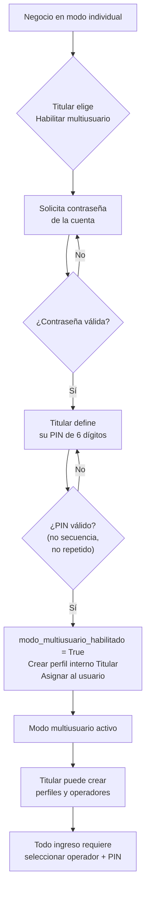
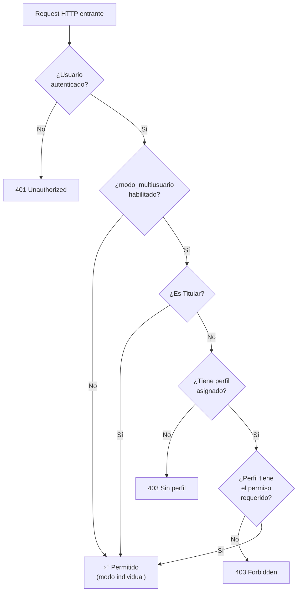

> [!WARNING]
> **Documento histórico / de análisis. Prevalece Usuarios - Contrato y reglas.md (reglas finales consolidadas).**
> Este borrador conserva propuestas superadas y no es un plan ejecutable. Para identidad, activación, PIN, permisos, actor, Caja X/Z y módulos deprecados prevalecen `Usuarios - Contrato y reglas.md` y `Usuarios - Decisiones de diseño paso 0.md`.
> Ante cualquier contradicción, seguir esos documentos.
# Usuarios - Permisos y plan inicial (borrador previo al contrato)

> Documento generado a partir de la investigación exhaustiva del código fuente (backend + frontend) y las decisiones de diseño acordadas para el sistema de Usuarios, Perfiles y Permisos.

---

## Índice

1. [Decisiones de diseño ya acordadas](#1-decisiones-de-diseño-ya-acordadas)
2. [Módulos del sistema y separación de responsabilidades](#2-módulos-del-sistema-y-separación-de-responsabilidades)
3. [Catálogo de permisos propuesto](#3-catálogo-de-permisos-propuesto)
4. [Arquitectura híbrida: backend + frontend](#4-arquitectura-híbrida-backend--frontend)
5. [Qué necesita cambiar en el sistema](#5-qué-necesita-cambiar-en-el-sistema)
6. [Plantillas sugeridas de perfiles](#6-plantillas-sugeridas-de-perfiles)
7. [Reglas de implementación de FerreDesk](#7-reglas-de-implementación-de-ferredesk)

---

## 1. Decisiones de diseño ya acordadas

Estas decisiones surgen de la conversación previa y constituyen el marco inamovible para todo lo que sigue:

| # | Decisión | Detalle |
|---|----------|---------|
| 1 | Modo individual por defecto | FerreDesk arranca con un solo usuario. No hay PIN, no hay perfiles, no hay selección de operador. |
| 2 | Activación explícita y persistente del modo multiusuario | El Titular elige "Habilitar acceso para empleados", confirma contraseña, define su PIN. El campo `modo_multiusuario_habilitado` es persistente en `Ferreteria`. |
| 3 | Un único Usuario Titular | Vinculado a la propiedad y recuperación de la cuenta. No es un perfil asignable. La titularidad no se transfiere por UI. |
| 4 | Usuario = persona, Perfil = conjunto editable de permisos | Los perfiles se crean desde cero o desde plantillas. No hay perfiles precargados en la base de datos. |
| 5 | Plantillas ≠ perfiles | Las plantillas son configuraciones sugeridas por FerreDesk para facilitar la creación de perfiles. No son registros en BD. |
| 6 | PIN fijo de 6 dígitos con bloqueo progresivo | Rechazo de secuencias y repeticiones. 5 intentos → bloqueo 1, 5, 15, 60 min. Contador en servidor por usuario. |
| 7 | Contraseña de la cuenta para operaciones críticas | Habilitar/deshabilitar multiusuario, restablecer PIN, cambios de perfil, cambios de configuración fiscal. |
| 8 | PIN temporal: criptográfico, 6 dígitos, hash, caduca 24h | Solo permite establecer PIN definitivo. No permite operar. Un restablecimiento invalida el anterior. |
| 9 | Sin límites de empleados o perfiles | Hasta que exista un modelo comercial de planes. |
| 10 | Auditoría completa | Altas, bajas, cambios de perfil, PIN, bloqueos, cambios de operador. |

---

## 2. Módulos del sistema y separación de responsabilidades

A partir de la investigación del código se identificaron **10 módulos funcionales de negocio** y **3 módulos de infraestructura/configuración**. A continuación, cada módulo con sus responsabilidades generales separadas.

> [!NOTE]
> La separación es **deliberadamente general**. No se distingue, por ejemplo, "puede hacer postventa de cotizaciones pero no de facturas". Se distingue "puede hacer postventa" vs. "no puede". La granularidad fina se reserva para una fase futura si la demanda del negocio lo justifica.

---

### 2.1. Ventas y Facturación

**Apps backend**: `ferreapps/ventas/`, `ferreapps/ventas/ARCA/`
**Frontend**: `/home/presupuestos`, `/home/libro-iva-ventas`

| Responsabilidad | Qué abarca | Endpoints representativos |
|-----------------|------------|---------------------------|
| **Consultar documentos de venta** | Ver listado de presupuestos, ventas, facturas y su detalle. Ver ticket. Dashboard de ventas. | `GET /api/ventas/`, `GET /api/ventas/{id}/`, `GET /api/ventas/{id}/ticket/`, `GET /api/home/*` |
| **Crear documentos internos** | Crear presupuestos y facturas internas (no fiscales). Editar presupuestos abiertos. | `POST /api/ventas/` (con comprobante tipo presupuesto/factura_interna), `PUT /api/ventas/{id}/` |
| **Facturar (ARCA/AFIP)** | Convertir presupuesto a venta fiscal, convertir factura interna a fiscal, emitir comprobantes con CAE. Operación irreversible ante AFIP. | `POST /api/convertir-presupuesto/`, `POST /api/convertir-factura-interna/` |
| **Postventa** | Devoluciones y cambios de mercadería. Genera notas de crédito/débito, repone stock, ajusta caja y cuenta corriente. | `POST /api/postventa/devoluciones/confirmar/`, `POST /api/postventa/cambios/confirmar/` |
| **Libro IVA** | Generar, consultar y exportar el Libro IVA Ventas en formatos oficiales. | `POST /api/libro-iva-ventas/generar/`, `GET /api/libro-iva-ventas/export/*` |
| **Eliminar presupuestos antiguos** | Purga física de presupuestos viejos. Operación destructiva e irreversible. | `POST /api/presupuestos/eliminar-antiguos/` |

---

### 2.2. Caja y Tesorería

**App backend**: `ferreapps/caja/`
**Frontend**: `/home/caja`

| Responsabilidad | Qué abarca | Endpoints representativos |
|-----------------|------------|---------------------------|
| **Consultar caja** | Ver sesiones históricas, resumen de caja, estado actual, control de fondos consolidado. | `GET /api/caja/sesiones/`, `GET /api/caja/sesiones/estado/`, `GET /api/caja/control-fondos/` |
| **Operar caja** | Abrir sesión, cerrar sesión (arqueo Z), registrar movimientos manuales (entradas/salidas de efectivo). | `POST /api/caja/sesiones/abrir/`, `POST /api/caja/sesiones/cerrar/`, `POST /api/caja/movimientos/` |
| **Gestionar cheques** | Registrar cheques, depositar, acreditar, endosar, marcar rechazados, reactivar. | `POST /api/caja/cheques/`, `POST /api/caja/cheques/{id}/depositar/`, `POST /api/caja/cheques/endosar/`, `POST /api/caja/cheques/{id}/marcar-rechazado/` |
| **Configurar medios de pago y bancos** | ABM de cuentas bancarias/billeteras y configuración de métodos de pago. | `CRUD /api/caja/cuentas-banco/`, `GET /api/caja/metodos-pago/` |

---

### 2.3. Cuentas Corrientes

**App backend**: `ferreapps/cuenta_corriente/`
**Frontend**: `/home/cuenta-corriente`, `/home/cuenta-corriente-proveedores`

| Responsabilidad | Qué abarca | Endpoints representativos |
|-----------------|------------|---------------------------|
| **Consultar cuentas corrientes** | Ver extracto de CC de clientes y proveedores, saldos, facturas pendientes, detalle de comprobantes e imputaciones. | `GET /api/cuenta-corriente/cliente/{id}/`, `GET /api/cuenta-corriente/proveedor/{id}/`, `GET /api/cuenta-corriente/clientes-con-movimientos/` |
| **Operar CC clientes** | Emitir recibos, imputar pagos a facturas, modificar imputaciones. | `POST /api/cuenta-corriente/crear-recibo/`, `POST /api/cuenta-corriente/imputar-existente/`, `POST /api/cuenta-corriente/modificar-imputaciones/` |
| **Operar CC proveedores** | Emitir órdenes de pago, imputar pagos a compras, crear ajustes de proveedor. | `POST /api/cuenta-corriente/crear-orden-pago/`, `POST /api/cuenta-corriente/proveedor/imputar/`, `POST /api/cuenta-corriente/crear-ajuste-proveedor/` |
| **Anulaciones en CC** | Anular recibos, anular órdenes de pago, eliminar imputaciones. Operaciones destructivas que reabren saldos. | `POST /api/cuenta-corriente/anular-recibo/`, `POST /api/cuenta-corriente/anular-orden-pago/{id}/`, `DELETE /api/cuenta-corriente/imputacion/{id}/eliminar/` |

---

### 2.4. Productos e Inventario

**App backend**: `ferreapps/productos/`
**Frontend**: `/home/productos`

| Responsabilidad | Qué abarca | Endpoints representativos |
|-----------------|------------|---------------------------|
| **Consultar catálogo** | Ver productos, stock, familias, proveedores de producto, códigos de barra. Búsqueda POS. | `GET /api/productos/stock/`, `GET /api/pos/productos/lookup/`, `GET /api/pos/productos/search/` |
| **Modificar catálogo** | Crear, editar y eliminar productos con sus relaciones (proveedores, precios, códigos de barra). Gestionar familias. | `POST /api/productos/crear-producto-con-relaciones/`, `POST /api/productos/editar-producto-con-relaciones/`, `CRUD /api/productos/familias/` |
| **Gestionar precios y listas** | Crear/editar listas de precios, modificar márgenes, fijar precios manuales, recalcular listas en cascada, importar listas de proveedores. | `CRUD /api/productos/listas-precio/`, `POST /api/productos/precios-lista/guardar_precios_producto/`, `POST /api/productos/proveedores/{id}/upload-price-list/` |

---

### 2.5. Clientes

**App backend**: `ferreapps/clientes/`
**Frontend**: `/home/clientes`

| Responsabilidad | Qué abarca | Endpoints representativos |
|-----------------|------------|---------------------------|
| **Consultar clientes** | Ver listado de clientes, detalle, datos fiscales. Consulta de CUIT en ARCA. | `GET /api/clientes/clientes/`, `GET /api/clientes/validar-cuit/`, `GET /api/clientes/procesar-cuit-arca/` |
| **Modificar clientes** | Crear, editar y eliminar clientes. Gestionar tablas maestras (barrios, localidades, provincias, transportes, vendedores, plazos, categorías). | `POST/PUT/DELETE /api/clientes/clientes/`, `CRUD /api/clientes/localidades/`, etc. |

---

### 2.6. Proveedores

**App backend**: `ferreapps/proveedores/`
**Frontend**: `/home/proveedores`

| Responsabilidad | Qué abarca | Endpoints representativos |
|-----------------|------------|---------------------------|
| **Consultar proveedores** | Ver listado, detalle, historial de importaciones, consulta ARCA. | `GET /api/proveedores/`, `GET /api/proveedores/{id}/historial-importaciones/` |
| **Modificar proveedores** | Crear, editar, eliminar proveedores. Carga inicial masiva de catálogo. | `POST/PUT/DELETE /api/proveedores/`, `POST /api/proveedores/{id}/carga-inicial/importar/` |

---

### 2.7. Compras

**App backend**: `ferreapps/compras/`
**Frontend**: `/home/compras`

| Responsabilidad | Qué abarca | Endpoints representativos |
|-----------------|------------|---------------------------|
| **Consultar compras** | Ver compras, órdenes de compra, detalle, estadísticas, exportar OC a PDF. | `GET /api/compras/`, `GET /api/ordenes-compra/`, `GET /api/ordenes-compra/{id}/export/pdf/` |
| **Registrar compras** | Crear compras en borrador, agregar ítems, cerrar compra (impacta stock). Crear y editar órdenes de compra. Convertir OC a compra. | `POST /api/compras/`, `POST /api/compras/{id}/cerrar/`, `POST /api/convertir-orden-compra/` |

---

### 2.8. Promociones

**App backend**: `ferreapps/promos/`
**Frontend**: Integrado en Presupuestos y Ventas

| Responsabilidad | Qué abarca | Endpoints representativos |
|-----------------|------------|---------------------------|
| **Consultar promociones** | Ver promos activas, desactualizadas, detalle. | `GET /api/promos/promociones/`, `GET /api/promos/promociones/activas/` |
| **Gestionar promociones** | Crear, editar, revisar precios, activar/desactivar promociones con ítems y grupos. | `POST /api/promos/promociones/`, `PUT /api/promos/promociones/{id}/`, `POST /api/promos/promociones/{id}/revisar/` |

---

### 2.9. Informes

**App backend**: `ferreapps/informes/`
**Frontend**: `/home/informes`

| Responsabilidad | Qué abarca | Endpoints representativos |
|-----------------|------------|---------------------------|
| **Acceder a informes** | Consultar informes operativos (stock bajo), exportar a PDF. | `GET /api/informes/stock-bajo/`, `GET /api/informes/stock-bajo/pdf/` |

> [!TIP]
> A medida que se agreguen más informes (ventas por período, rentabilidad, etc.) se puede subdividir este permiso. Por ahora, un solo toggle es suficiente.

---

### 2.10. Notas, Alertas y Notificaciones

**Apps backend**: `ferreapps/notas/`, `ferreapps/alertas/`
**Frontend**: `/home/notas`, `/home/notas-alertas-notificaciones`

| Responsabilidad | Qué abarca | Endpoints representativos |
|-----------------|------------|---------------------------|
| **Notas personales** | CRUD de notas propias, archivar, restaurar, estadísticas. Cada usuario ve solo sus propias notas. | `CRUD /api/notas/` |
| **Alertas y notificaciones** | CRUD de alertas y notificaciones propias. | `CRUD /api/alertas/`, `CRUD /api/notificaciones/` |

> [!NOTE]
> Notas y alertas son inherentemente personales (filtradas por `usuario`). No requieren un permiso separado; todo usuario activo las tiene. Se excluyen del catálogo de permisos.

---

### 2.11. Configuración del negocio

**Apps backend**: `ferreapps/productos/` (modelo `Ferreteria`), `ferreapps/usuarios/`
**Frontend**: `/home/configuracion`, `/setup`

| Responsabilidad | Qué abarca | Endpoints representativos |
|-----------------|------------|---------------------------|
| **Configuración general** | Datos del negocio, datos fiscales (CUIT, razón social, punto de venta), logo. | `PUT /api/ferreteria/` |
| **Configuración ARCA** | Certificados digitales, clave privada, modo homologación/producción. | `PUT /api/ferreteria/` (campos ARCA) |
| **Gestión de usuarios** | ABM de usuarios, asignación de perfiles, restablecimiento de PIN. Solo Titular o perfil con `puede_gestionar_usuarios`. | *Endpoints nuevos a crear* |

---

### 2.12. Reservas y Locks (infraestructura)

**App backend**: `ferreapps/reservas/`

> No requiere permiso separado. Las reservas de stock y los form locks son mecanismos de infraestructura que se ejecutan automáticamente cuando el usuario tiene permiso sobre la operación que los genera (venta, presupuesto, conversión).

---

### 2.13. Dashboard / Panel principal

**Frontend**: `/home`, `/dashboards`

| Responsabilidad | Qué abarca | Endpoints representativos |
|-----------------|------------|---------------------------|
| **Ver dashboard** | KPIs, gráficos de ventas por día, productos más vendidos, mejores clientes. | `GET /api/home/ventas-por-dia/`, `GET /api/home/productos-mas-vendidos/`, `GET /api/home/clientes-mas-ventas/` |

> [!NOTE]
> El dashboard consume datos de ventas. El permiso de "ver dashboard" podría derivarse del permiso de consultar ventas, o ser independiente si se quiere restringir la información financiera agregada.

---

## 3. Catálogo de permisos propuesto

Este es el catálogo centralizado que viviría en `permisos/catalogo.py`. Cada clave es un `modulo.accion` y su valor es la descripción para la UI.

```python
# permisos/catalogo.py

CATALOGO_PERMISOS = {
    # ── Ventas y Facturación ──────────────────────────────────
    "ventas.consultar": "Ver presupuestos, ventas y facturas",
    "ventas.crear_documentos": "Crear presupuestos y facturas internas",
    "ventas.facturar": "Emitir facturas fiscales (ARCA/AFIP)",
    "ventas.postventa": "Realizar devoluciones y cambios",
    "ventas.libro_iva": "Generar y exportar Libro IVA Ventas",
    "ventas.eliminar_presupuestos": "Eliminar presupuestos antiguos",

    # ── Caja y Tesorería ─────────────────────────────────────
    "caja.consultar": "Ver sesiones de caja y control de fondos",
    "caja.operar": "Abrir/cerrar caja y registrar movimientos",
    "caja.cheques": "Gestionar cheques (depositar, endosar, rechazar)",
    "caja.configurar": "Configurar medios de pago y cuentas bancarias",

    # ── Cuentas Corrientes ────────────────────────────────────
    "cuenta_corriente.consultar": "Ver extractos y saldos de clientes y proveedores",
    "cuenta_corriente.operar_clientes": "Emitir recibos e imputar pagos de clientes",
    "cuenta_corriente.operar_proveedores": "Emitir órdenes de pago e imputar a proveedores",
    "cuenta_corriente.anular": "Anular recibos, órdenes de pago e imputaciones",

    # ── Productos e Inventario ────────────────────────────────
    "productos.consultar": "Ver catálogo de productos y stock",
    "productos.modificar": "Crear, editar y eliminar productos",
    "productos.precios": "Gestionar listas de precios e importar listas",

    # ── Clientes ──────────────────────────────────────────────
    "clientes.consultar": "Ver listado y detalle de clientes",
    "clientes.modificar": "Crear, editar y eliminar clientes",

    # ── Proveedores ───────────────────────────────────────────
    "proveedores.consultar": "Ver listado y detalle de proveedores",
    "proveedores.modificar": "Crear, editar, eliminar proveedores y carga inicial",

    # ── Compras ───────────────────────────────────────────────
    "compras.consultar": "Ver compras y órdenes de compra",
    "compras.registrar": "Crear compras, cerrar y convertir órdenes de compra",

    # ── Promociones ───────────────────────────────────────────
    "promociones.consultar": "Ver promociones activas y desactualizadas",
    "promociones.gestionar": "Crear, editar y revisar promociones",

    # ── Informes ──────────────────────────────────────────────
    "informes.acceder": "Acceder a informes operativos y exportaciones",

    # ── Dashboard ─────────────────────────────────────────────
    "dashboard.ver": "Ver panel principal con KPIs y gráficos",

    # ── Configuración ─────────────────────────────────────────
    "configuracion.negocio": "Modificar datos del negocio",
    "configuracion.fiscal": "Modificar configuración fiscal y ARCA",
    "configuracion.usuarios": "Gestionar usuarios y perfiles",
}

# Permisos agrupados por módulo para la UI de edición de perfiles
MODULOS_UI = {
    "Ventas y Facturación": [
        "ventas.consultar",
        "ventas.crear_documentos",
        "ventas.facturar",
        "ventas.postventa",
        "ventas.libro_iva",
        "ventas.eliminar_presupuestos",
    ],
    "Caja y Tesorería": [
        "caja.consultar",
        "caja.operar",
        "caja.cheques",
        "caja.configurar",
    ],
    "Cuentas Corrientes": [
        "cuenta_corriente.consultar",
        "cuenta_corriente.operar_clientes",
        "cuenta_corriente.operar_proveedores",
        "cuenta_corriente.anular",
    ],
    "Productos e Inventario": [
        "productos.consultar",
        "productos.modificar",
        "productos.precios",
    ],
    "Clientes": [
        "clientes.consultar",
        "clientes.modificar",
    ],
    "Proveedores": [
        "proveedores.consultar",
        "proveedores.modificar",
    ],
    "Compras": [
        "compras.consultar",
        "compras.registrar",
    ],
    "Promociones": [
        "promociones.consultar",
        "promociones.gestionar",
    ],
    "Informes": [
        "informes.acceder",
    ],
    "Dashboard": [
        "dashboard.ver",
    ],
    "Configuración": [
        "configuracion.negocio",
        "configuracion.fiscal",
        "configuracion.usuarios",
    ],
}
```

**Total: 28 permisos, organizados en 11 módulos.**

> [!IMPORTANT]
> `configuracion.usuarios` es el permiso que permite gestionar empleados y perfiles. Solo el Titular lo tiene por defecto. Puede otorgarse a otros perfiles si el Titular lo decide, pero eso implica que ese usuario puede crear/modificar otros usuarios (no convertirse en Titular).

---

## 4. Arquitectura híbrida: backend + frontend

### 4.1. Principio fundamental

```
El backend DECIDE. El frontend OCULTA.
```

- **Backend**: Cada endpoint verifica el permiso requerido. Si el usuario no lo tiene, responde `403 Forbidden`. Esto es la **única línea de defensa real**.
- **Frontend**: Recibe la lista de permisos del usuario al cargar la sesión y oculta los elementos de UI (botones, rutas, tabs) que el usuario no puede usar. Esto es **UX, no seguridad**.

### 4.2. Cómo exponer los permisos al frontend

El endpoint `GET /api/user/` ya devuelve datos del usuario. Se extiende para incluir los permisos:

```python
# Respuesta actual de /api/user/
{
    "id": 1,
    "username": "facundo",
    "tipo_usuario": "admin",
    "es_admin_tenant": true
}

# Respuesta extendida con permisos
{
    "id": 1,
    "username": "facundo",
    "es_titular": true,
    "modo_multiusuario": false,
    "perfil": {
        "id": 1,
        "nombre": "Titular",
        "es_titular": true
    },
    "permisos": [
        "ventas.consultar",
        "ventas.crear_documentos",
        "ventas.facturar",
        "ventas.postventa",
        "ventas.libro_iva",
        "ventas.eliminar_presupuestos",
        "caja.consultar",
        "caja.operar",
        "caja.cheques",
        "caja.configurar",
        "cuenta_corriente.consultar",
        "cuenta_corriente.operar_clientes",
        "cuenta_corriente.operar_proveedores",
        "cuenta_corriente.anular",
        "productos.consultar",
        "productos.modificar",
        "productos.precios",
        "clientes.consultar",
        "clientes.modificar",
        "proveedores.consultar",
        "proveedores.modificar",
        "compras.consultar",
        "compras.registrar",
        "promociones.consultar",
        "promociones.gestionar",
        "informes.acceder",
        "dashboard.ver",
        "configuracion.negocio",
        "configuracion.fiscal",
        "configuracion.usuarios"
    ]
}
```

En modo individual (`modo_multiusuario: false`), el array de permisos contiene **todos los permisos** (el usuario es el único y puede hacer todo).

### 4.3. Hook de permisos en el frontend

```javascript
// hooks/usePermisos.js
import { useSessionUserQuery } from '../domains/session/useSessionUserQuery';

export function usePermisos() {
    const { user } = useSessionUserQuery();
    const permisos = user?.permisos ?? [];

    const tiene = (permiso) => permisos.includes(permiso);
    const tieneAlguno = (...permisos) => permisos.some(p => tiene(p));
    const tieneTodos = (...permisos) => permisos.every(p => tiene(p));

    return { tiene, tieneAlguno, tieneTodos, permisos, esTitular: user?.es_titular };
}
```

### 4.4. Uso en la Navbar

```jsx
// Navbar.js — ejemplo de ocultamiento
function Navbar() {
    const { tiene } = usePermisos();

    return (
        <nav>
            {tiene('dashboard.ver') && <NavLink to="/home">Panel</NavLink>}
            {tiene('clientes.consultar') && <NavLink to="/home/clientes">Clientes</NavLink>}
            {tiene('productos.consultar') && <NavLink to="/home/productos">Productos</NavLink>}
            {tieneAlguno('ventas.consultar', 'ventas.crear_documentos') &&
                <NavLink to="/home/presupuestos">Presupuestos y Ventas</NavLink>}
            {tiene('compras.consultar') && <NavLink to="/home/compras">Compras</NavLink>}
            {tiene('caja.consultar') && <NavLink to="/home/caja">Tesorería</NavLink>}
            {tiene('cuenta_corriente.consultar') &&
                <NavLink to="/home/cuenta-corriente">C.C. Clientes</NavLink>}
            {tiene('cuenta_corriente.consultar') &&
                <NavLink to="/home/cuenta-corriente-proveedores">C.C. Proveedor</NavLink>}
            {tiene('informes.acceder') && <NavLink to="/home/informes">Informes</NavLink>}
            {/* Configuración siempre visible para Titular; para otros, si tiene algún permiso de config */}
        </nav>
    );
}
```

### 4.5. Uso en RutaPrivada

```jsx
// RutaPrivada.js — extensión con permisos
function RutaPrivada({ children, permiso, permisoAlguno }) {
    const { isAuthenticated, isLoading } = useSessionUserQuery();
    const { tiene, tieneAlguno } = usePermisos();

    if (isLoading) return <Spinner />;
    if (!isAuthenticated) return <Navigate to="/login" />;

    // Chequeo de permiso (UX, no seguridad)
    if (permiso && !tiene(permiso)) return <Navigate to="/home" />;
    if (permisoAlguno && !tieneAlguno(...permisoAlguno)) return <Navigate to="/home" />;

    return children;
}

// Uso en App.js
<Route path="/home/caja" element={
    <RutaPrivada permiso="caja.consultar">
        <CajaManager />
    </RutaPrivada>
} />
```

### 4.6. Ocultamiento de acciones dentro de una vista

```jsx
// Ejemplo en PresupuestosManager.js
function PresupuestosManager() {
    const { tiene } = usePermisos();

    return (
        <div>
            {/* Todos los que pueden consultar ven la lista */}
            <VentasTable />

            {/* Solo quienes pueden crear documentos ven el botón */}
            {tiene('ventas.crear_documentos') && <Button>Nuevo Presupuesto</Button>}

            {/* Solo quienes pueden facturar ven la conversión a fiscal */}
            {tiene('ventas.facturar') && <Button>Convertir a Factura</Button>}

            {/* Solo quienes pueden hacer postventa ven el botón */}
            {tiene('ventas.postventa') && <Button>Devolución / Cambio</Button>}
        </div>
    );
}
```

### 4.7. Enforcement en el backend (DRF)

```python
# ferredesk_backend/permissions.py

from rest_framework.permissions import BasePermission

class RequierePermiso(BasePermission):
    """
    Permission class del modelo híbrido.
    Uso: permission_classes = [RequierePermiso("ventas.crear_documentos")]
    """
    def __init__(self, permiso_requerido):
        self.permiso_requerido = permiso_requerido

    def has_permission(self, request, view):
        user = request.user
        if not user or not user.is_authenticated:
            return False

        # Modo individual: todo permitido
        ferreteria = getattr(user, 'ferreteria', None)
        if ferreteria and not ferreteria.modo_multiusuario_habilitado:
            return True

        # Titular: bypass total
        if getattr(user, 'es_titular', False):
            return True

        # Chequear perfil
        perfil = getattr(user, 'perfil_acceso', None)
        if not perfil:
            return False

        return perfil.tiene_permiso(self.permiso_requerido)


def requiere(*permisos):
    """
    Factory para crear permission classes en línea.
    Uso: permission_classes = [requiere("ventas.facturar")]
    """
    class _Permiso(RequierePermiso):
        def __init__(self):
            super().__init__(permisos[0] if len(permisos) == 1 else permisos)

        def has_permission(self, request, view):
            if isinstance(self.permiso_requerido, (list, tuple)):
                return any(
                    RequierePermiso(p).has_permission(request, view)
                    for p in self.permiso_requerido
                )
            return super().has_permission(request, view)

    return _Permiso
```

**Aplicación gradual a ViewSets:**

```python
# ferreapps/ventas/views.py (ejemplo)
from ferredesk_backend.permissions import requiere

class VentaViewSet(ModelViewSet):
    # ...
    def get_permissions(self):
        if self.action in ['list', 'retrieve']:
            return [requiere('ventas.consultar')()]
        if self.action == 'create':
            return [requiere('ventas.crear_documentos')()]
        return [requiere('ventas.crear_documentos')()]

# FBVs (ejemplo)
@api_view(['POST'])
@permission_classes([requiere('ventas.facturar')])
def convertir_presupuesto_a_venta(request):
    ...

@api_view(['POST'])
@permission_classes([requiere('ventas.postventa')])
def confirmar_devolucion_view(request):
    ...
```

---

## 5. Qué necesita cambiar en el sistema

### 5.1. Modelos nuevos y migraciones

```python
# ferreapps/usuarios/models.py — cambios

class PerfilAcceso(models.Model):
    """Conjunto editable de permisos asignado a usuarios."""
    nombre = models.CharField(max_length=100)
    permisos = models.JSONField(
        default=dict,
        validators=[ValidarPermisosCatalogo],
        help_text="Dict {permiso: True/False} validado contra CATALOGO_PERMISOS"
    )
    es_titular = models.BooleanField(
        default=False,
        help_text="Perfil interno del Titular. No editable, no asignable."
    )
    puede_gestionar_usuarios = models.BooleanField(
        default=False,
        help_text="Redundante con configuracion.usuarios pero útil para queries rápidas."
    )
    fecha_creacion = models.DateTimeField(auto_now_add=True)
    fecha_modificacion = models.DateTimeField(auto_now=True)

    def tiene_permiso(self, permiso):
        if self.es_titular:
            return True
        return self.permisos.get(permiso, False)

    class Meta:
        verbose_name = "Perfil de acceso"
        verbose_name_plural = "Perfiles de acceso"


class Usuario(AbstractUser):
    # Campos existentes que se conservan
    tipo_usuario = ...  # DEPRECAR gradualmente
    ferreteria = ...

    # Campos nuevos
    perfil_acceso = models.ForeignKey(
        PerfilAcceso, null=True, blank=True,
        on_delete=models.PROTECT,
        related_name='usuarios'
    )
    es_titular = models.BooleanField(
        default=False,
        help_text="Único usuario vinculado a la propiedad de la cuenta."
    )
    pin_hash = models.CharField(
        max_length=128, blank=True, default='',
        help_text="Hash bcrypt del PIN de 6 dígitos."
    )
    pin_temporal_hash = models.CharField(
        max_length=128, blank=True, default='',
        help_text="Hash del PIN temporal para restablecimiento."
    )
    pin_temporal_expira = models.DateTimeField(null=True, blank=True)
    pin_intentos_fallidos = models.PositiveSmallIntegerField(default=0)
    pin_bloqueado_hasta = models.DateTimeField(null=True, blank=True)
    activo_operador = models.BooleanField(
        default=True,
        help_text="Si False, no puede operar el negocio."
    )
    ultimo_cambio_pin = models.DateTimeField(null=True, blank=True)


# Cambios en Ferreteria (ferreapps/productos/models.py)
class Ferreteria(models.Model):
    # ... campos existentes ...

    # Campos nuevos
    modo_multiusuario_habilitado = models.BooleanField(
        default=False,
        help_text="Si True, todo ingreso requiere selección de operador + PIN."
    )
    fecha_activacion_multiusuario = models.DateTimeField(null=True, blank=True)
```

### 5.2. Mapa de endpoints → permisos requeridos

> [!IMPORTANT]
> Esta tabla es la referencia definitiva para aplicar `permission_classes` en cada vista. Los endpoints de lectura (`GET`) suelen requerir el permiso `.consultar` del módulo. Los de escritura requieren el permiso de la acción específica.

| Módulo | Endpoint | Método | Permiso requerido |
|--------|----------|--------|-------------------|
| **Ventas** | `/api/ventas/` | GET | `ventas.consultar` |
| | `/api/ventas/` | POST (presupuesto/interna) | `ventas.crear_documentos` |
| | `/api/ventas/{id}/` | GET | `ventas.consultar` |
| | `/api/ventas/{id}/` | PUT/PATCH | `ventas.crear_documentos` |
| | `/api/ventas/{id}/ticket/` | GET | `ventas.consultar` |
| | `/api/convertir-presupuesto/` | POST | `ventas.facturar` |
| | `/api/convertir-factura-interna/` | POST | `ventas.facturar` |
| | `/api/postventa/*/confirmar/` | POST | `ventas.postventa` |
| | `/api/postventa/*/previsualizar/` | POST | `ventas.postventa` |
| | `/api/libro-iva-ventas/*` | GET/POST | `ventas.libro_iva` |
| | `/api/presupuestos/eliminar-antiguos/` | POST | `ventas.eliminar_presupuestos` |
| | `/api/home/*` | GET | `dashboard.ver` |
| **Caja** | `/api/caja/sesiones/` | GET | `caja.consultar` |
| | `/api/caja/sesiones/abrir/` | POST | `caja.operar` |
| | `/api/caja/sesiones/cerrar/` | POST | `caja.operar` |
| | `/api/caja/sesiones/estado/` | GET | `caja.consultar` |
| | `/api/caja/movimientos/` | POST | `caja.operar` |
| | `/api/caja/control-fondos/` | GET | `caja.consultar` |
| | `/api/caja/cheques/*` | ALL | `caja.cheques` |
| | `/api/caja/cuentas-banco/*` | ALL | `caja.configurar` |
| | `/api/caja/metodos-pago/` | GET | `caja.consultar` |
| **CC** | `/api/cuenta-corriente/cliente/*/` | GET | `cuenta_corriente.consultar` |
| | `/api/cuenta-corriente/proveedor/*/` | GET | `cuenta_corriente.consultar` |
| | `/api/cuenta-corriente/crear-recibo/` | POST | `cuenta_corriente.operar_clientes` |
| | `/api/cuenta-corriente/imputar-existente/` | POST | `cuenta_corriente.operar_clientes` |
| | `/api/cuenta-corriente/crear-orden-pago/` | POST | `cuenta_corriente.operar_proveedores` |
| | `/api/cuenta-corriente/proveedor/imputar/` | POST | `cuenta_corriente.operar_proveedores` |
| | `/api/cuenta-corriente/crear-ajuste-proveedor/` | POST | `cuenta_corriente.operar_proveedores` |
| | `/api/cuenta-corriente/anular-recibo/` | POST | `cuenta_corriente.anular` |
| | `/api/cuenta-corriente/anular-orden-pago/*/` | POST | `cuenta_corriente.anular` |
| | `/api/cuenta-corriente/imputacion/*/eliminar/` | DELETE | `cuenta_corriente.anular` |
| **Productos** | `/api/productos/stock/` | GET | `productos.consultar` |
| | `/api/pos/productos/*` | GET | `productos.consultar` |
| | `/api/productos/crear-producto-con-relaciones/` | POST | `productos.modificar` |
| | `/api/productos/editar-producto-con-relaciones/` | POST | `productos.modificar` |
| | `/api/productos/listas-precio/*` | ALL | `productos.precios` |
| | `/api/productos/precios-lista/*` | ALL | `productos.precios` |
| | `/api/productos/proveedores/*/upload-price-list/` | POST | `productos.precios` |
| **Clientes** | `/api/clientes/clientes/` | GET | `clientes.consultar` |
| | `/api/clientes/clientes/` | POST/PUT/DELETE | `clientes.modificar` |
| | `/api/clientes/*/` (maestros) | ALL | `clientes.modificar` |
| **Proveedores** | `/api/proveedores/` | GET | `proveedores.consultar` |
| | `/api/proveedores/` | POST/PUT/DELETE | `proveedores.modificar` |
| | `/api/proveedores/*/carga-inicial/*` | POST | `proveedores.modificar` |
| **Compras** | `/api/compras/` | GET | `compras.consultar` |
| | `/api/ordenes-compra/` | GET | `compras.consultar` |
| | `/api/compras/` | POST | `compras.registrar` |
| | `/api/compras/{id}/cerrar/` | POST | `compras.registrar` |
| | `/api/convertir-orden-compra/` | POST | `compras.registrar` |
| **Promos** | `/api/promos/promociones/` | GET | `promociones.consultar` |
| | `/api/promos/promociones/` | POST/PUT | `promociones.gestionar` |
| **Informes** | `/api/informes/*` | GET | `informes.acceder` |
| **Config** | `PUT /api/ferreteria/` (datos generales) | PUT | `configuracion.negocio` |
| | `PUT /api/ferreteria/` (campos ARCA) | PUT | `configuracion.fiscal` |

### 5.3. Cambios necesarios en el frontend

| Archivo | Cambio |
|---------|--------|
| `utils/useAuthAPI.js` / `domains/session/sessionApi.js` | Parsear `permisos[]` de la respuesta de `/api/user/` |
| **Nuevo**: `hooks/usePermisos.js` | Hook centralizado `tiene()`, `tieneAlguno()`, `tieneTodos()` |
| `components/RutaPrivada.js` | Aceptar prop `permiso` o `permisoAlguno` para control de acceso UX |
| `layouts/AppShell.js` / `components/Navbar.js` | Condicionar cada `NavLink` con `tiene('modulo.accion')` |
| `components/Presupuestos y Ventas/PresupuestosManager.js` | Ocultar botones según permisos de ventas |
| `components/Caja/CajaManager.js` | Ocultar tabs/acciones según permisos de caja |
| `components/CuentaCorriente/CuentaCorrienteManager.js` | Ocultar acciones según permisos de CC |
| `components/Productos/ProductosManager.js` | Ocultar acciones según permisos de productos |
| `components/ConfiguracionManager.js` | Reemplazar chequeo actual de `es_admin_tenant` por `tiene('configuracion.*')` |
| **Nuevo**: Vista de gestión de usuarios y perfiles | Solo accesible con `configuracion.usuarios` |
| **Nuevo**: Modal de selección de operador + PIN | Cuando `modo_multiusuario === true` |

### 5.4. FBVs que necesitan conversión a APIView

> [!CAUTION]
> Estos function-based views no pasan por el pipeline de permisos de DRF. Deben convertirse a `@api_view` con `@permission_classes` o a `APIView`.

| Vista actual | Archivo | Acción |
|-------------|---------|--------|
| `register` | `usuarios/views.py` | **ELIMINAR** o proteger con `configuracion.usuarios` — actualmente permite creación anónima |
| `login_view` | `login/views.py` | Convertir a `@api_view(['POST'])` con `AllowAny` explícito |
| `logout_view` | `login/views.py` | Convertir a `@api_view(['POST'])` |
| `user_view` | `login/views.py` | Convertir a `@api_view(['GET'])` con `IsAuthenticated` |
| `password_reset_request_view` | `login/views.py` | Convertir a `@api_view(['POST'])` con `AllowAny` explícito |
| Todas las FBVs de `ventas/` | `ventas/views*.py` | Ya son `@api_view` — agregar `@permission_classes` |
| Todas las FBVs de `cuenta_corriente/` | `cuenta_corriente/views*.py` | Ya son `@api_view` — agregar `@permission_classes` |

### 5.5. Auditoría: campos a agregar en modelos existentes

> [!WARNING]
> Actualmente, la gran mayoría de las operaciones financieras **no registran qué usuario las realizó**. Esto es un gap crítico tanto para auditoría como para el sistema de permisos.

| Modelo | Campo a agregar | Propósito |
|--------|----------------|-----------|
| `Venta` | `usuario_creacion` (FK User) | Quién emitió la venta |
| `Compra` | `usuario_creacion` (FK User) | Quién registró la compra |
| `MovimientoCaja` | ya tiene `usuario` ✅ | — |
| `SesionCaja` | ya tiene `usuario` ✅ | — |
| `Recibo` | ya tiene `rec_usuario` ✅ | — |
| `OrdenPago` | ya tiene `op_usuario` ✅ | — |
| `AjusteProveedor` | ya tiene `aj_usuario` ✅ | — |
| `Imputacion` | `imp_usuario` (FK User) | Quién imputó |
| `Producto` (Stock) | `usuario_modificacion` (FK User) | Quién modificó por última vez |
| `Cliente` | `usuario_modificacion` (FK User) | Quién modificó por última vez |
| `PostventaOperacion` | ya tiene `usuario` ✅ | — |

---

## 6. Plantillas sugeridas de perfiles

Estas plantillas son configuraciones en código (no registros en BD) que se ofrecen al Titular cuando crea un perfil nuevo.

### Plantilla: Vendedor

```python
PLANTILLA_VENDEDOR = {
    "ventas.consultar": True,
    "ventas.crear_documentos": True,
    "ventas.facturar": False,        # No emite facturas fiscales
    "ventas.postventa": False,       # No hace devoluciones
    "ventas.libro_iva": False,
    "ventas.eliminar_presupuestos": False,
    "caja.consultar": False,
    "caja.operar": False,
    "caja.cheques": False,
    "caja.configurar": False,
    "cuenta_corriente.consultar": True,   # Ve saldos de clientes
    "cuenta_corriente.operar_clientes": False,
    "cuenta_corriente.operar_proveedores": False,
    "cuenta_corriente.anular": False,
    "productos.consultar": True,     # Consulta precios y stock
    "productos.modificar": False,
    "productos.precios": False,
    "clientes.consultar": True,
    "clientes.modificar": True,      # Puede dar de alta clientes
    "proveedores.consultar": False,
    "proveedores.modificar": False,
    "compras.consultar": False,
    "compras.registrar": False,
    "promociones.consultar": True,   # Ve promos activas
    "promociones.gestionar": False,
    "informes.acceder": False,
    "dashboard.ver": False,
    "configuracion.negocio": False,
    "configuracion.fiscal": False,
    "configuracion.usuarios": False,
}
```

### Plantilla: Cajero

```python
PLANTILLA_CAJERO = {
    "ventas.consultar": True,
    "ventas.crear_documentos": True,   # Puede crear presupuestos y cobrar
    "ventas.facturar": True,           # Puede emitir facturas
    "ventas.postventa": False,
    "ventas.libro_iva": False,
    "ventas.eliminar_presupuestos": False,
    "caja.consultar": True,
    "caja.operar": True,               # Abre y cierra caja
    "caja.cheques": False,
    "caja.configurar": False,
    "cuenta_corriente.consultar": True,
    "cuenta_corriente.operar_clientes": True,  # Puede emitir recibos
    "cuenta_corriente.operar_proveedores": False,
    "cuenta_corriente.anular": False,
    "productos.consultar": True,
    "productos.modificar": False,
    "productos.precios": False,
    "clientes.consultar": True,
    "clientes.modificar": True,
    "proveedores.consultar": False,
    "proveedores.modificar": False,
    "compras.consultar": False,
    "compras.registrar": False,
    "promociones.consultar": True,
    "promociones.gestionar": False,
    "informes.acceder": False,
    "dashboard.ver": False,
    "configuracion.negocio": False,
    "configuracion.fiscal": False,
    "configuracion.usuarios": False,
}
```

### Plantilla: Encargado

```python
PLANTILLA_ENCARGADO = {
    "ventas.consultar": True,
    "ventas.crear_documentos": True,
    "ventas.facturar": True,
    "ventas.postventa": True,          # Puede hacer devoluciones
    "ventas.libro_iva": True,
    "ventas.eliminar_presupuestos": True,
    "caja.consultar": True,
    "caja.operar": True,
    "caja.cheques": True,              # Gestiona cheques
    "caja.configurar": False,          # No configura medios de pago
    "cuenta_corriente.consultar": True,
    "cuenta_corriente.operar_clientes": True,
    "cuenta_corriente.operar_proveedores": True,
    "cuenta_corriente.anular": True,   # Puede anular recibos/OP
    "productos.consultar": True,
    "productos.modificar": True,       # Puede modificar catálogo
    "productos.precios": True,         # Puede modificar precios
    "clientes.consultar": True,
    "clientes.modificar": True,
    "proveedores.consultar": True,
    "proveedores.modificar": True,
    "compras.consultar": True,
    "compras.registrar": True,
    "promociones.consultar": True,
    "promociones.gestionar": True,
    "informes.acceder": True,
    "dashboard.ver": True,
    "configuracion.negocio": False,    # No cambia datos del negocio
    "configuracion.fiscal": False,     # No toca ARCA
    "configuracion.usuarios": False,   # No gestiona usuarios
}
```

### Plantilla: Solo consulta

```python
PLANTILLA_SOLO_CONSULTA = {
    "ventas.consultar": True,
    "ventas.crear_documentos": False,
    "ventas.facturar": False,
    "ventas.postventa": False,
    "ventas.libro_iva": True,
    "ventas.eliminar_presupuestos": False,
    "caja.consultar": True,
    "caja.operar": False,
    "caja.cheques": False,
    "caja.configurar": False,
    "cuenta_corriente.consultar": True,
    "cuenta_corriente.operar_clientes": False,
    "cuenta_corriente.operar_proveedores": False,
    "cuenta_corriente.anular": False,
    "productos.consultar": True,
    "productos.modificar": False,
    "productos.precios": False,
    "clientes.consultar": True,
    "clientes.modificar": False,
    "proveedores.consultar": True,
    "proveedores.modificar": False,
    "compras.consultar": True,
    "compras.registrar": False,
    "promociones.consultar": True,
    "promociones.gestionar": False,
    "informes.acceder": True,
    "dashboard.ver": True,
    "configuracion.negocio": False,
    "configuracion.fiscal": False,
    "configuracion.usuarios": False,
}
```

---

## 7. Reglas de implementación de FerreDesk

Estas son las reglas que gobiernan la lógica del sistema de permisos y no pueden violarse.

### 7.1. Reglas de identidad

| # | Regla |
|---|-------|
| R-01 | Existe un único **Usuario Titular** por tenant, vinculado a la creación de la cuenta y a `CuentaAccesoPublico`. |
| R-02 | El Titular **no puede** desactivarse, eliminarse ni cambiar de perfil desde ninguna UI del tenant. |
| R-03 | El Titular **siempre** tiene acceso total (bypass de permisos). Su perfil interno es `es_titular=True` y no es asignable. |
| R-04 | Todos los demás usuarios son **operadores** con un perfil asignado que define sus permisos. |
| R-05 | Un operador sin perfil asignado (`perfil_acceso=null`) **no puede** acceder al sistema. |

### 7.2. Reglas del modo multiusuario

| # | Regla |
|---|-------|
| R-06 | FerreDesk comienza en **modo individual** (`modo_multiusuario_habilitado=False`). En este modo no existen operadores, PIN ni selección de usuario. |
| R-07 | Habilitar el modo multiusuario requiere: contraseña de la cuenta + definir PIN del Titular. |
| R-08 | Una vez habilitado, **todo ingreso** requiere seleccionar operador y validar PIN, incluso si todos los operadores están inactivos. |
| R-09 | Deshabilitar el modo multiusuario requiere: contraseña de la cuenta + que no existan operadores activos + registro de auditoría. |
| R-10 | `modo_multiusuario_habilitado` es un campo persistente en `Ferreteria`, no se infiere de la cantidad de usuarios. |

### 7.3. Reglas de PIN

| # | Regla |
|---|-------|
| R-11 | El PIN es de exactamente **6 dígitos numéricos**. |
| R-12 | Se rechazan: `000000`, `123456`, `654321`, secuencias (`234567`), repeticiones (`111111`, `222222`), y PINs comunes (`123123`). |
| R-13 | El PIN se almacena **hasheado** (bcrypt). Nunca en texto plano, nunca en logs. |
| R-14 | **5 intentos fallidos** → bloqueo progresivo: 1 min, 5 min, 15 min, 60 min. Contador en servidor por usuario. |
| R-15 | Cambiar de operador **rota la sesión** (regenera session key). |
| R-16 | El PIN **no reemplaza** la contraseña. La contraseña autoriza el acceso a la cuenta; el PIN identifica al operador dentro de una sesión ya autorizada. |

### 7.4. Reglas de PIN temporal

| # | Regla |
|---|-------|
| R-17 | Generado con `secrets.token_hex()` o `secrets.randbelow()`, criptográficamente seguro. |
| R-18 | Mostrado **una sola vez** al Titular que lo genera. |
| R-19 | Almacenado como hash. Caduca en **24 horas**. |
| R-20 | Un nuevo restablecimiento **invalida** el anterior inmediatamente. |
| R-21 | Con PIN temporal, el operador **solo puede** establecer su PIN definitivo; no puede operar el negocio. |
| R-22 | Al completar el cambio, se regenera la sesión. |

### 7.5. Reglas de perfiles

| # | Regla |
|---|-------|
| R-23 | Los permisos se validan contra el `CATALOGO_PERMISOS`. No se aceptan claves fuera del catálogo. |
| R-24 | Editar un perfil **afecta inmediatamente** a todos los usuarios que lo tienen asignado. La UI debe advertir esto. |
| R-25 | Un perfil asignado a usuarios **no puede eliminarse**. Primero se reasignan los usuarios a otro perfil. |
| R-26 | Los permisos nunca dependen del **nombre** del perfil. Solo del contenido de `permisos` (JSONField). |
| R-27 | El perfil del Titular (`es_titular=True`) es **interno al sistema**, no aparece en la lista de perfiles gestionables. |

### 7.6. Reglas de autorización

| # | Regla |
|---|-------|
| R-28 | La autorización se verifica **en cada request** en el backend. Ocultar botones en el frontend no es una medida de seguridad. |
| R-29 | En modo individual, todo request de un usuario autenticado está autorizado (no hay permisos que chequear). |
| R-30 | En modo multiusuario, todo request verifica: 1) usuario autenticado, 2) operador identificado (PIN validado), 3) permiso en perfil del operador. |
| R-31 | Operaciones críticas (habilitar/deshabilitar multiusuario, restablecer PIN, cambiar perfil de usuarios, configuración fiscal) requieren **reautenticación con contraseña de la cuenta** además del permiso. |
| R-32 | Las acciones del Titular sobre la gestión de usuarios **se auditan** siempre: quién hizo qué, cuándo, sobre quién. |

### 7.7. Reglas de auditoría

| # | Regla |
|---|-------|
| R-33 | Se registra: creación/desactivación de operadores, cambios de perfil, restablecimiento de PIN, bloqueos por intentos fallidos, cambios de operador activo. |
| R-34 | Al operador cuyo PIN fue restablecido se le muestra "Tu PIN fue restablecido por [nombre]" en su próximo ingreso. |
| R-35 | El primer ingreso tras un restablecimiento se registra en auditoría. |

---

## Diagrama de flujo: activación multiusuario



## Diagrama de flujo: request con permisos


