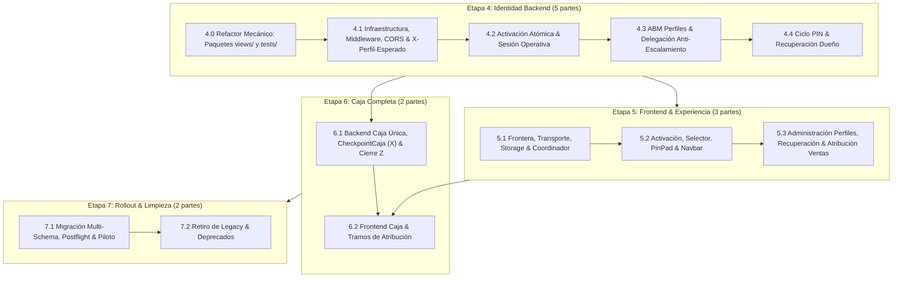

# Módulo de Usuarios — Plan de Ejecución y Prompts: Etapa 4 y Etapas Restantes

> **Jerarquía y Fuentes de Verdad Normativas:**
> 1. `Usuarios - Cierre del contrato HTTP.md` (Contrato HTTP congelado: códigos de error, shapes JSON, algoritmo de middleware, matriz de delegación y contrato completo de Caja §11).
> 2. `Usuarios - Documento maestro.md` (Regla funcional general y modelo de dominio).
> 3. `Usuarios - Especificacion backend.md` (Arquitectura por capas, invariantes transaccionales, sesiones y seguridad backend).
> 4. `Usuarios - Especificacion frontend.md` (Arquitectura frontend, coordinador de sesión, storage operativo y gates).
> 5. `Estándares de testing backend (caja negra)` (`.agents/skills/backend-testing-standards/SKILL.md`).

---

## 1. Visión General, Criterio de División y Decisiones Cerradas

Tras completar las Etapas 1, 2 y 3 (seguridad inicial, `ActorContext`, catálogo/evaluador de permisos, cobertura de rutas y verificador `verificar_cobertura_permisos`), el módulo entra en su fase operativa central.

### 1.1. Mapa de Cortes (12 Partes)

Para mantener entregas cohesivas, evitar sobrecarga de contexto y separar refactors mecánicos de la lógica de negocio, el trabajo se estructura en **12 partes**:



---

### 1.2. Decisiones de Producto y Seguridad Cerradas (Invariantes Globales)

Estas definiciones resuelven las ambigüedades entre los documentos fuente y el esquema actual. Son decisiones de negocio y seguridad ya tomadas; **las decisiones de diseño interno, estructura de clases/helpers y organización de código corresponden al agente implementador respetando SOLID**:

1. **Catálogo cerrado de códigos HTTP (`Usuarios - Cierre del contrato HTTP.md` §2):**
   - Ningún endpoint puede emitir códigos fuera de la tabla cerrada del contrato HTTP (el coordinador del frontend toma decisiones de transición según el `code` exacto):
     - Espera activa por intentos de PIN (Dueño u ordinario): `429 pin_espera_activa` con header `Retry-After`.
     - Fallo en `identificar/` o `cambiar/` por PIN incorrecto, perfil inexistente o perfil deshabilitado: `403 identificacion_fallida` (mismo código y mensaje para no filtrar causa).
     - Formato de PIN inválido (distinto de 6 dígitos numéricos): `400 pin_invalido` (`fields.pin` o `fields.pin_nuevo`).
     - Confirmación de PIN distinta: `400 pin_confirmacion_distinta` (`fields.confirmar_pin`).
     - PIN actual incorrecto en cambio propio: `400 pin_actual_incorrecto` (suma al contador de intentos del perfil).
     - Identificar cuando ya hay perfil válido en sesión: `409 perfil_ya_identificado`.
     - Activación con flag apagado o sin capacidad: `403 activacion_no_disponible`.
     - Contraseña incorrecta / bloqueada en activación o guardado fiscal: `400 contrasena_incorrecta` / `429 contrasena_espera_activa`.
     - Violación de reglas de objetivo en administración (delegado sobre Dueño, sobre sí mismo, sobre par, o enviando `puede_gestionar_perfiles`): `403 gestion_no_permitida`.
     - Delegado intentando otorgar un permiso que no posee: `403 permiso_no_otorgable` (`fields.permisos`).
     - Nombre reservado (`dueño`, `dueno`, o prefijo `dueño (` / `dueno (`): `400 nombre_reservado` (`fields.nombre`).
     - Colisión de nombre entre perfiles habilitados: `409 nombre_perfil_en_uso` (`fields.nombre`).

2. **Política de escalamiento y persistencia de intentos en Perfiles Ordinarios:**
   - Sin agregar columnas nuevas a `Perfil`, `intentos_fallidos` solo se resetea a `0` al acertar el PIN o cuando el Dueño restablece su PIN (no se resetea por el mero paso del tiempo al vencer `bloqueado_hasta`).
   - Cada múltiplo de 5 fallos (`intentos_fallidos >= 5` y `intentos_fallidos % 5 == 0`) aplica la escala progresiva `(60, 300, 900, 3600)` segundos (1, 5, 15 y 60 minutos) según el escalón alcanzado.
   - **Invariante transaccional:** El incremento de `intentos_fallidos`, la fijación de `bloqueado_hasta` y su evento de seguridad deben quedar confirmados en base de datos **antes** de propagar la excepción de error hacia la capa HTTP (para que el bloque atómico no revierta el contador).

3. **Política de contadores en sesión del Dueño y recuperación cross-session:**
   - Los contadores de PIN del Dueño viven exclusivamente en la sesión Django (nunca en la fila `Perfil` de BD) y quedan vinculados a la `credencial_version` vigente del Dueño.
   - Si el Dueño recupera su PIN desde otro navegador o dispositivo (`POST /api/usuarios/pin-dueno/recuperacion/confirmar/`, que es `AllowAny` e incrementa `credencial_version` en BD), cualquier sesión que tuviera esperas o intentos acumulados bajo una `credencial_version` anterior debe descartarlos automáticamente al observar el cambio de versión.

4. **Semántica del Middleware Operativo y del Heartbeat (`Usuarios - Cierre del contrato HTTP.md` §4):**
   - Si la sesión contiene un `perfil_operativo_id`, el middleware valida su vigencia (existencia, `habilitado`, `credencial_version` e inactividad `> PERFIL_INACTIVIDAD_SEGUNDOS`) **en toda petición `/api/` autenticada de un tenant adoptado antes de evaluar si la ruta es exenta**.
   - Las exenciones de perfil no se duplican en listas de URLs hardcodeadas: se determinan inspeccionando los metadatos declarativos de la vista resuelta (`exencion_permiso`), en sintonía con `verificar_cobertura_permisos`.
   - `POST /api/usuarios/perfiles/actividad/` exige un perfil operativo válido y vigente: nunca revive una identidad ya expirada y limita la escritura en sesión a un máximo de una vez cada 60 segundos.

5. **Precondición `X-Perfil-Esperado` consistente en toda la frontera HTTP:**
   - En un tenant con perfiles adoptados, toda mutación protegida (`POST`, `PUT`, `PATCH`, `DELETE`), tanto en vistas DRF (`RequierePermisoFuncional`) como en vistas Django decoradas (`@requiere_permiso_funcional`), debe validar `X-Perfil-Esperado` con una única lógica compartida (`409 perfil_esperado_requerido` / `409 perfil_desactualizado`).

6. **Vencimiento absoluto de 60 días de la sesión de cuenta:**
   - La sesión de la cuenta compartida dura 60 días fijos desde el login/bridge. Ninguna operación de perfil (identificación, cambio, bloqueo o heartbeat) debe extender esa fecha absoluta de expiración.

### 1.3. Alertas Técnicas y Edge Cases Críticos Detectados en Etapa 3 (Para no romper en Etapas 4, 5 y 6)

1. **Guardado en `ConfiguracionManager.js` y Reautenticación Fiscal (`CAMPOS_FISCALES_FERRETERIA`):**
   - **El Problema:** En el frontend actual, `handleSave()` toma todo el objeto `config` y lo envía en un solo `PATCH /api/ferreteria/`.
   - **La Regla Backend (Corte 3.9):** Si el payload contiene cualquiera de los `CAMPOS_FISCALES_FERRETERIA` (`situacion_iva`, `punto_venta_arca`, `cuit_cuil`, `razon_social`, `ingresos_brutos`, `inicio_actividad`, `certificado_arca`, `clave_privada_arca`, etc.), el backend exige obligatoriamente `configuracion.fiscal` y el campo `contrasena`. Si falta la contraseña, responde `400 contrasena_incorrecta` y tras 5 fallos consecutivos en la sesión bloquea progresivamente con `429 contrasena_espera_activa` (60s, 300s, 900s, 3600s).
   - **Cómo debe procederse (Etapa 5.3):**
     * Al editar y guardar datos fiscales o certificados ARCA, debe solicitarse la contraseña del usuario en un diálogo/modal de confirmación antes de disparar el `PATCH`.
     * Si solo se editan datos comerciales/generales (nombre de fantasía, teléfono, dirección, logo), NO se deben incluir campos fiscales en el payload para no forzar la solicitud de contraseña ni el chequeo de permisos fiscales.
     * En caso de error `400 contrasena_incorrecta`, mostrar el error en el diálogo; en caso de `429 contrasena_espera_activa`, mostrar el temporizador de cuenta regresiva basado en `Retry-After`.
     * Limpiar la contraseña del estado inmediatamente después del envío.

2. **Módulos de Notas y Alertas ya están Bloqueados (403 `DeniegaOperacionDeprecada`):**
   - **El Estado Real (Corte 3.11):** `NotaViewSet`, `AlertaViewSet` y `NotificacionViewSet` rechazan cualquier método con HTTP 403 `DeniegaOperacionDeprecada`, y `/api/usuarios/register/` responde 410 `register_retirado`.
   - **Cómo debe procederse (Etapa 5.2):**
     * En `App.js`, las rutas `/home/notas` y `/home/notas-alertas-notificaciones` no deben seguir intentando consumir la API. Deben retirarse de la navegación activa o reemplazarse por una pantalla neutra de módulo discontinuado.
     * Ningún agente de frontend o backend debe intentar crear permisos ni "arreglar" llamadas hacia notas o alertas; están deprecadas y se retirarán físicamente en la Etapa 7.2.

3. **Permisos Compuestos en Productos (`StockForm.js` y `useGuardadoAtomico.js`):**
   - **La Regla Backend (Corte 3.3):** `crear_producto_con_relaciones` y `editar_producto_con_relaciones` están decorados con `@requiere_permiso_funcional(('productos.modificar', 'productos.precios'))`.
   - **Cómo debe procederse (Etapa 5.3):**
     * En el formulario de producto (`StockForm.js`), si el operador solo tiene `productos.modificar` pero no `productos.precios`, los campos de precios, costos y listas deben renderizarse como deshabilitados o de solo lectura.
     * Si el producto tiene movimientos comerciales previos, el backend rechaza su eliminación física con HTTP 400 (`"El producto no puede ser eliminado porque posee movimientos comerciales en el sistema."`), admitiendo únicamente la baja lógica (`acti='N'`).

4. **Aislamiento de Django Admin y `verify_auth.py`:**
   - En el backend se eliminó `admin/` del URLConf del tenant (Corte 3.11). Scripts de pruebas manuales como `verify_auth.py` que esperaban 200/302 en `/admin/` dentro del tenant deben esperar 404, validando el aislamiento.

---

## 2. Metodología Dual por Parte: Agente Implementador (A) + Agente Revisor/QA (B)

Cada una de las 12 partes se ejecuta en **dos turnos separados con roles distintos**:

1. **Parte X.A — Agente Implementador:**
   - Hace reconocimiento del código real existente antes de tocar archivos.
   - Diseña e implementa la solución entendiendo el flujo de punta a punta, respetando SOLID (`selectors`, `validators`, `services`, `serializers`, `views` en backend; separación entre transporte, coordinador, storage y UI en frontend) sin generar código parche.
2. **Parte X.B — Agente de Code Review, Testing y QA (Caja Negra):**
   - **No confía a ciegas en el código del Agente A.**
   - Primero realiza un **Code Review arquitectónico y de contrato** comparando el diff entregado contra los documentos fuente (`Cierre del contrato HTTP`, `Documento maestro`, `Especificacion backend/frontend`) y los principios SOLID. Si encuentra parches, acoplamientos indebidos, códigos fuera de contrato o bugs transaccionales, los corrige.
   - Luego diseña y ejecuta los **tests de caja negra** derivando la verdad esperada desde las especificaciones (nunca copiando la implementación del Agente A) y verifica que los tests realmente detecten fallos mediante **falsificación empírica**.

---

# ETAPA 4: IDENTIDAD BACKEND

---

## ETAPA 4 — PARTE 4.0: Refactor Mecánico de Paquetes `views/` y `tests/`

### 4.0.A — Prompt de Implementación

```markdown
Eres un Staff Backend Engineer en FerreDesk. Tu objetivo es ejecutar la Parte 4.0 (Refactor Mecánico de modularización en `ferreapps/usuarios`) de acuerdo con `Usuarios - Especificacion backend.md` §2 ("Archivo, responsabilidad y cambio").

### 1. Reconocimiento Previo Obligatorio
Antes de modificar archivos, inspecciona el estado real de `ferredesk_v0/backend/ferreapps/usuarios/`:
- Revisa `views.py`, `urls.py`, `tests.py` y todos los archivos `test_*.py` existentes en el directorio del módulo.
- Identifica todos los consumidores internos o externos que importen desde `ferreapps.usuarios.views` o `ferreapps.usuarios.tests`, incluido el comando `verificar_cobertura_permisos`.
- Reporta brevemente qué encontraste antes de realizar cambios.

### 2. Objetivo y Alcance
Transformar los módulos planos `views.py` y `tests.py` de `ferreapps/usuarios` en paquetes Python (`views/` y `tests/`) manteniendo **exactamente el mismo comportamiento funcional, las mismas rutas y los mismos metadatos de cobertura**.
- **Fuera de alcance:** No agregar endpoints nuevos, no tocar modelos, no tocar middlewares ni modificar reglas de negocio en este corte.

### 3. Directrices de Diseño
- En `ferreapps/usuarios/views/`: alojar la vista tombstone `register` en su propio módulo (`registro_legacy.py`) conservando intactos sus atributos declarativos para el verificador de cobertura, y reexportarla en `__init__.py` mientras `register/` siga montado.
- En `ferreapps/usuarios/tests/`: separar limpiamente las suites que hoy conviven en `tests.py` (tombstone de `register` y pruebas unitarias/comando de `preflight_usuarios`) e integrar los tests existentes de etapas previas para que el test runner de Django/pytest descubra y ejecute el 100% de las pruebas sin duplicaciones ni omisiones.
- No deben coexistir un archivo `.py` y un paquete homónimo.

### 4. Criterios de Salida del Implementador
- El 100% de los tests existentes en `ferreapps/usuarios` se descubre y pasa en verde.
- `python manage.py verificar_cobertura_permisos --fail-on-unclassified` pasa sin errores.
```

---

### 4.0.B — Prompt de Code Review, Testing y QA

```markdown
Eres un Staff Backend Reviewer & QA Engineer en FerreDesk. Tu tarea es auditar la Parte 4.0 entregada por el agente implementador.

### 1. Code Review Arquitectónico y de Integridad
Inspecciona los cambios realizados en `ferreapps/usuarios/`:
- Verifica que `views.py` y `tests.py` planos hayan sido eliminados y reemplazados por los paquetes `views/` y `tests/` sin dejar archivos huérfanos ni imports rotos.
- Comprueba que ningún test existente en el módulo (tombstone `register`, `preflight_usuarios`, pruebas de actor de Etapa 2 y pruebas de permisos de Etapa 3) haya sido eliminado, comentado o silenciado durante el movimiento de archivos.
- Verifica que la vista `register` conserve todos sus metadatos de clasificación (`allowed_methods`, `exencion_permiso`, `metodos_deprecados`, `retiro_deprecado_en`, `corte_permisos`).

### 2. Verificación de QA y Cobertura
- Ejecuta la suite completa de tests de `ferreapps.usuarios` y compara el conteo total de tests ejecutados antes y después del refactor para garantizar que no se perdió cobertura.
- Ejecuta `python manage.py verificar_cobertura_permisos --fail-on-unclassified` y verifica que el resolver inspeccione correctamente el nuevo paquete `views/`.
- Realiza una prueba rápida de falsificación sobre el descubrimiento de tests (confirmando que las suites reubicadas realmente son ejecutadas por el runner) y reporta el dictamen final de la Parte 4.0.
```

---

## ETAPA 4 — PARTE 4.1: Infraestructura de Identidad, Middleware Operativo y `X-Perfil-Esperado`

### 4.1.A — Prompt de Implementación

```markdown
Eres un Staff Backend Engineer en FerreDesk. Tu objetivo es implementar la Parte 4.1 de la Etapa 4 (Infraestructura de sesión operativa, `PerfilOperativoMiddleware`, validación transversal `X-Perfil-Esperado` y contrato ampliado de `GET /api/user/`).

### 1. Fuentes de Verdad Obligatorias
Lee antes de diseñar:
- `Usuarios - Cierre del contrato HTTP.md` §0, §1, §2, §3.4, §4 y §8.
- `Usuarios - Especificacion backend.md` §2, §3 ("Claves de sesion y middleware") y §4 ("Convenciones", "`GET /api/user/` compatible").
- `Usuarios - Documento maestro.md` §14.

### 2. Reconocimiento Previo del Repositorio
Inspecciona el código actual en `ferredesk_v0/backend/`:
- `ferredesk_backend/settings/base.py`, `ferredesk_backend/utils/exceptions.py`, `ferredesk_backend/permissions.py`
- `ferreapps/usuarios/decorators.py`, `ferreapps/usuarios/services/actor_service.py`, `ferreapps/usuarios/permisos.py`
- `ferreapps/login/views.py` y `ferreapps/usuarios/management/commands/verificar_cobertura_permisos.py`
Contrasta qué piezas ya existen en la rama local (como `ErrorFuncional`, `respuesta_error`, restricción en `logout_view`, `_perfiles_adoptados`, `resolver_actor_http`) y qué falta o debe ajustarse al contrato cerrado. Expón tu diagnóstico antes de escribir código.

### 3. Objetivo, Contratos e Invariantes
1. **Sesión de Cuenta de 60 Días, Autenticación y CORS:**
   - Configurar los parámetros de sesión, inactividad (`PERFIL_INACTIVIDAD_SEGUNDOS = 900`), flag global (`PERFILES_ROLLOUT_HABILITADO = False`) y CORS (`x-perfil-esperado` en `CORS_ALLOW_HEADERS`) según `Cierre del contrato HTTP` §0, §1.3, §1.4 y `Especificacion backend` §3.
   - Asegurar que el vencimiento absoluto de 60 días de la sesión de cuenta se fije al autenticar (`login_view` y `login_bridge_view`) y que las escrituras operativas posteriores en `request.session` no extiendan ese plazo absoluto.
   - Garantizar que las peticiones no autenticadas a vistas DRF protegidas respondan `401` con el sobre de error estándar y `code="cuenta_no_autenticada"`.
2. **`PerfilOperativoMiddleware` (`ferreapps/usuarios/middleware.py`):**
   - Implementar el algoritmo exacto de 6 pasos de `Usuarios - Cierre del contrato HTTP.md` §4.
   - La validación del `perfil_operativo_id` presente en sesión (existencia, habilitación, `credencial_version` e inactividad) ocurre **siempre antes** de evaluar si la ruta es exenta, dejando registrado `perfil_salida_motivo` y `perfil_salida_id` cuando la identidad se limpia.
   - Las rutas exentas de exigir perfil activo se determinan mediante los metadatos declarativos de la vista resuelta (`exencion_permiso`), sin duplicar listas de URLs hardcodeadas.
   - El middleware es estrictamente pasivo respecto a la actividad: jamás actualiza `perfil_ultima_actividad_en`.
3. **Precondición `X-Perfil-Esperado` y Errores de Permiso (DRF + FBV):**
   - Asegurar que tanto las vistas DRF (`RequierePermisoFuncional`) como las vistas Django decoradas (`@requiere_permiso_funcional`) compartan una única lógica sin duplicación para:
     - Exigir y comparar `X-Perfil-Esperado` en métodos mutantes (`POST`, `PUT`, `PATCH`, `DELETE`) cuando el tenant adoptó perfiles (`409 perfil_esperado_requerido` / `409 perfil_desactualizado`), respetando las exenciones de los endpoints de identidad.
     - Emitir `403` con el sobre estándar y `code="permiso_insuficiente"` cuando el actor no posea el permiso funcional requerido.
4. **Estado de Sesión en `GET /api/user/` y `POST /api/logout/`:**
   - Ampliar `GET /api/user/` con el shape completo y las 5 capacidades definidas en `Especificacion backend` §4 y `Cierre del contrato HTTP` §3.4 y §8, delegando la lectura y construcción del estado a la capa `selectors/` de `usuarios` para mantener `ferreapps/login/views.py` libre de reglas de negocio.

### 4. Principios SOLID y Libertad de Diseño
- Diseña la organización interna de `selectors/`, helpers de sesión y validadores de frontera respetando SRP (Responsabilidad Única) y DIP, integrándote limpiamente con `actor_service.py` para no consultar múltiples veces el estado de adopción o el perfil en un mismo request.
```

---

### 4.1.B — Prompt de Code Review, Testing y QA

```markdown
Eres un Staff Backend Reviewer & QA Engineer en FerreDesk. Tu tarea es auditar la Parte 4.1, revisar el diseño del agente implementador y construir la suite de pruebas de caja negra siguiendo `.agents/skills/backend-testing-standards/SKILL.md` y `Usuarios - Cierre del contrato HTTP.md` §1-§4.

### 1. Code Review Arquitectónico y de Contrato (Antes de testear)
Revisa críticamente todo el código modificado en la Parte 4.1:
- **Frontera DRF y FBV:** ¿Se protegió `X-Perfil-Esperado` tanto en `RequierePermisoFuncional` como en `@requiere_permiso_funcional` mediante una única fuente de verdad, o quedó un agujero en las FBV / código duplicado?
- **Desacoplamiento (SOLID):** ¿`user_view` en `ferreapps/login/views.py` solo adapta HTTP delegando en un selector de `ferreapps/usuarios/selectors/`, o metieron reglas de negocio y queries dentro de la vista de login?
- **Exenciones declarativas:** ¿`PerfilOperativoMiddleware` determina las exenciones leyendo los metadatos de la vista resuelta, o hardcodeó una lista paralela de strings de rutas?
- **Algoritmo y códigos HTTP:** ¿El paso 4 del middleware limpia y registra `perfil_salida_motivo` incluso cuando la petición va a `/api/user/`? ¿Todos los códigos coinciden carácter por carácter con `Usuarios - Cierre del contrato HTTP.md` §2 (`cuenta_no_autenticada`, `perfil_requerido`, `perfil_invalido`, `credencial_perfil_cambiada`, `perfil_expirado_por_inactividad`, `perfil_esperado_requerido`, `perfil_desactualizado`, `permiso_insuficiente`, `solo_dueno`)?
- **Sesión de 60 días:** ¿Las mutaciones de sesión operativa preservan el vencimiento absoluto de la cuenta sin extenderlo?
Si encuentras cualquier desvío arquitectónico o de contrato, corrígelo antes de cerrar la revisión.

### 2. Pruebas Automatizadas de Caja Negra
Crea suites nombradas por comportamiento de dominio en `ferreapps/usuarios/tests/` (ej. `test_middleware_operativo.py`, `test_perfil_esperado.py`, `test_sesion_user_view.py`) usando esquemas PostgreSQL reales (`TenantTestCase` / `TwoTenantIsolationTestCase`) y cero mocks internos:
- **Fuente de verdad de las aserciones:** Deriva los payloads y respuestas esperadas directamente de `Usuarios - Cierre del contrato HTTP.md` y `Especificacion backend.md`, nunca copiando la implementación interna.
- Cubre todos los estados de la máquina en `PerfilOperativoMiddleware` (schema `public`, pre-adopción `TITULAR`, post-adopción sin perfil, perfil deshabilitado, versión cambiada, expiración tras `> 900s` y verificación de que requests normales jamás renuevan `perfil_ultima_actividad_en`).
- Cubre `X-Perfil-Esperado` ausente, distinto y coincidente tanto sobre endpoints DRF como sobre FBV decoradas, más el preflight CORS `OPTIONS`.
- Cubre el shape completo de `GET /api/user/` en todos los estados (pre-adopción con flag apagado/encendido, post-adopción sin perfil, con Dueño, con delegado y con ordinario común), la restricción de `POST /api/logout/`, el `401 cuenta_no_autenticada` sin cookie y la invariante de no extensión del vencimiento absoluto de 60 días.
- Cubre aislamiento entre dos tenants (uno adoptado y otro no adoptado).

### 3. Falsificación Empírica y Condición de Salida
- Sabotea deliberadamente al menos tres puntos críticos en el código productivo (ej. validación de `credencial_version`, validación de `X-Perfil-Esperado` en FBV y pasividad del middleware ante actividad) para comprobar que tus tests fallan por el motivo exacto.
- Restaura el código productivo, ejecuta toda la suite de regresión y `python manage.py verificar_cobertura_permisos --fail-on-unclassified`.
```

---

## ETAPA 4 — PARTE 4.2: Activación Atómica y Ciclo de Vida de Identificación Operativa

### 4.2.A — Prompt de Implementación

```markdown
Eres un Staff Backend Engineer en FerreDesk. Tu objetivo es implementar la Parte 4.2 de la Etapa 4 (Activación atómica de perfiles, selector operativo, identificación, cambio, bloqueo manual, heartbeat de actividad y opciones de actor para Ventas).

### 1. Fuentes de Verdad Obligatorias
Lee antes de diseñar:
- `Usuarios - Cierre del contrato HTTP.md` §1, §2, §3.1, §3.3, §4, §8, §9 y §10.
- `Usuarios - Especificacion backend.md` §2, §3 y §4.
- `Usuarios - Documento maestro.md` §6, §10 y §14.

### 2. Reconocimiento Previo del Repositorio
Inspecciona en `ferredesk_v0/backend/`:
- `ferreapps/usuarios/models.py` (`Perfil`, `EventoSeguridad` y todas sus `CheckConstraint` / `UniqueConstraint`).
- `ferreapps/usuarios/services/reautenticacion.py` (`verificar_contrasena_request`).
- `ferreapps/usuarios/services/actor_service.py` y `ferreapps/usuarios/selectors/`.
- `ferreapps/usuarios/middleware.py` (implementado en 4.1).
Analiza cómo reutilizar `verificar_contrasena_request` y cómo estructurar los servicios, selectores, validadores y serializers sin duplicar lógica. Reporta tu análisis antes de codificar.

### 3. Objetivo, Contratos e Invariantes
Implementar los endpoints y casos de uso de sesión operativa:
- `POST /api/usuarios/activar-perfiles/`
- `GET /api/usuarios/perfiles/seleccion/`
- `POST /api/usuarios/perfiles/identificar/`
- `POST /api/usuarios/perfiles/cambiar/`
- `POST /api/usuarios/perfiles/bloquear/`
- `POST /api/usuarios/perfiles/actividad/`
- `GET /api/usuarios/perfiles/opciones-actor/`

Respetando de punta a punta estas invariantes de dominio y seguridad:
1. **Auditoría Centralizada y Sanitizada:** Toda emisión de `EventoSeguridad` debe pasar por un servicio/componente único de auditoría que garantice el cumplimiento de `usuarios_evento_actor_valido` y elimine defensivamente cualquier clave sensible (`pin`, `contrasena`, `token`, hashes) antes de persistir o loguear.
2. **Activación Atómica:**
   - Respeta el flag `PERFILES_ROLLOUT_HABILITADO` (`403 activacion_no_disponible`), verifica la contraseña reutilizando la política por sesión de `reautenticacion.py` (`400 contrasena_incorrecta` / `429 contrasena_espera_activa`), valida nombre (1..60 chars, colapso de espacios, rechazo de reservados con `400 nombre_reservado`) y PIN de 6 dígitos (`400 pin_invalido` / `400 pin_confirmacion_distinta`).
   - Se ejecuta de forma atómica bloqueando con `select_for_update` al único `Usuario` canónico del tenant (`count == 1`), impidiendo carreras por segundo Dueño (`409 adopcion_ya_realizada`) e identificando inmediatamente la sesión actual como Dueño.
3. **Política Dual de PIN (`identificar/` y `cambiar/`):**
   - `identificar/` exige ausencia de perfil válido en sesión (`409 perfil_ya_identificado` si ya hay uno); `cambiar/` exige perfil válido vigente en sesión.
   - Si el perfil objetivo no existe o está deshabilitado, o el PIN es incorrecto, la respuesta es indistinguible (`403 identificacion_fallida`), salvo cuando aplique `429 pin_espera_activa` con `Retry-After`.
   - **Ordinario (Estado Global en BD):** Bloquea la fila con `select_for_update`. `intentos_fallidos` solo se resetea a `0` al acertar (o al restablecerse el PIN) y escala la espera `(60, 300, 900, 3600)` en cada múltiplo de 5 fallos. **El incremento y el eventual `bloqueado_hasta` deben quedar confirmados (commit) en base de datos antes de propagar `ErrorFuncional`** para evitar que el rollback de `transaction.atomic()` anule el contador.
   - **Dueño (Estado por Sesión Django):** Nunca modifica `intentos_fallidos` ni `bloqueado_hasta` en BD (la constraint `usuarios_perfil_tipo_valido` lo prohíbe). Sus contadores y esperas `(60, 300, 900, 3600)` viven en `request.session` atados a la `credencial_version` del Dueño.
4. **Heartbeat (`actividad/`), Selector (`seleccion/`) y Opciones de Actor (`opciones-actor/`):**
   - `actividad/` exige perfil identificado y vigente (nunca revive una sesión expirada) y solo escribe `perfil_ultima_actividad_en` si transcurrieron al menos 60 segundos desde la marca previa.
   - `seleccion/` devuelve perfiles habilitados (Dueño primero, luego por nombre) calculando `espera_hasta` según corresponda a ordinario (BD) o Dueño (sesión actual).
   - `opciones-actor/` requiere `ventas.ver` e incluye deshabilitados para los filtros históricos de Ventas.

### 4. Principios SOLID y Libertad de Diseño
- Separa estrictamente `validators/` (reglas puras de PIN y nombres), `selectors/` (lecturas de cuenta canónica, `seleccion/` y `opciones-actor/`), `serializers/` (contratos HTTP de entrada/salida), `services/` (transacciones, locks, contadores y auditoría) y `views/` (adaptación HTTP y metadatos para `verificar_cobertura_permisos`).
```

---

### 4.2.B — Prompt de Code Review, Testing y QA

```markdown
Eres un Staff Backend Reviewer & QA Engineer en FerreDesk. Tu tarea es auditar la Parte 4.2, revisar la calidad arquitectónica de lo implementado y construir la suite de pruebas de caja negra siguiendo `.agents/skills/backend-testing-standards/SKILL.md` y `Usuarios - Cierre del contrato HTTP.md`.

### 1. Code Review Arquitectónico y Transaccional (Antes de testear)
Audita el código entregado por el Agente 4.2.A verificando:
- **Trampa transaccional del contador:** ¿Qué ocurre en el código cuando un perfil ordinario o una verificación de contraseña falla? ¿Se confirma la escritura del contador/evento en BD/sesión **antes** de lanzar `ErrorFuncional`, o está dentro de un `with transaction.atomic():` que hace rollback al levantar la excepción?
- **Invariante del Dueño:** ¿Existe alguna ruta de código que intente escribir `intentos_fallidos` o `bloqueado_hasta` en la fila `Perfil` del Dueño (lo cual violaría `usuarios_perfil_tipo_valido` dando un `IntegrityError` 500)?
- **Reutilización y SOLID:** ¿Se reutilizó `reautenticacion.py` para la contraseña en `activar-perfiles/`? ¿Se centralizó la creación y sanitización de `EventoSeguridad`, o hay llamadas `EventoSeguridad.objects.create` dispersas y acopladas? ¿Las vistas están limpias de lógica de dominio?
- **Contratos y Códigos:** Verifica todos los códigos HTTP contra `Usuarios - Cierre del contrato HTTP.md` §2 (`activacion_no_disponible`, `adopcion_ya_realizada`, `nombre_reservado`, `pin_invalido`, `pin_confirmacion_distinta`, `contrasena_incorrecta`, `contrasena_espera_activa`, `identificacion_fallida`, `perfil_ya_identificado`, `pin_espera_activa`) y los metadatos de cobertura en las vistas.
Corrige cualquier defecto de diseño o contrato antes de pasar a los tests.

### 2. Pruebas Automatizadas de Caja Negra
Crea la suite en `ferreapps/usuarios/tests/test_activacion_e_identificacion.py`:
- **Activación Atómica y Concurrencia:** Flag apagado/encendido, validación de nombre reservado/PIN/contraseña (incluyendo bloqueo al 5.º fallo de contraseña), activación exitosa e intento de doble activación / carrera (`TransactionTestCase` cuando se pruebe concurrencia real entre conexiones) devolviendo `409 adopcion_ya_realizada`.
- **Política Dual y Escalamiento Real (1 → 5 → 15 → 60 min):**
  - Para un ordinario: verifica refrescando desde la BD (`perfil.refresh_from_db()`) que tras cada fallo 1..4 `intentos_fallidos` realmente se incrementa en la tabla; que el 5.º fallo devuelve `429 pin_espera_activa` con `Retry-After` y bloquea también a un segundo cliente; que al vencer la espera de 1 min sin acertar, 5 nuevos fallos escalan a 5 min (`300s`), 15 min (`900s`) y 60 min (`3600s`); y que acertar resetea a `0`.
  - Para el Dueño: verifica que 5 fallos bloquean solo la sesión atacante (`429`), que en BD `intentos_fallidos` sigue en `0` y `bloqueado_hasta` en `None`, y que un segundo navegador se identifica sin espera.
- **Ciclo `identificar/` vs `cambiar/`, `bloquear/`, `actividad/` y `opciones-actor/`:**
  - `identificar/` con perfil ya activo → `409 perfil_ya_identificado`.
  - `cambiar/` sin perfil activo o tras expirar → `403`.
  - `actividad/` respeta el rate-limit de 60s y rechaza con `403 perfil_expirado_por_inactividad` si ya pasaron `> 900s`.
  - Aislamiento multi-tenant entre dos esquemas.

### 3. Falsificación Empírica y Condición de Salida
- Sabotea temporalmente: (a) el manejo transaccional del contador de fallos del ordinario, (b) el aislamiento por sesión de la espera del Dueño, y (c) el rate-limit de 60s de `actividad/`. Comprueba que los tests fallan, revierte los sabotajes y ejecuta `python manage.py verificar_cobertura_permisos --fail-on-unclassified`.
```

---

## ETAPA 4 — PARTE 4.3: ABM de Perfiles y Administración Delegada Anti-Escalamiento

### 4.3.A — Prompt de Implementación

```markdown
Eres un Staff Backend Engineer en FerreDesk. Tu objetivo es implementar la Parte 4.3 de la Etapa 4 (Catálogo HTTP de permisos, ABM de perfiles, matriz de administración delegada anti-escalamiento y borrado físico protegido).

### 1. Fuentes de Verdad Obligatorias
Lee antes de diseñar:
- `Usuarios - Cierre del contrato HTTP.md` §2, §3.1, §3.2, §3.3, §5, §6 y §10.
- `Usuarios - Especificacion backend.md` §2, §3 y §4.
- `Usuarios - Documento maestro.md` §7, §8, §11, §14 y §17.

### 2. Reconocimiento Previo del Repositorio
Inspecciona en `ferredesk_v0/backend/`:
- `ferreapps/usuarios/permisos.py` (`CATALOGO_PERMISOS`, `DEPENDENCIAS_PERMISOS`, `PLANTILLAS_PERMISOS`, `expandir_dependencias`).
- `ferreapps/usuarios/models.py` (`Perfil` y sus constraints de base de datos, más los modelos del proyecto que referencian a `Perfil` con `on_delete=models.PROTECT` vs `EventoSeguridad` con `SET_NULL`).
- Los validadores, selectores y servicios creados en 4.1 y 4.2.
Reporta cómo vas a extender `permisos.py` para exponer los metadatos descriptivos del catálogo sin duplicar los IDs de permisos ni sus dependencias.

### 3. Objetivo, Contratos e Invariantes
Implementar los endpoints administrativos:
- `GET /api/usuarios/catalogo-permisos/`
- `GET, POST /api/usuarios/perfiles/`
- `GET, PATCH, DELETE /api/usuarios/perfiles/<id>/`

Garantizando estas invariantes de negocio:
1. **Única Fuente del Catálogo (`permisos.py` y `catalogo-permisos/`):**
   - El catálogo expuesto por HTTP se construye dinámicamente desde `ferreapps/usuarios/permisos.py` (incluyendo versión, módulos, labels, descripciones, dependencias directas `requiere`, plantillas y el booleano `otorgable` calculado según el actor que consulta).
   - Al crear o modificar un perfil, el backend valida que todos los permisos existan en el catálogo (`400 permiso_desconocido`) y aplica siempre la clausura transitiva de dependencias (`Cierre del contrato HTTP` §6). `plantilla_origen` solo se audita y nunca deriva permisos.
2. **Matriz Anti-Escalamiento y `permisos_no_editables` (`Cierre del contrato HTTP` §3.1 y §5):**
   - El shape `PerfilAdmin` incluye `acciones_permitidas` y `permisos_no_editables` calculados por el backend para el actor solicitante.
   - El Dueño solo puede editar `nombre` sobre sí mismo y tiene control total sobre cualquier perfil ordinario.
   - Un administrador delegado (`puede_gestionar_perfiles=True`) no puede modificar ni eliminar al Dueño, a sí mismo ni a otro delegado (`403 gestion_no_permitida`), no puede enviar ni alterar `puede_gestionar_perfiles` (`403 gestion_no_permitida`), no puede otorgar un permiso que él mismo no posee (`403 permiso_no_otorgable`), y al editar los permisos de un ordinario el backend preserva automáticamente `permisos_no_editables = permisos_objetivo - permisos_delegado`.
3. **Unicidad de Nombre, Invalidación Instantánea y Borrado Protegido:**
   - La unicidad insensible a mayúsculas (`Lower("nombre")`) rige entre perfiles con `habilitado=True` (al crear, renombrar o reactivar). Debe validarse de forma limpia y además **capturar `IntegrityError`** de la constraint `usuarios_perfil_nombre_unico_habilitados` ante condiciones de carrera para responder siempre `409 nombre_perfil_en_uso` (nunca `500`).
   - Deshabilitar un perfil (`habilitado=False`) o cambiar sus credenciales/estado incrementa `credencial_version`, invalidando sus sesiones en el acto.
   - `DELETE` rechaza al Dueño y objetivos no permitidos (`403 gestion_no_permitida`). Para un ordinario permitido, intenta el borrado físico manejando `ProtectedError` fuera del bloque atómico para devolver `409 perfil_con_historial` sin romper la transacción ni deshabilitarlo automáticamente. Si solo tenía referencias `SET_NULL` en `EventoSeguridad`, el borrado físico se confirma (`204`), preservando los eventos históricos con su `actor_etiqueta`.

### 4. Principios SOLID y Libertad de Diseño
- Mantén las reglas de la matriz de delegación y cálculo de intersección/unión de permisos como funciones puras y testeables en `validators/`, las lecturas y armado de `PerfilAdmin` en `selectors/`, y las mutaciones atómicas con su auditoría en `services/`.
```

---

### 4.3.B — Prompt de Code Review, Testing y QA

```markdown
Eres un Staff Backend Reviewer & QA Engineer en FerreDesk. Tu tarea es auditar la Parte 4.3, revisar el cumplimiento de SOLID y del contrato, y escribir la suite de pruebas de caja negra siguiendo `.agents/skills/backend-testing-standards/SKILL.md` y `Usuarios - Cierre del contrato HTTP.md` §3, §5, §6 y §10.

### 1. Code Review Arquitectónico y de Seguridad (Antes de testear)
Revisa el código implementado en la Parte 4.3:
- **Anti-escalamiento completo:** ¿Existe algún vector por el cual un delegado pueda: (a) crear un delegado, (b) quitar o dar delegación en `PATCH`, (c) editarse a sí mismo, (d) editar/deshabilitar/borrar a otro delegado o al Dueño, (e) otorgar un permiso que no tiene, o (f) borrar silenciosamente un permiso en `permisos_no_editables` que el objetivo ya tenía?
- **Manejo de `IntegrityError` y `ProtectedError`:** ¿Se captura `IntegrityError` al guardar nombres en carrera devolviendo `409 nombre_perfil_en_uso`? ¿Se captura `ProtectedError` **fuera** del bloque `transaction.atomic()` en el `DELETE` devolviendo `409 perfil_con_historial`?
- **Separación de responsabilidades (SOLID):** ¿La matriz de objetivos y el cálculo de `acciones_permitidas` / `permisos_no_editables` están desacoplados de las vistas HTTP? ¿`permisos.py` sigue siendo la única fuente de verdad del catálogo sin números ni listas hardcodeadas en otros archivos?
Corrige cualquier defecto encontrado antes de ejecutar las pruebas.

### 2. Pruebas Automatizadas de Caja Negra
Crea `ferreapps/usuarios/tests/test_administracion_perfiles.py` cubriendo:
- **Catálogo y Dependencias:** Respuesta de `catalogo-permisos/` para Dueño (`otorgable=True` en todo el catálogo) vs. delegado (`otorgable=False` en los que no posee) vs. ordinario sin gestión (`403 permiso_insuficiente`). Expansión transitiva automática al guardar permisos dependientes y rechazo de IDs desconocidos (`400 permiso_desconocido`).
- **Matriz exhaustiva de Delegación:** Pruebas de lectura (`acciones_permitidas` y `permisos_no_editables` en `GET`) y de escritura (`POST`, `PATCH`, `DELETE`) para Dueño y delegado sobre los 4 tipos de objetivo (Dueño, sí mismo, ordinario común, otro delegado), verificando la preservación de `permisos_no_editables` cuando un delegado edita a un ordinario que tenía permisos fuera del alcance del delegado.
- **Nombres y Snapshots:** Unicidad insensible a mayúsculas entre habilitados (`409 nombre_perfil_en_uso`), coexistencia de nombres iguales entre deshabilitados, conflicto al reactivar (`409`), y verificación de que renombrar un perfil genera `EventoSeguridad(evento="perfil_renombrado")` pero deja intacto `actor_etiqueta` en ventas/movimientos previos.
- **Invalidación y Borrado (`DELETE`):** Deshabilitar sube `credencial_version` y bloquea la sesión del ordinario (`403 credencial_perfil_cambiada`). `DELETE` de ordinario sin historia comercial (pero con `EventoSeguridad` previos) borra el `Perfil` (`204`) y preserva los `EventoSeguridad` con `actor_perfil=None` y `actor_etiqueta` poblada; `DELETE` de ordinario con una `Venta` o `MovimientoCaja` devuelve `409 perfil_con_historial` y conserva el registro.

### 3. Falsificación Empírica y Condición de Salida
- Sabotea temporalmente: (a) la preservación de `permisos_no_editables`, (b) la prohibición de que un delegado modifique a un par, y (c) el manejo de `ProtectedError`. Comprueba que los tests fallan, restaura el código y ejecuta `python manage.py verificar_cobertura_permisos --fail-on-unclassified`.
```

---

## ETAPA 4 — PARTE 4.4: Ciclo de Vida del PIN y Recuperación Segura del Dueño

### 4.4.A — Prompt de Implementación

```markdown
Eres un Staff Backend Engineer en FerreDesk. Tu objetivo es implementar la Parte 4.4 de la Etapa 4 (Cambio de PIN propio, restablecimiento directo de PIN ordinario por el Dueño, y solicitud/confirmación de recuperación de PIN del Dueño por correo).

### 1. Fuentes de Verdad Obligatorias
Lee antes de diseñar:
- `Usuarios - Cierre del contrato HTTP.md` §0, §2, §3.3 y §7.
- `Usuarios - Especificacion backend.md` §1, §3 y §4.
- `Usuarios - Documento maestro.md` §10 y §14.

### 2. Reconocimiento Previo del Repositorio
Inspecciona en `ferredesk_v0/backend/`:
- `ferreapps/usuarios/models.py` (`RecuperacionPinDueno` y su constraint parcial `usuarios_recuperacion_dueno_activa_unica`).
- `ferreapps/login/password_reset_service.py` y el cliente de correo Resend (`enviar_email_resend`) para reutilizar el patrón de envío transaccional y claves de idempotencia.
- Los servicios de identificación y contadores implementados en 4.2.
Reporta cómo se integra `RecuperacionPinDueno` con el cliente de correo existente antes de escribir código.

### 3. Objetivo, Contratos e Invariantes
Implementar los endpoints:
- `POST /api/usuarios/perfiles/pin/cambiar/`
- `POST /api/usuarios/perfiles/<id>/pin/restablecer/`
- `POST /api/usuarios/pin-dueno/recuperacion/solicitar/`
- `POST /api/usuarios/pin-dueno/recuperacion/confirmar/`

Garantizando estas invariantes de dominio y seguridad:
1. **Cambio de PIN Propio (`pin/cambiar/`):**
   - Requiere perfil activo y `X-Perfil-Esperado`.
   - Respeta y alimenta los mismos contadores de intentos/esperas del perfil (global en BD para ordinario confirmando el incremento fuera del rollback; en sesión para el Dueño). Un `pin_actual` erróneo devuelve `400 pin_actual_incorrecto` (o `429 pin_espera_activa` con `Retry-After` al alcanzar el límite).
   - Al acertar, actualiza `pin_hash`, incrementa `credencial_version`, limpia contadores de fallo y **actualiza `perfil_credencial_version` en la sesión actual** para que la sesión donde se hizo el cambio siga activa mientras todas las demás sesiones de ese perfil quedan invalidadas (`204`).
2. **Restablecimiento de PIN Ordinario por el Dueño (`perfiles/<id>/pin/restablecer/`):**
   - Exclusivo para el Dueño identificado (`403 solo_dueno` para cualquier ordinario o delegado) y solo aplicable sobre un perfil ordinario (`403 gestion_no_permitida` si apunta al Dueño, `404 perfil_no_encontrado` si no existe).
   - En un único paso define el nuevo PIN, incrementa `credencial_version`, limpia `intentos_fallidos = 0` y `bloqueado_hasta = None` del ordinario sin alterar la sesión del Dueño (`204`).
3. **Recuperación del PIN del Dueño (`solicitar/` y `confirmar/`):**
   - `solicitar/` exige cuenta autenticada (`sesion_exenta` de perfil) y responde siempre `202 {}` sin revelar si se envió correo o si aplicó rate-limit.
   - **Ventana de 5 minutos medida desde el último envío aceptado:** Si existe un token no revocado creado hace menos de 5 minutos, retorna `202 {}` sin crear token ni enviar email. Si pasaron 5 minutos, revoca el anterior activo (respetando `usuarios_recuperacion_dueno_activa_unica`), persiste solo `token_hash = sha256(token)` con vigencia de 30 minutos y envía el enlace post-commit usando el dominio primario persistido del tenant (`https://<dominio>/recuperar-pin#token=<token>`). **Si el proveedor de email falla o rechaza el envío, el token se marca revocado de inmediato** para permitir reintentar sin esperar 5 minutos.
   - `confirmar/` es `AllowAny` (`publica`), ligado al tenant por subdominio. Valida y consume atómicamente el token vigente no usado ni revocado (`400 token_recuperacion_invalido` ante cualquier invalidez/vencimiento), actualiza el PIN del Dueño, incrementa `dueno.credencial_version` (lo cual invalida sesiones previas y desbloquea contadores de sesión en cualquier navegador gracias a `dueno_pin_credencial_version`), envía aviso por correo sin incluir el PIN y retorna `204` sin abrir sesión ni identificar perfil.
```

---

### 4.4.B — Prompt de Code Review, Testing y QA

```markdown
Eres un Staff Backend Reviewer & QA Engineer en FerreDesk. Tu tarea es auditar la Parte 4.4, revisar la seguridad e integridad transaccional del código entregado y escribir la suite de pruebas de caja negra siguiendo `.agents/skills/backend-testing-standards/SKILL.md` y `Usuarios - Cierre del contrato HTTP.md` §2, §3.3 y §7.

### 1. Code Review Arquitectónico y de Seguridad (Antes de testear)
Audita la implementación de la Parte 4.4 verificando:
- **Cero fuga de secretos:** ¿Se guarda únicamente el SHA-256 del token en `RecuperacionPinDueno`? ¿Están excluidos `token`, `pin`, `pin_actual`, `pin_nuevo` y `confirmar_pin` de cualquier log, respuesta de error o `EventoSeguridad.detalles`?
- **Dominio canónico y fragmento URL:** ¿El enlace de recuperación se construye desde el dominio primario persistido del tenant (`get_primary_domain()`) con `#token=...`, o usaron `request.get_host()` / query params?
- **Ventana de 5 minutos vs. Fallo de Resend:** ¿Si `enviar_email_resend` falla se revoca el token permitiendo reintentar de inmediato, o la query de ventana de 5 minutos bloquea también los tokens revocados?
- **Constraint `usuarios_recuperacion_dueno_activa_unica` y atomicidad:** ¿Se revocan los tokens activos anteriores antes de insertar uno nuevo bajo `select_for_update()`, y se consume el token en `confirmar/` con `select_for_update()` para evitar reutilización concurrente?
- **Desbloqueo cross-session:** ¿El incremento de `credencial_version` en `confirmar/` efectivamente desbloquea a un navegador distinto que tenía `dueno_pin_espera_hasta` en su sesión?
Corrige cualquier defecto antes de ejecutar los tests.

### 2. Pruebas Automatizadas de Caja Negra
Crea `ferreapps/usuarios/tests/test_pin_y_recuperacion.py` cubriendo:
- **Cambio de PIN propio:** Fallos de `pin_actual` (`400 pin_actual_incorrecto` y escalamiento a `429 pin_espera_activa` al 5.º fallo con persistencia real del contador); éxito (`204`) conservando viva la sesión actual mientras una segunda sesión del mismo perfil recibe `403 credencial_perfil_cambiada`.
- **Restablecimiento de PIN ajeno:** Rechazo a ordinarios y delegados (`403 solo_dueno`), rechazo sobre el propio Dueño (`403 gestion_no_permitida`), y éxito del Dueño sobre un ordinario bloqueado limpiando su bloqueo e invalidando sus sesiones.
- **Recuperación del Dueño completa:**
  - Emisión de token hasheado, URL con dominio primario y `#token=`, y respuesta `202 {}`.
  - Silencio dentro de los 5 minutos tras un envío exitoso vs. reintento inmediato permitido cuando el envío por Resend falla (revocación automática).
  - Rechazo (`400 token_recuperacion_invalido`) para token inexistente, vencido (`> 30 min`), revocado o ya utilizado.
  - **Prueba cross-session:** Bloquear el PIN del Dueño en el Cliente A (`429`), confirmar la recuperación desde un Cliente B anónimo (sin la cookie de sesión de A), y comprobar que el Cliente A queda desbloqueado de inmediato y puede identificarse con el nuevo PIN.

### 3. Falsificación Empírica y Condición de Salida
- Sabotea temporalmente: (a) la revocación del token cuando falla el envío de correo, (b) el control de expiración de 30 minutos del token, y (c) la actualización de `perfil_credencial_version` en la sesión que ejecuta `pin/cambiar/`. Comprueba que los tests fallan, revierte los sabotajes y ejecuta toda la suite de Etapa 4 más `python manage.py verificar_cobertura_permisos --fail-on-unclassified`.
```

---

# ETAPA 5: FRONTERA Y EXPERIENCIA FRONTEND

---

## ETAPA 5 — PARTE 5.1: Frontera, Transporte, Storage Operativo y Coordinador de Sesión

### 5.1.A — Prompt de Implementación

```markdown
Eres un Staff Frontend Engineer en FerreDesk. Tu objetivo es implementar la Parte 5.1 de la Etapa 5 (Transporte HTTP con `X-Perfil-Esperado`, fachada `operationalStorage`, `sessionCoordinator`, `useSessionSync`, `useInactivitySession` y `usePermisos`).

### 1. Fuentes de Verdad Obligatorias
Lee antes de diseñar:
- `Usuarios - Especificacion frontend.md` §1, §2, §3 y §5.
- `Usuarios - Cierre del contrato HTTP.md` §1, §2, §3.4 y §8.

### 2. Reconocimiento Previo del Repositorio
Inspecciona en `ferredesk_v0/frontend/src/`:
- `domains/session/` (`sessionApi.js`, `useSessionUserQuery.js`)
- `utils/clienteAPI.js` e `index.js` (parche global de `window.fetch`)
- `core/query/queryKeys.js`, `queryProfiles.js` y `context/ProcessContext.js`
- Todos los módulos que hoy leen o escriben borradores, pestañas o claves de idempotencia en `localStorage` / `sessionStorage`.
Reporta el mapa de claves de storage encontradas y el flujo actual de `clienteAPI` antes de escribir código.

### 3. Objetivo, Contratos e Invariantes
Construir la infraestructura cliente de sesión e identidad sin montar aún las pantallas visuales:
1. **Autoridad de Sesión y Permisos (`sessionApi.js`, `useSessionUserQuery.js`, `usePermisos.js`):**
   - Consumir el contrato completo de `GET /api/user/` con `staleTime: 0` y sin reintentos en `401`/`403`. No existe flag local en frontend (`usuariosFeature.js` no debe existir; todo se rige por `capacidades.puede_activar_perfiles` y `perfiles_adoptados`).
   - `usePermisos` evalúa exclusivamente `permisos_efectivos` en memoria.
2. **Transporte y `X-Perfil-Esperado` (`utils/clienteAPI.js`):**
   - Mantener el ID de perfil esperado únicamente en memoria de módulo (nunca en storage). Adjuntar `X-Perfil-Esperado` a toda mutación same-origin (`clienteAPI`, `fetch` directo con string o con objeto `Request`), exceptuando las rutas exentas de sesión/identificación/recuperación.
   - Preservar `error.status`, `error.code` y `error.fields`.
   - Disparar avisos globales al coordinador **exclusivamente** para los códigos de `Usuarios - Cierre del contrato HTTP.md` §2 cuya columna Frontend es `login`, `suave`, `dura` o `revalidar`. Los códigos marcados `local` jamás disparan el coordinador global.
3. **Aislamiento de Storage Operativo (`operationalStorage.js` y `ProcessContext.js`):**
   - Encapsular todas las familias de estado de trabajo (borradores, pestañas, procesos, idempotencias) bajo ámbito `tenant/perfil`, impidiendo que `ProcessProvider` restaure o haga polling antes de que `/api/user/` valide cuenta y perfil.
4. **Coordinador de Transición, Multi-Pestaña e Inactividad (`sessionCoordinator.js`, `useSessionSync.js`, `useInactivitySession.js`):**
   - Implementar la **transición dura** (bloqueo visual, limpieza de perfil esperado, `limpiarEstadoOperativo()`, `queryClient.clear()`, refetch de `/api/user/` e incremento de `sessionGeneration`) y la **reidentificación suave** (conserva el árbol y borradores montados si al reidentificar tras inactividad el perfil coincide; si cambia de perfil, convierte en transición dura antes de revelar datos).
   - `useSessionSync`: único `BroadcastChannel` que solo emite `{type: "revalidate-session"}` sin compartir identidad ni secretos, y sin fallback por eventos de `storage`.
   - `useInactivitySession`: usa `user.inactividad_segundos` como única fuente del timeout, envía heartbeat a `POST /api/usuarios/perfiles/actividad/` solo ante actividad humana real (máx. 1 vez por minuto) y, al vencer el timer local, **consulta primero `GET /api/user/`** antes de decidir si corresponde mostrar el overlay de expiración.
```

---

### 5.1.B — Prompt de Code Review, Testing y QA

```markdown
Eres un Staff Frontend Reviewer & QA Engineer en FerreDesk. Tu tarea es auditar la Parte 5.1, verificar la arquitectura del código entregado y construir la suite de pruebas con Jest y React Testing Library siguiendo `Usuarios - Especificacion frontend.md` §6 y `Usuarios - Cierre del contrato HTTP.md` §2.

### 1. Code Review Arquitectónico y de Seguridad (Antes de testear)
Revisa el código implementado por el Agente 5.1.A:
- **Cero secretos o identidad en Storage / BroadcastChannel:** ¿Se persiste algún dato de `perfil_activo`, `permisos_efectivos`, PIN o token en `localStorage`/`sessionStorage`, o viaja algo más que `{type: "revalidate-session"}` por `BroadcastChannel`?
- **Tabla de códigos del coordinador:** Contrasta el filtro de códigos de `clienteAPI.js` contra la tabla de `Usuarios - Cierre del contrato HTTP.md` §2. ¿Un `403 permiso_insuficiente` o un `409 perfil_con_historial` se queda como error `local`, mientras un `409 perfil_desactualizado` o `403 credencial_perfil_cambiada` dispara la transición dura?
- **Cobertura del parche de `fetch`:** ¿El header `X-Perfil-Esperado` se inyecta tanto cuando se invoca `fetch("/api/...", {method: "POST"})` como cuando se pasa una instancia `new Request("/api/...", {method: "DELETE"})`?
- **Autoridad del servidor en inactividad:** ¿Al vencer el reloj local se consulta primero `/api/user/` (para no bloquear una pestaña si el usuario estuvo activo en otra), o muestra el overlay ciegamente al terminar el `setTimeout`?
Corrige cualquier desvío antes de cerrar la revisión.

### 2. Pruebas Automatizadas (Jest / RTL)
Escribe tests de comportamiento observable (mockeando únicamente `fetch` en el borde HTTP y `BroadcastChannel`):
- Inyección de `X-Perfil-Esperado` en `clienteAPI`, `fetch` directo y `Request`, y omisión en `GET` y endpoints exentos.
- Ramificación exacta de códigos `local` vs. `login` / `suave` / `dura` / `revalidar`.
- Limpieza de `operationalStorage` y `QueryClient` en transición dura vs. preservación de borradores y formularios montados en reidentificación suave del mismo perfil (y conversión a transición dura si en el overlay se elige un perfil distinto).
- Con fake timers: que renders/polling no disparen heartbeat, rate-limit de 1 heartbeat por minuto ante eventos humanos, y consulta previa a `/api/user/` al agotar `inactividad_segundos`.

### 3. Falsificación Empírica y Condición de Salida
- Sabotea temporalmente: (a) la distinción entre códigos `local` y `dura` en `clienteAPI`, y (b) la conversión a transición dura cuando cambia el ID de perfil tras inactividad. Comprueba que los tests fallan, restaura el código y verifica que toda la suite frontend pase en verde.
```

---

## ETAPA 5 — PARTE 5.2: Activación, Selector de Perfiles, PinPad y Navegación Operativa

### 5.2.A — Prompt de Implementación

```markdown
Eres un Staff Frontend Engineer en FerreDesk. Tu objetivo es implementar la Parte 5.2 de la Etapa 5 (`PerfilOperativoGate`, `SessionTransitionOverlay`, `ActivacionPerfiles`, `SelectorPerfil`, `PinPad` e integración en `AppShell`, `RutaPrivada` y `Navbar`).

### 1. Fuentes de Verdad Obligatorias
Lee antes de diseñar:
- `Usuarios - Especificacion frontend.md` §2, §3 y §4.
- `Usuarios - Cierre del contrato HTTP.md` §2, §3.1, §3.3, §4 y §8.

### 2. Reconocimiento Previo del Repositorio
Inspecciona en `ferredesk_v0/frontend/src/`:
- `layouts/AppShell.js`, `components/RutaPrivada.js`, `components/Navbar.js`, `App.js`
- Los componentes visuales y hooks de tema (`useFerreDeskTheme`, `Botones.js`) y las piezas de `domains/session/` creadas en 5.1.
Reporta cómo se estructuran hoy el layout principal y las rutas privadas antes de escribir código.

### 3. Objetivo, Contratos e Invariantes
1. **Montaje Único en `AppShell` y Máquina de Estados en `PerfilOperativoGate`:**
   - `AppShell` es el único punto de montaje de los hooks globales de sesión/inactividad, del `SessionTransitionOverlay` y de `PerfilOperativoGate`, remontando el árbol ERP mediante `key={sessionGeneration}`.
   - Representar fielmente los 6 estados de `Especificacion frontend` §3: sin adopción opera como `TITULAR` (mostrando el acceso opcional a `ActivacionPerfiles` solo si `capacidades.puede_activar_perfiles=True`); con adopción y sin perfil identificado bloquea el montaje de Managers mostrando `SelectorPerfil` + `PinPad`; en expiración por inactividad superpone el overlay sobre el árbol montado sin destruir el trabajo en curso.
2. **Flujo de `ActivacionPerfiles`, `SelectorPerfil` y `PinPad`:**
   - `SelectorPerfil` consume `GET /api/usuarios/perfiles/seleccion/`.
   - Invoca `POST /api/usuarios/perfiles/identificar/` siempre que no exista un perfil válido vigente en sesión (incluida la reidentificación tras inactividad) e invoca `POST /api/usuarios/perfiles/cambiar/` únicamente cuando el usuario elige "Cambiar perfil" desde una sesión activa (`Cierre del contrato HTTP` §4).
   - `PinPad` admite entrada por teclado físico y botones numéricos accesibles, limpia el PIN de la memoria ante error (`403 identificacion_fallida`), cambio de perfil seleccionado o desmontaje, y respeta `429 pin_espera_activa` (`Retry-After`) y `espera_hasta` mostrando cuenta regresiva y deshabilitando el envío.
3. **`Navbar` y `RutaPrivada`:**
   - `Navbar` muestra `perfil_activo.etiqueta`, filtra la navegación por `usePermisos`, expone "Cambiar perfil", "Bloquear perfil" y "Cambiar mi PIN", y renderiza "Cerrar sesión del negocio" **únicamente** cuando `capacidades.puede_cerrar_sesion_negocio=True`.
   - `RutaPrivada` evalúa el permiso requerido por la ruta y, si falta, muestra una vista de acceso restringido con retorno a Home sin montar el Manager ni disparar sus queries.
4. **Higiene de Rutas Deprecadas en `App.js`:**
   - Desmontar o retirar las rutas `/home/notas` y `/home/notas-alertas-notificaciones` en `App.js` (o enrutar a una vista neutra informativa de módulo discontinuado), ya que los endpoints backend de Notas y Alertas devuelven 403 `DeniegaOperacionDeprecada` desde la Etapa 3.11. NO intentar conectar permisos ni reparar llamadas a notas/alertas.
```

---

### 5.2.B — Prompt de Code Review, Testing y QA

```markdown
Eres un Staff Frontend Reviewer & QA Engineer en FerreDesk. Tu tarea es auditar la Parte 5.2, revisar el cumplimiento de la arquitectura UI y escribir las pruebas RTL siguiendo `Usuarios - Especificacion frontend.md` §6.

### 1. Code Review Arquitectónico y de Contrato (Antes de testear)
Revisa el código implementado en la Parte 5.2:
- **Frontera de montaje:** ¿Se evita montar los Managers del ERP cuando `perfiles_adoptados=True` y `requiere_identificacion=True` (salvo en el caso de expiración por inactividad donde se cubre con overlay)? ¿`RutaPrivada` impide que un Manager sin permiso se monte y dispare requests?
- **Uso correcto de `identificar/` vs `cambiar/`:** ¿El overlay de reidentificación tras inactividad llama a `identificar/` como exige `Cierre del contrato HTTP` §4, o llama por error a `cambiar/`?
- **Higiene de credenciales en UI:** ¿El estado de PIN y contraseña se limpia siempre en `finally`, al cambiar de perfil o cerrar el modal, y jamás se envía a `toast`, `console` ni storage?
- **Capacidades del servidor:** ¿La visibilidad del botón de logout y de la activación de perfiles sale de `user.capacidades`, sin inferir si es Dueño por el nombre o por la lista de permisos?
Corrige cualquier defecto antes de pasar a las pruebas.

### 2. Pruebas Automatizadas (RTL)
Escribe pruebas de integración de componentes para la Parte 5.2:
- Los 6 estados de la máquina en `PerfilOperativoGate` y `RutaPrivada` (comprobando que un Manager protegido no se monta si falta perfil o permiso).
- `ActivacionPerfiles`: envío único (bloqueo contra doble clic), manejo de errores de campo (`fields.nombre`, `fields.contrasena`, `fields.pin`) y transición tras `201`.
- `SelectorPerfil` y `PinPad`: ingreso por teclado y clic, limpieza del PIN tras `403 identificacion_fallida`, bloqueo con cuenta regresiva ante `429 pin_espera_activa` (`Retry-After`), y uso de `identificar/` tras inactividad vs `cambiar/` con sesión vigente.
- `Navbar`: presencia de `perfil_activo.etiqueta`, acciones operativas y ocultamiento de "Cerrar sesión del negocio" para perfiles ordinarios.

### 3. Falsificación Empírica y Condición de Salida
- Sabotea temporalmente: (a) el gate de `RutaPrivada` para que monte el componente hijo aunque falte el permiso, y (b) la limpieza del PIN tras un error `403 identificacion_fallida`. Verifica que los tests fallen, revierte los sabotajes y confirma que toda la suite pase en verde.
```

---

## ETAPA 5 — PARTE 5.3: Administración de Perfiles, Recuperación de PIN y Atribución en Ventas

### 5.3.A — Prompt de Implementación

```markdown
Eres un Staff Frontend Engineer en FerreDesk. Tu objetivo es implementar la Parte 5.3 de la Etapa 5 (`PerfilesPanel`, `PerfilForm`, `PermisosSelector`, `CambiarPinModal`, `RestablecerPinModal`, `RecuperarPinDueno`, integración en `ConfiguracionManager`, control de Clientes restringidos y atribución de Perfil/Actor en Ventas).

### 1. Fuentes de Verdad Obligatorias
Lee antes de diseñar:
- `Usuarios - Especificacion frontend.md` §2, §3 y §4.
- `Usuarios - Cierre del contrato HTTP.md` §3, §5, §6, §9 y §13.

### 2. Reconocimiento Previo del Repositorio
Inspecciona en `ferredesk_v0/frontend/src/`:
- `components/ConfiguracionManager.js` (tabs actuales y validación de configuración fiscal / ARCA).
- `components/Presupuestos y Ventas/` (`hooks/useFiltrosComprobantes.js`, `herramientasforms/FiltrosPresupuestos.js`, `ComprobantesList.js`, `herramientasforms/MapeoVentaDetalle.js`).
- Los formularios y listados de Clientes donde se gestionan los datos del cliente.
Reporta cómo están implementados hoy esos componentes antes de modificarlos.

### 3. Objetivo, Contratos e Invariantes
1. **Administración de Perfiles y Selector de Permisos (`PerfilesPanel.js`, `PerfilForm.js`, `PermisosSelector.js`):**
   - El tab "Perfiles" en `ConfiguracionManager` se habilita según `capacidades.puede_gestionar_perfiles`.
   - Oculta deshabilitados por defecto y permite incluirlos con el toggle "Mostrar deshabilitados" (`?incluir_deshabilitados=true`).
   - La UI obedece estrictamente a `acciones_permitidas`, `permisos_no_editables` y `otorgable` enviados por el backend (`Cierre del contrato HTTP` §3.1, §3.2 y §5), sin reimplementar ni adivinar reglas de delegación en el cliente.
   - `PermisosSelector` aplica las dependencias `requiere` desde el catálogo recibido: marcar un permiso agrega sus requisitos transitivos; desmarcar un requisito quita **en cascada** los dependientes e informa en línea cuáles fueron retirados (§6).
   - Si `DELETE` devuelve `409 code="perfil_con_historial"`, ofrece deshabilitar mediante una segunda acción explícita (`PATCH`), nunca de forma automática.
2. **Ciclo de PIN y Recuperación del Dueño (`CambiarPinModal.js`, `RestablecerPinModal.js`, `RecuperarPinDueno.js`):**
   - `RecuperarPinDueno` se monta en `/recuperar-pin` fuera del gate de perfil operativo: extrae el token del fragmento `#token=...` a memoria, limpia inmediatamente el hash de la URL (`history.replaceState`) y al confirmar envía `POST /api/usuarios/pin-dueno/recuperacion/confirmar/` sin persistir nunca el token ni iniciar sesión por sí sola.
3. **Configuración Fiscal (ARCA), Clientes Restringidos y Atribución en Ventas:**
   - En `ConfiguracionManager`: reemplazar el chequeo legacy de `es_admin_tenant`/`tipo_usuario` por `tienePermiso("configuracion.fiscal")`.
   - **¡ATENCIÓN EDGE CASE CRÍTICO EN GUARDADO DE CONFIGURACIÓN!** `ConfiguracionManager.js:handleSave` hoy vuelca todo el objeto `config` en `FormData` y envía un `PATCH /api/ferreteria/`. En el backend nuevo (corte 3.9), si el payload contiene cualquiera de los `CAMPOS_FISCALES_FERRETERIA` (`cuit_cuil`, `razon_social`, `situacion_iva`, `punto_venta_arca`, `certificado_arca`, `clave_privada_arca`, etc.), exige obligatoriamente el campo `contrasena`. Si falta, responde `400 contrasena_incorrecta` y tras 5 intentos bloquea con `429 contrasena_espera_activa`. Por lo tanto:
     * Al guardar cambios fiscales o de certificados ARCA, debe mostrarse un modal pidiendo la contraseña de la cuenta antes del envío.
     * Si solo se editan datos comerciales/generales (nombre de fantasía, teléfono, dirección, logo), NO incluir campos fiscales en el payload para no forzar la solicitud de contraseña.
     * Manejar adecuadamente `400 contrasena_incorrecta` (en el modal) y `429 contrasena_espera_activa` (mostrando el temporizador regresivo según `Retry-After`). Limpiar la contraseña de la memoria inmediatamente tras el request.
   - En Clientes: mostrar el control `restringido` exclusivamente si `capacidades.puede_gestionar_restriccion_clientes=True`, pidiendo confirmación al desmarcar e invalidando caches de clientes y cuenta corriente tras el cambio (`Cierre del contrato HTTP` §13).
   - En Ventas: incorporar la columna y detalle de `actor.etiqueta` (snapshot histórico) y cambiar el filtro visual de la pantalla principal a Perfil/Actor consumiendo `GET /api/usuarios/perfiles/opciones-actor/` + `actor_tipo` (`TITULAR`, `SISTEMA`), conservando intacto el campo comercial `Vendedor` (`ven_idvdo`) en los formularios de carga/edición.
4. **Productos y Precios en UI (`StockForm.js`):**
   - Recordar que `crear/editar-producto-con-relaciones` exige en backend la tupla obligatoria `('productos.modificar', 'productos.precios')`.
   - Si el operador carece de `productos.precios`, los campos de precios de venta, costos y márgenes en `StockForm.js` deben mostrarse como de solo lectura o deshabilitados.
   - Si el producto tiene movimientos previos, la eliminación física se rechaza con HTTP 400; el botón "Eliminar" debe orientar al usuario a darlo de baja lógica (`acti='N'`).
```

---

### 5.3.B — Prompt de Code Review, Testing y QA

```markdown
Eres un Staff Frontend Reviewer & QA Engineer en FerreDesk. Tu tarea es auditar la Parte 5.3, revisar el cumplimiento de SOLID y del contrato UI, y escribir las pruebas RTL siguiendo `Usuarios - Especificacion frontend.md` §6 y `Usuarios - Cierre del contrato HTTP.md` §3, §5, §6 y §13.

### 1. Code Review Arquitectónico y de Contrato (Antes de testear)
Revisa el código implementado en la Parte 5.3:
- **Autoridad del backend en delegación y catálogo:** ¿`PerfilesPanel`, `PerfilForm` y `PermisosSelector` se guían exclusivamente por `acciones_permitidas`, `permisos_no_editables`, `otorgable` y `requiere` del backend, o hardcodearon IDs de permisos / reglas de quién puede editar a quién en el frontend?
- **Borrado vs. Deshabilitación:** ¿Un `409 perfil_con_historial` en `DELETE` requiere confirmación explícita del usuario antes de disparar el `PATCH`, y cualquier otro `409` (como `perfil_desactualizado`) sigue el camino del coordinador sin ofrecer deshabilitar?
- **Seguridad del token en `/recuperar-pin`:** ¿El token se retira de `window.location.hash` apenas se lee y nunca toca storage?
- **Separación Actor vs. Vendedor en Ventas:** ¿Se muestra `actor.etiqueta` del snapshot histórico sin usar el nombre actual del perfil, y se conservó intacto `ven_idvdo` en los formularios de presupuestos/ventas?
- **Guardado fiscal en ConfiguracionManager:** ¿Se exige la contraseña en modal exclusivamente cuando se modifican/envían campos fiscales (`CAMPOS_FISCALES_FERRETERIA`), o se envía el dump completo de `config` sin contraseña causando error `400 contrasena_incorrecta`? ¿Se maneja `429 contrasena_espera_activa` con cuenta regresiva basada en `Retry-After`?
- **StockForm y permisos de precios:** ¿Los campos de precios/márgenes se deshabilitan o quedan de solo lectura si falta `productos.precios`?
Corrige cualquier defecto antes de pasar a los tests.

### 2. Pruebas Automatizadas (RTL)
Escribe pruebas cubriendo:
- Administración de perfiles vista por Dueño vs. delegado: visibilidad de acciones según `acciones_permitidas`, checkboxes bloqueados en `permisos_no_editables` y `otorgable=false`, selección de plantillas, marcado transitivo y desmarcado en cascada con aviso en línea.
- Flujo de `DELETE` con `204` vs `409 perfil_con_historial` (confirmación separada de `PATCH`).
- `RecuperarPinDueno`: lectura de `#token=...`, limpieza inmediata de la barra de direcciones, envío a `confirmar/` y respuesta genérica en solicitud de recuperación.
- Filtro y columna Perfil/Actor en `ComprobantesList` / `FiltrosPresupuestos` (incluyendo opciones de `opciones-actor/`, `TITULAR` y `SISTEMA`), control de ARCA por `configuracion.fiscal` y visibilidad de `Cliente.restringido` solo con `puede_gestionar_restriccion_clientes=True`.
- Guardado de configuración en `ConfiguracionManager`: verificación del modal de contraseña ante campos fiscales, manejo de error `400 contrasena_incorrecta` y `429 contrasena_espera_activa`.

### 3. Falsificación Empírica y Condición de Salida
- Sabotea temporalmente: (a) el desmarcado en cascada en `PermisosSelector`, y (b) la limpieza del hash `#token=` en `RecuperarPinDueno`. Verifica que los tests fallen, restaura el código y confirma toda la suite frontend en verde.
```

---

# ETAPA 6: CAJA COMPLETA

---

## ETAPA 6 — PARTE 6.1: Backend de Caja Única por Negocio, `CheckpointCaja` (X) y Cierre Z

### 6.1.A — Prompt de Implementación

```markdown
Eres un Staff Backend Engineer en FerreDesk. Tu objetivo es implementar la Parte 6.1 de la Etapa 6 (Caja única por negocio/schema, reconciliación auditada de migración, modelo append-only `CheckpointCaja`, atribución de tramos y cierre Z normal).

### 1. Fuentes de Verdad Obligatorias
Lee antes de diseñar:
- `Usuarios - Cierre del contrato HTTP.md` §0, §2 y §11 completo (§11.1 a §11.8).
- `Usuarios - Especificacion backend.md` §2, §3 y §5.
- `Usuarios - Documento maestro.md` §13.

### 2. Reconocimiento Previo del Repositorio
Inspecciona en `ferredesk_v0/backend/`:
- `ferreapps/caja/` (`models.py`, `views.py`, `serializers/`, `utils.py`, `urls.py`, `migrations/`, `tests/`)
- `ferreapps/usuarios/selectors/preflight.py` y `management/commands/preflight_usuarios.py`
Analiza cómo se abren, consultan y cierran hoy las sesiones de caja, qué movimientos afectan efectivo (`MovimientoCaja`) y cómo se aplica hoy la constraint `caja_una_sesion_abierta_por_usuario`. Reporta tu relevamiento antes de escribir código.

### 3. Objetivo, Contratos e Invariantes (`Usuarios - Cierre del contrato HTTP.md` §11)
1. **Unicidad por Negocio, Preflight y Reconciliación (§11.1, §11.2 y §11.8):**
   - Implementar el comando `reconciliar_caja_abierta` para el procedimiento operativo de migración (cierra una sesión abierta con `cierre_tipo="MIGRACION"`, motivo obligatorio, actor `TITULAR`, cuenta canónica, `EventoSeguridad` y acta JSON; jamás elige ni cierra sesiones en lote automáticamente).
   - Evolucionar `SesionCaja` conservando compatibilidad de campos existentes y agregando actor completo de apertura y cierre (con FK `PROTECT` nullable a `Perfil` y etiquetas históricas), `cierre_tipo` (`NORMAL`, `MIGRACION`, `LEGACY`), `cierre_motivo` y los campos de snapshot del último tramo (`saldo_final_esperado_intervalo`, `diferencia_final_intervalo`, `intervalo_final_atribuible`, `intervalo_final_perfil` y etiqueta).
   - Reemplazar en la migración Contract (previa verificación de cero sesiones abiertas en el schema) la constraint por usuario por un índice único parcial sobre una constante cuando `estado=ABIERTA`, garantizando **como máximo una sesión abierta por schema** sin particionar por usuario ni sucursal.
2. **Modelo `CheckpointCaja` (X Manual) y Fórmulas Contables (§11.2 y §11.3):**
   - Crear `CheckpointCaja` con todos los campos, relaciones `PROTECT`, secuencia contigua por sesión, puntero `anterior` (`OneToOne`), watermarks de corte (`movimiento_hasta_id`, `evento_seguridad_hasta_id`), importes (`efectivo_base`, `efectivo_declarado`, `efectivo_esperado`, `diferencia`), atribución y constraints de consistencia definidos en §11.2. Es estrictamente append-only e inmutable.
   - Toda apertura, creación de X, creación de `MovimientoCaja` que afecte efectivo y cierre Z debe bloquear la fila `SesionCaja` con `select_for_update()` dentro de `transaction.atomic()`.
   - Calcular los importes acumulados y de cada tramo siguiendo exactamente las fórmulas de §11.3 a partir de `MovimientoCaja` con `afecta_efectivo=True`.
3. **Regla Exacta de Atribución del Tramo (§11.4):**
   - Un tramo (en X o en el tramo final de Z) es `atribuible=True` **solo** si entre la base anterior (apertura o watermark del X previo) y el corte actual: (1) hubo un único perfil operativo activo en la sesión operativa, (2) todos los `MovimientoCaja` que afectan efectivo en el tramo pertenecen a ese mismo `actor_perfil` (ninguno `TITULAR`, `SISTEMA` o de otro perfil), y (3) quien confirma el X o Z actual es ese mismo perfil.
   - Cambiar de perfil (`cambiar/`) es libre e inmediato: nunca consulta, bloquea ni fuerza un X (§11.7).
4. **Endpoints y Contrato HTTP (§2 y §11.5):**
   - Exponer `GET /api/caja/sesiones/actual/` (manteniendo `mi-caja/` como alias compatible y `estado/` como resumen informativo sin llamarlo X), `POST /api/caja/sesiones/abrir/`, `POST /api/caja/sesiones/checkpoints/`, `GET /api/caja/sesiones/<id>/checkpoints/` y `POST /api/caja/sesiones/cerrar/` con sus permisos (`caja.ver` / `caja.operar`), shapes y códigos (`caja_ya_abierta`, `caja_no_abierta`, `caja_desactualizada`, `caja_integridad_invalida`). No existe cierre forzado.
```

---

### 6.1.B — Prompt de Code Review, Testing y QA

```markdown
Eres un Staff Backend Reviewer & QA Engineer en FerreDesk. Tu tarea es auditar la Parte 6.1, revisar el diseño contable y de concurrencia, y construir la suite de pruebas de caja negra siguiendo `.agents/skills/backend-testing-standards/SKILL.md` y `Usuarios - Cierre del contrato HTTP.md` §11.

### 1. Code Review Arquitectónico, Contable y de Concurrencia (Antes de testear)
Revisa críticamente la implementación de la Parte 6.1:
- **Serialización por lock (`select_for_update`):** ¿Tanto abrir caja, como registrar un movimiento de efectivo, registrar un X y cerrar Z adquieren `select_for_update()` sobre la misma `SesionCaja` dentro de `transaction.atomic()`, impidiendo que un movimiento quede en el limbo entre el cálculo de `efectivo_esperado` y el guardado del watermark?
- **Tres condiciones de atribución (§11.4):** ¿El cálculo de `atribuible` verifica también los cambios de perfil ocurridos en la sesión (`EventoSeguridad` desde el watermark anterior hasta el actual) aunque el perfil intermedio no haya registrado movimientos, o solo miró `MovimientoCaja`?
- **Inmutabilidad y FKs `PROTECT`:** ¿Todas las FKs nuevas hacia `Perfil` en `SesionCaja` y `CheckpointCaja` usan `on_delete=models.PROTECT`? ¿`CheckpointCaja` impide cualquier edición o borrado posterior?
- **Independencia entre Cambio de Perfil y Caja (§11.7):** ¿Se mantuvo `usuarios/perfiles/cambiar/` totalmente libre de acoplamientos con Caja?
Corrige cualquier defecto antes de pasar a las pruebas.

### 2. Pruebas Automatizadas de Caja Negra
Crea la suite en `ferreapps/caja/tests/test_caja_unica_checkpoints_y_z.py` (usando `TenantTestCase` y `TransactionTestCase` para pruebas de concurrencia real):
- **Preflight, Reconciliación y Constraint Global:** Detección de 0/1/2 sesiones abiertas; cierre auditado con `reconciliar_caja_abierta`; rechazo por BD y por servicio (`409 caja_ya_abierta`) al intentar abrir una segunda sesión en el mismo tenant (incluso con distinto perfil o distinta sucursal); aislamiento multi-tenant.
- **Exactitud Contable (Fórmula por Tramo vs. Acumulada):** Secuencia con apertura + movimientos de entrada/salida + X1 (con diferencia negativa) + nuevos movimientos + X2 (con diferencia positiva, verificando que su `efectivo_base` es el `efectivo_declarado` de X1) + movimientos finales + Z normal (verificando que `saldo_final_sistema` y `diferencia` reflejan el acumulado desde la apertura mientras `tramo_final` refleja solo lo ocurrido después de X2).
- **Casos de Atribución del Tramo:**
  - Un único perfil opera y confirma → `atribuible=True`.
  - Dos perfiles hacen movimientos sin X intermedio → `atribuible=False`, `atribuido_a=None`.
  - El Perfil A abre caja sin movimientos, cambia al Perfil B y B confirma un X → `atribuible=False`.
  - Tras un X no atribuible, el Perfil B opera solo durante todo el tramo siguiente y confirma el próximo X → ese nuevo tramo sí es `atribuible=True` para B, y el X anterior permanece inalterado.
  - Presencia de un movimiento `SISTEMA` o `TITULAR` en el tramo → `atribuible=False`.
- **Errores de Frontera e Inmutabilidad:** `409 caja_no_abierta`, `409 caja_desactualizada` (al enviar un `sesion_id` viejo), rechazo de modificación/eliminación sobre `CheckpointCaja`, y verificación de que bloquear perfil, cambiar perfil o expirar por inactividad jamás cierra la Caja.

### 3. Falsificación Empírica y Condición de Salida
- Sabotea temporalmente: (a) el uso de `efectivo_declarado` del X anterior como `efectivo_base` del tramo siguiente, y (b) una de las 3 condiciones de atribución de §11.4. Comprueba que los tests fallan, restaura el código y ejecuta toda la suite de Caja/Usuarios más `python manage.py verificar_cobertura_permisos --fail-on-unclassified`.
```

---

## ETAPA 6 — PARTE 6.2: Frontend de Caja, Checkpoints X y Tramos de Atribución

### 6.2.A — Prompt de Implementación

```markdown
Eres un Staff Frontend Engineer en FerreDesk. Tu objetivo es implementar la Parte 6.2 de la Etapa 6 (UI de Caja única del negocio, formulario y modal de Checkpoint X manual, historial inmutable de tramos con atribución y Cierre Z normal).

### 1. Fuentes de Verdad Obligatorias
Lee antes de diseñar:
- `Usuarios - Cierre del contrato HTTP.md` §2 y §11.5 a §11.9.
- `Usuarios - Especificacion frontend.md` §2 y §4.

### 2. Reconocimiento Previo del Repositorio
Inspecciona todos los archivos del módulo de Caja en `ferredesk_v0/frontend/src/` para identificar cómo se consultan hoy la sesión actual, el resumen informativo (antes llamado erróneamente "Cierre X"), la apertura, los movimientos y el cierre Z. Reporta el diagnóstico antes de escribir código.

### 3. Objetivo, Contratos e Invariantes
1. **Semántica de Caja del Negocio y Permisos (`caja.ver` vs `caja.operar`):**
   - Consumir `GET /api/caja/sesiones/actual/`, `POST /api/caja/sesiones/abrir/`, `POST /api/caja/sesiones/checkpoints/`, `GET /api/caja/sesiones/<id>/checkpoints/` y `POST /api/caja/sesiones/cerrar/`.
   - El resumen informativo de solo lectura deja de llamarse "Cierre X" en código y pantalla.
   - Con `caja.ver` se consultan el estado actual, el resumen y el historial de checkpoints; las acciones de abrir caja, registrar un Checkpoint X y ejecutar el Cierre Z normal requieren `caja.operar`. No existe botón ni flujo de cierre forzado.
2. **Checkpoint X Manual, Historial de Tramos y Cierre Z:**
   - El formulario de Checkpoint X pide el efectivo contado (`efectivo_declarado`) y observaciones opcionales, enviando `sesion_id`.
   - El historial de checkpoints y el detalle de cierre Z muestran para cada tramo: `secuencia`, `actor.etiqueta` que realizó el arqueo, `efectivo_base`, `efectivo_esperado`, `efectivo_declarado`, `diferencia` y el estado de atribución (`atribuido_a.etiqueta` cuando `atribuible=true`, o indicación clara de diferencia no atribuible a una sola persona cuando `atribuible=false`), sin ofrecer acciones de edición ni borrado.
   - Cambiar de perfil en la aplicación nunca abre modales ni interrumpe con preguntas de Caja (§11.7).
   - Ante `409` (`caja_ya_abierta`, `caja_no_abierta`, `caja_desactualizada`, `caja_integridad_invalida`), muestra el mensaje correspondiente y refresca el estado de Caja sin reintentar la mutación automáticamente.
```

---

### 6.2.B — Prompt de Code Review, Testing y QA

```markdown
Eres un Staff Frontend Reviewer & QA Engineer en FerreDesk. Tu tarea es auditar la Parte 6.2, verificar el cumplimiento del contrato de interfaz y escribir las pruebas RTL siguiendo `Usuarios - Cierre del contrato HTTP.md` §11.9.

### 1. Code Review Arquitectónico y de Contrato (Antes de testear)
Revisa el código implementado en la Parte 6.2:
- **Cero cálculo contable paralelo en el cliente:** ¿Los valores de `efectivo_base`, `efectivo_esperado`, `diferencia` y `atribuible` provienen íntegramente de la respuesta del backend (§11.3 y §11.5), sin recalcular ni inferir atribución en el frontend?
- **Ausencia de interrupciones en cambio de perfil:** ¿El flujo de cambio de perfil permanece 100% libre de acoplamientos o advertencias de Caja?
- **Permisos y manejo de conflictos (`409`):** ¿Las acciones mutantes respetan `caja.operar`? ¿Ante un `409 caja_desactualizada` se refresca la vista sin reenviar el `POST` solo?
Corrige cualquier desvío antes de pasar a los tests.

### 2. Pruebas Automatizadas (RTL)
Escribe pruebas cubriendo:
- Vista con solo `caja.ver` (historial y resumen visibles, botones de apertura/X/Z ocultos o deshabilitados) vs. vista con `caja.operar` (flujo completo de apertura, registro de Checkpoint X y Cierre Z normal, sin rastro de cierre forzado).
- Renderizado del historial de checkpoints y del `tramo_final` de Z distinguiendo visualmente un tramo con `atribuible: true` (`atribuido_a.etiqueta`) de uno con `atribuible: false`.
- Respuesta de la UI ante `409 caja_desactualizada` y `409 caja_integridad_invalida` (refresco de query sin reintento automático).

### 3. Falsificación Empírica y Condición de Salida
- Sabotea temporalmente el control de permiso `caja.operar` sobre las acciones de X/Z o el manejo de `atribuible: false`, comprueba que el test falla, revierte el sabotaje y verifica toda la suite frontend en verde.
```

---

# ETAPA 7: ROLLOUT, POSTFLIGHT Y LIMPIEZA

---

## ETAPA 7 — PARTE 7.1: Migración Multi-Schema, Postflight y Ensayo Piloto

### 7.1.A — Prompt de Implementación

```markdown
Eres un Staff Backend & DevOps Engineer en FerreDesk. Tu objetivo es implementar la Parte 7.1 de la Etapa 7 (Comando de validación integral `postflight_usuarios`, pruebas multi-schema de despliegue y preparación del encendido del rollout).

### 1. Fuentes de Verdad Obligatorias
Lee antes de diseñar:
- `Usuarios - Especificacion backend.md` §5 ("Secuencia segura por todos los schemas", "Flag y rollout", "Runbook de emergencia") y §6.
- `Usuarios - Cierre del contrato HTTP.md` §11.8.

### 2. Reconocimiento Previo del Repositorio
Inspecciona `ferreapps/usuarios/management/commands/preflight_usuarios.py` y `ferreapps/usuarios/selectors/preflight.py` para analizar cómo se recorren hoy `public` y los schemas tenant y qué validaciones ya existen.

### 3. Objetivo, Contratos e Invariantes
1. **Verificador de Postflight (`postflight_usuarios`):**
   - Comando de solo lectura que recorre `public` y todos los schemas de `EmpresaTenant` comprobando que el estado post-migración cumple todas las invariantes estructurales y de datos:
     - Exactamente un `Usuario` comercial canónico por tenant y correspondencia inequívoca con `CuentaAccesoPublico`.
     - A lo sumo un `Perfil` con `tipo=DUENO` ligado al `Usuario` canónico, y unicidad normalizada de nombres entre perfiles habilitados.
     - Validez de combinaciones de actor (`actor_tipo`, `actor_perfil`, `actor_etiqueta`) en todas las tablas operativas intervenidas en Etapas 2 y 6.
     - Política de borrado en todas las FKs hacia `Perfil` (`PROTECT` en todas las tablas operativas y `SET_NULL` exclusivamente en `EventoSeguridad.actor_perfil`).
     - A lo sumo una `SesionCaja` abierta por schema y consistencia de secuencia/enlaces en `CheckpointCaja`.
   - Si detecta cualquier anomalía en algún schema, emite el reporte detallado sin imprimir secretos y termina con `CommandError` (exit code != 0).
2. **Alistamiento de Rollout y Runbook:**
   - Verificar que el encendido de `PERFILES_ROLLOUT_HABILITADO` habilite la adopción voluntaria sin alterar a los tenants que aún operan como `TITULAR`, y que un tenant ya adoptado permanezca siempre protegido aunque el flag se apague.
```

---

### 7.1.B — Prompt de Code Review, Testing y QA

```markdown
Eres un Staff Backend Reviewer & QA Engineer en FerreDesk. Tu tarea es auditar la Parte 7.1, revisar el comando `postflight_usuarios` y escribir las pruebas de caja negra siguiendo `.agents/skills/backend-testing-standards/SKILL.md` y `Usuarios - Especificacion backend.md` §5 y §6.

### 1. Code Review Arquitectónico y Operativo (Antes de testear)
Revisa el código implementado en la Parte 7.1:
- **Garantía de solo lectura:** ¿El selector y el comando `postflight_usuarios` son 100% libres de efectos secundarios (`INSERT`, `UPDATE`, `DELETE`) sobre cualquier schema?
- **Exhaustividad de invariantes:** ¿El postflight verifica todos los schemas y también la introspección de `on_delete` de todas las relaciones hacia `Perfil`?
- **Seguridad en salida de consola:** ¿El reporte imprime únicamente IDs, schemas, conteos y códigos de hallazgo, sin exponer nunca hashes, tokens ni detalles sensibles?

### 2. Pruebas Automatizadas de Caja Negra
Crea `ferreapps/usuarios/tests/test_postflight_y_rollout.py` usando `TwoTenantIsolationTestCase`:
- Ejecución limpia de `postflight_usuarios` con un Tenant A adoptado (Dueño, ordinarios, ventas, caja y checkpoints) y un Tenant B no adoptado (`TITULAR`), verificando con `CaptureQueriesContext` que se ejecutan cero sentencias de escritura.
- Detección de anomalías inyectadas en cualquiera de los dos schemas devolviendo `CommandError`.
- Introspección automatizada de todas las relaciones del ORM hacia `Perfil` comprobando `PROTECT` vs `SET_NULL`.
- Verificación de la invariante de rollout: apagar `PERFILES_ROLLOUT_HABILITADO` impide activar perfiles en Tenant B, pero **nunca** desactiva el middleware ni la exigencia de perfil/permisos en Tenant A (ya adoptado).

### 3. Falsificación Empírica y Condición de Salida
- Sabotea una validación del postflight y la regla del middleware cuando el flag está apagado sobre un tenant adoptado; comprueba que los tests fallan, restaura el código y ejecuta `python manage.py verificar_cobertura_permisos --fail-on-unclassified`.
```

---

## ETAPA 7 — PARTE 7.2: Retiro de Compatibilidad Legacy y Rutas Deprecadas

### 7.2.A — Prompt de Implementación

```markdown
Eres un Staff Fullstack Engineer en FerreDesk. Tu objetivo es implementar la Parte 7.2 de la Etapa 7 (Retiro coordinado de campos de compatibilidad legacy, rutas deprecadas y flag temporal de rollout).

### 1. Fuentes de Verdad Obligatorias
Lee antes de diseñar:
- `Usuarios - Especificacion backend.md` §2 y §4 ("Retiro legacy", clasificación de rutas deprecadas 3.11).
- `Usuarios - Especificacion frontend.md` §1 y §5.

### 2. Reconocimiento Previo Exhaustivo
Realiza una búsqueda global en `ferredesk_v0/backend` y `ferredesk_v0/frontend` de todos los usos restantes de:
- `tipo_usuario`, `es_admin_tenant`, `EsAdminTenant`
- `api/notas/`, `api/alertas/` y sus componentes/servicios en el frontend
- `api/usuarios/register/` (`registro_legacy.py`)
- `PERFILES_ROLLOUT_HABILITADO`
Reporta la lista completa de archivos consumidores antes de realizar cualquier eliminación.

### 3. Objetivo, Contratos e Invariantes
1. **Desmontaje de Consumidores y Retiro de Rutas Deprecadas:**
   - Retirar primero en el frontend cualquier consumidor residual de `tipo_usuario`, `es_admin_tenant` y de Notas/Alertas.
   - Retirar en el backend las rutas deprecadas (`api/notas/`, `api/alertas/` y el tombstone `api/usuarios/register/` con su `registro_legacy.py`) que tenían hito de retiro en la Etapa 7.
2. **Retiro de Campos Legacy y del Flag Temporal:**
   - Retirar `tipo_usuario` y `es_admin_tenant` de las respuestas de `login_view` y `user_view`, y retirar `EsAdminTenant` si aún existiera.
   - Retirar el setting temporal `PERFILES_ROLLOUT_HABILITADO`, dejando `not perfiles_adoptados and actor_tipo == "TITULAR"` como única condición definitiva para `capacidades.puede_activar_perfiles`.
```

---

### 7.2.B — Prompt de Code Review, Testing y QA

```markdown
Eres un Staff Fullstack Reviewer & QA Engineer en FerreDesk. Tu tarea es auditar el cierre definitivo del módulo en la Parte 7.2.

### 1. Code Review de Limpieza Total (Antes de testear)
- Verifica mediante búsqueda en todo el repositorio que no queden referencias huérfanas a `EsAdminTenant`, `PERFILES_ROLLOUT_HABILITADO`, `registro_legacy`, `api/notas/` ni `api/alertas/` en código productivo.
- Verifica que `login_view` y `user_view` hayan retirado `tipo_usuario` y `es_admin_tenant` manteniendo intacto todo el contrato vigente de `GET /api/user/`.

### 2. Verificación de Cobertura y Regresión Final
- Ejecuta `python manage.py verificar_cobertura_permisos --corte 7 --fail-on-unclassified` y el barrido global sin `--corte` (`python manage.py verificar_cobertura_permisos --fail-on-unclassified`): comprueba que ninguna ruta deprecada con retiro en Etapa 7 siga montada y que el 100% de las operaciones `/api/` en los URLConfs `tenant` y `public` estén clasificadas sin errores.
- Ejecuta `python manage.py postflight_usuarios` en pruebas de integración.
- Ejecuta las suites completas de tests de backend y de frontend verificando que todo el sistema pase en verde y sin regresiones.
```

---

## 3. Instrucciones de Uso Operativo

1. **Secuencia estricta por pares (A → B):**
   - Comenzar por **4.0.A** (Agente Implementador) y validarlo con **4.0.B** (Agente de Code Review, Testing y QA).
   - Solo cuando el Agente B dé el visto bueno con tests, falsificación empírica revertida y `verificar_cobertura_permisos` en verde, avanzar a **4.1.A → 4.1.B**, y así sucesivamente hasta **7.2.B**.
2. **Aislamiento de contexto:** No ejecutar nunca la parte A y la parte B en el mismo turno ni mezclar dos cortes distintos en una misma ejecución.
